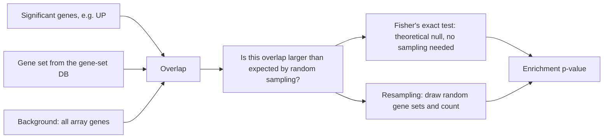

# Fisher's exact test

## Problem

**Input**: a `2 × 2` contingency table of counts `a, b, c, d` with `n = a + b + c + d`.
**Output**: an **exact** p-value for the null hypothesis that the two binary variables
are independent — in enrichment terms, that the overlap between a set of significant
genes and a pre-given [[gene-set]] is no larger than random sampling would give.

| | in gene set | not in gene set | row total |
|---|---|---|---|
| **significant** | `a` | `b` | `a + b` |
| **not significant** | `c` | `d` | `c + d` |
| **column total** | `a + c` | `b + d` | `n` |

## Idea

The honest way to ask whether an overlap is surprising is to **take random samples from
the gene expression table and check how often an overlap this large occurs**. Fisher's
exact test makes that resampling unnecessary: it is a **statistical model** that
**does not require actually performing the random sampling**, because it is based on a
**theoretical null-hypothesis distribution** — the hypergeometric distribution obtained
by conditioning on both margins of the table.

With the margins fixed, the only free quantity is `a`, and the probability of each
possible value of `a` can be written down in closed form.

## Pseudocode

```text
FISHER-TABLE-PROBABILITY(a, b, c, d):
  n ← a + b + c + d
  return ((a+b)! · (c+d)! · (a+c)! · (b+d)!) / (n! · a! · b! · c! · d!)

FISHER-EXACT-ONE-SIDED(a, b, c, d):               // enrichment = over-representation
  p ← 0
  k_max ← min(a + b, a + c)                        // largest overlap the margins allow
  for k ← a to k_max:                              // tables at least as extreme as observed
    p ← p + FISHER-TABLE-PROBABILITY(k,
                                     (a + b) - k,
                                     (a + c) - k,
                                     n - (a + b) - (a + c) + k)
  return p                                         // enrichment p-value

FISHER-EXACT-TWO-SIDED(a, b, c, d):
  p0 ← FISHER-TABLE-PROBABILITY(a, b, c, d)
  p  ← 0
  for every table T with the same row and column margins:
    if FISHER-TABLE-PROBABILITY(T) ≤ p0: p ← p + FISHER-TABLE-PROBABILITY(T)
  return p
```

`FISHER-TABLE-PROBABILITY` is the formula given in the notes:

```
p = (a+b)! · (a+c)! · (c+d)! · (b+d)!  /  ( n! · a! · b! · c! · d! )
```

In practice the factorials are computed in log space (`lgamma`) to avoid overflow — a
`n = 20 000` gene universe makes `n!` astronomically large.

## Worked example

A tiny table, so the arithmetic is checkable by hand:

| | in set | not in set | total |
|---|---|---|---|
| significant | `a = 3` | `b = 1` | 4 |
| not significant | `c = 1` | `d = 5` | 6 |
| total | 4 | 6 | `n = 10` |

```
p(observed) = 4! · 4! · 6! · 6! / (10! · 3! · 1! · 1! · 5!)
            = 24 · 24 · 720 · 720 / (3 628 800 · 6 · 1 · 1 · 120)
            = 298 598 400 / 2 612 736 000
            ≈ 0.1143
```

The only more extreme table has `a = 4, b = 0, c = 0, d = 6`:

```
p(a=4) = 4! · 4! · 6! · 6! / (10! · 4! · 0! · 0! · 6!)
       = 24 · 24 · 720 · 720 / (3 628 800 · 24 · 1 · 1 · 720)
       ≈ 0.00476
```

One-sided enrichment p-value: `0.1143 + 0.0048 ≈ 0.119` — not significant, as one would
hope with counts this small.

## Complexity

- One table probability: `O(1)` with precomputed log-factorials, `O(n)` without.
- The one-sided sum runs over at most `min(a+b, a+c) − a + 1` tables, so `O(n)` in the
  worst case.
- An entire enrichment run is `O(|DB| · n)` — negligible compared to the permutation
  null of [[gene-set-enrichment-analysis]].

## Variants & pitfalls

- **Threshold dependence.** The test needs a *thresholded* list of significant genes, and
  that threshold has no natural value. The full treatment of this critique, and of the
  whole-distribution alternative, is on [[enrichment-analysis]].
- **Margins are conditioned on.** Fisher's test treats both margins as fixed. That is
  what makes it exact and also what makes it slightly conservative.
- **One- versus two-sided.** Enrichment is a one-sided question (*over*-representation);
  using the two-sided p-value roughly doubles it and mixes depletion into the result.
- **χ² is the approximation.** For large counts the χ² test agrees; Fisher's test is the
  one to use when any expected count is small, which is the normal situation for small
  gene sets.
- Outside enrichment, the same test is used in this wiki for case/control genotype tables
  in [[genome-wide-association-study]] and for per-site methylation differences in
  [[bisulfite-sequencing]].

## Diagram


Two ways to answer the same question; Fisher's exact test replaces the simulation with a closed-form null.

## Relations

- [[enrichment-analysis]] — the analysis this test implements in its threshold-dependent
  form.
- [[gene-set-enrichment-analysis]] — the whole-distribution replacement recommended by
  the lecture.
- [[gene-set]] — the set whose overlap is being tested.
- [[statistical-testing]] — null hypothesis, p-value and significance level come from
  there; this is the first **concrete** test statistic in the wiki.
- [[probability-distribution]] — the null here is the hypergeometric distribution.
- [[multiple-testing-correction]] — one Fisher test per set means thousands of tests.
- [[genome-wide-association-study]] — the same test on a case/control genotype table.
- [[bisulfite-sequencing]] — the same test per cytosine when calling differential
  methylation.
- [[microarray-expression-analysis]] — the assay whose significant-gene list forms the
  two-by-two table.
- [[mutual-information]] — ceRNA inference by conditional mutual information combines per-triplet p-values with Fisher's method, which loses power.
- [[competing-endogenous-rna]] — the application in which that combination breaks down.

## Appears in

- [[M2L01-enrichment-analysis]]
- [[M2E01-enrichment-analysis-and-keypathwayminer]]
- [[L10-biostatistics-and-statistical-testing]] — the module-1 lecture that defines the
  hypotheses, error types and p-value this test instantiates.

## Sources

- `raw/module2/csb_1.pdf`, p. 5 — the overlap question, Fisher's exact test as a
  statistical model that replaces the random sampling, and the p-value formula.
- `raw/module2/csb_1.pdf`, p. 6 — the threshold-dependent versus whole-distribution
  contrast.
- `raw/module2/csb_1.pdf`, p. 10 — exercise: Fisher's exact test named as the way to
  calculate the significance of an overlap.
- `raw/module2/csb_4.pdf`, p. 6 — Fisher's method for combining conditional mutual information p-values.
