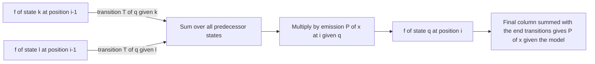

# Forward algorithm

## Problem

The **evaluation problem** of a [[hidden-markov-model]]:

> Given a model and an output sequence, what is the probability that the model generated
> that output?

**Input**: an HMM with transition probabilities `T(r | q)` and emission probabilities
`P(x | q)`, and an observed sequence `x₁ … x_L`.
**Output**: `P(x₁ … x_L | model)`, summed over **all possible state paths**.

## Idea

For one fixed path, the joint probability is a simple product of transitions and
emissions:

```
P(x₁ … x_L, q₀ … q_{N+1} | model) = T(q_{N+1} | q_N) · ∏_{i=1}^{N} T(q_i | q_{i-1}) · P(x_i | q_i)
```

The answer is the **sum of this over every path**, and the number of paths is exponential
in `L`. The forward algorithm avoids enumerating them by dynamic programming over a
trellis: the quantity

```
f_q(i) = P(x₁ … x_i, X_i = q | model)
```

— the probability of having emitted the first `i` symbols *and* sitting in state `q` —
can be computed from the previous column, because of the Markov assumption. The recursion
is exactly the phrase written under the arrows of the trellis in the notes:
**previous · transition · emission**.

The mirror-image **backward** variable `b_q(i)` accumulates the same information from the
right end; together they give the probability of each state at each position, which is
what the [[baum-welch-algorithm]] needs.

## Pseudocode

```text
FORWARD(x, Q, T, P):
  // x ← observed sequence x[1..L]
  // Q ← set of states, with start state q0 and end state qEnd
  // T(r|q) ← transition probability, P(c|q) ← emission probability

  L ← |x|
  for each q in Q: f[q, 0] ← 0
  f[q0, 0] ← 1                                  // start deterministically in q0

  for i ← 1 to L:
    for each q in Q:
      s ← 0
      for each k in Q:
        s ← s + f[k, i-1] · T(q | k)            // previous · transition
      f[q, i] ← P(x[i] | q) · s                 // · emission
  return Σ_{q in Q} f[q, L] · T(qEnd | q)       // sum over all paths

BACKWARD(x, Q, T, P):
  L ← |x|
  for each q in Q: b[q, L] ← T(qEnd | q)
  for i ← L-1 down to 1:
    for each q in Q:
      b[q, i] ← Σ_{k in Q} T(k | q) · P(x[i+1] | k) · b[k, i+1]
  return b

POSTERIOR(x, Q, T, P):
  f ← FORWARD(x, Q, T, P);  b ← BACKWARD(x, Q, T, P)
  Pseq ← Σ_{q in Q} f[q, L] · T(qEnd | q)
  for i ← 1 to L:
    for each q in Q:
      γ[q, i] ← f[q, i] · b[q, i] / Pseq        // P(state q at position i | x)
  return γ
```

In practice all products are computed in **log space** as sums, for the same numerical
reason as in the [[viterbi-algorithm]]; the forward recursion then needs a
log-sum-exp step instead of a plain addition.

## Worked example

Take the two-state model of the exercise (p. 20), in which the emissions sit on the
**transitions** rather than on the states — the second of the two conventions set out in
[[hidden-markov-model]] § *Two emission conventions*, so the emission factor below
belongs to the arrow, not to the destination state, and the pseudocode above (written in
the standard state-emission form) must be read accordingly:
`S₁ → S₁` has probability 0.6 and emits `A`/`C` with 0.8/0.2,
`S₁ → S₂` has 0.4 and emits 0.5/0.5, `S₂ → S₁` has 0.1 and emits 0.1/0.9, and
`S₂ → S₂` has 0.9 and emits 0.3/0.7. The chain starts with `P(S₁) = 0` and `P(S₂) = 1`.

For the observation `C`:

```
f[S₁, 1] = f[S₁,0]·0.6·0.2 + f[S₂,0]·0.1·0.9 = 0 + 0.09 = 0.09
f[S₂, 1] = f[S₁,0]·0.4·0.5 + f[S₂,0]·0.9·0.7 = 0 + 0.63 = 0.63
```

The column already sums the two ways of arriving at each state, where
[[viterbi-algorithm]] would instead keep only the larger one. Continuing over `C A A`
gives `P(CAA | model)` as the sum of the final column.

## Complexity

- **Time**: `O(L · |Q|²)` — one column per observation, each entry summing over all
  predecessor states.
- **Space**: `O(L · |Q|)` for the full trellis, or `O(|Q|)` if only the final probability
  is needed and the previous column is overwritten. The backward pass and the posterior
  computation need the whole trellis.
- Compare the naive `O(|Q|^L)` path enumeration — the dynamic-programming saving is the
  same one that makes [[needleman-wunsch]] feasible; see [[algorithmic-complexity]].

## Variants & pitfalls

- **Forward vs Viterbi**: the two recursions are identical except that forward **sums**
  over predecessors and Viterbi takes the **maximum**. Forward answers "how likely is
  this sequence at all", Viterbi answers "which path produced it".
- **Underflow**: products of thousands of probabilities underflow double precision;
  either rescale each column to sum to 1 or work in log space.
- The **forward–backward** combination gives the probability of each state at each
  position — the "expectation" half of [[baum-welch-algorithm]].

## Diagram


One trellis column of the forward recursion: previous times transition, summed over every predecessor, then multiplied by the emission.

## Relations

- [[hidden-markov-model]] — the model whose evaluation problem this solves.
- [[viterbi-algorithm]] — the max-instead-of-sum twin.
- [[baum-welch-algorithm]] — uses forward and backward variables as its E-step.
- [[markov-chain]] — the underlying state process.
- [[algorithmic-complexity]] — a textbook case of dynamic programming collapsing an
  exponential search.
- [[dynamic-programming]] — the design pattern; the trellis is its table and the forward
  variable its summing instance.
- [[maximum-likelihood]] — the forward sum supplies the `P(x | model)` term that the likelihood is a product of.

## Appears in

- [[L17-markov-chains-and-hidden-markov-models]]

## Sources

- `raw/module1/gsb_part4.pdf`, p. 14 (evaluation problem, trellis sketch, path
  probability formula), p. 18 (summary of the forward/backward algorithm).
