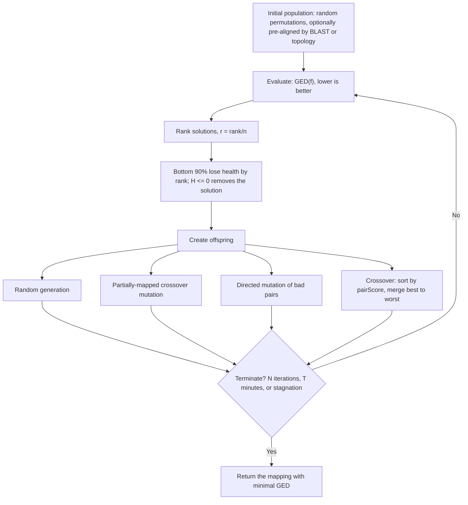

# GEDEVO

## Problem

**GEDEVO** = **E**volutionary **G**raph **ED**it Distance Algorithm for Biological
Network Alignment.

**Input**: two networks `G₁ = (V₁,E₁)` and `G₂ = (V₂,E₂)`.
**Output**: an **alignment between the two networks that minimizes the graph edit
distance (GED) with respect to edges** — i.e. a mapping that **transforms graph `G₁` into
`G₂` with as few indels as possible**.

## Idea

The fitness function is the **number of edges we need to insert/delete to make `G₁`
isomorphic to `G₂`**:

```text
GED(f) = | { (u,v)   ∈ E₁ : (f(u),  f(v))     ∉ E₂ } |
       + | { (u',v') ∈ E₂ : (f⁻¹(u'), f⁻¹(v')) ∉ E₁ } |
```

Minimising it over all mappings is NP-hard ([[network-alignment]]), so GEDEVO **uses an
[[evolutionary-algorithm]] to find a good solution**: a population of mappings, mutated
and recombined, with the worst dying off each generation.

### Initial population generation

- **Created from random permutations.**
- To **reduce convergence time**, candidates can be **pre-aligned based on sequence
  similarity** (**BLAST**, see [[blast]]) or **pre-aligned based on local network
  topology**.

### Evaluating node pairs

A pair score is **used for local optimization when building offspring**. For `u ∈ V₁`,
`v ∈ V₂` with `u = f(v)`:

```text
                   pairGED_f(u,v) + GDSD(u,v)
pairScore_f(u,v) = ──────────────────────────
                               2
```

- **pairGED**: the **relative number of indel edges incident to `u` or `v`** when mapping
  `u` to `v` — the local version of [[graph-edit-distance]].
- **GDSD**: the **[[graphlet-degree-signature-distance]]**, *a topological measure for
  how dissimilar the local neighbourhoods of two nodes are*.

Low `pairScore` = good pair. This is what lets the crossover operator sort pairs into
"good" and "bad" instead of treating the mapping as an opaque permutation.

### Offspring generation

Four strategies:

1. **Random Generation** — random permutations.
2. **Partially-mapped crossover mutation** — *splits the mapping into good and bad pairs
   and randomly permutes all bad pairs. Also permutes 1 % of good pairs.*
3. **Directed Mutation** — *swaps a random number of randomly chosen bad pairs; keep only
   the one that induces the best score.*
4. **Crossover** — *combines two or more existing solutions into a new one: sorts pairs
   by score and adds pairs from best to worst. Assigns remaining nodes randomly.*

### Selecting surviving solutions — health values

- Solutions are initialised with **health** `H_i(0) = Q`, `Q > 0`.
- Fitness is computed by **ranking solutions (lower is better)**:
  `C = { GED(f_i) : 1 ≤ i ≤ n }` and `r_i = rank(C_i) / n`.
- The **bottom 90 % of solutions lose health proportional to their rank**:

```text
            { H_i(t) − (r_i − 0.1) × 0.9 × α ,  if r_i > 0.1
H_i(t+1) =  {
            { H_i(t)                         ,  else
```

- **If health ≤ 0 → remove this solution.**

Health is the diversity mechanism: a solution that is merely mediocre survives several
generations instead of dying at once, which **increases population diversity and helps
escape local optima**.

### Termination

Possible criteria: **after `N` iterations**, **after `T` minutes**, or **when the fitness
of the best solution did not improve for** a given number of generations (the last
criterion runs off the edge of the page in the scan; see [[open-questions]]).

## Pseudocode

```text
GEDEVO(G1, G2, Q, α, population_size):
  // ---- Initial population -------------------------------------------------
  P ← ∅
  repeat population_size times:
    f ← RANDOM-PERMUTATION(V1 → V2)
    f ← PRE-ALIGN(f, BLAST-similarity)        // optional: sequence similarity
    f ← PRE-ALIGN(f, local-topology)          // optional: GDSD-based
    H[f] ← Q                                  // initial health
    P ← P ∪ { f }

  repeat
    // ---- Evaluate solutions -----------------------------------------------
    for each f in P: C[f] ← GED(f)            // lower is better
    for each f in P: r[f] ← RANK(C[f], C) / |P|

    // ---- Select: health decay by rank -------------------------------------
    for each f in P:
      if r[f] > 0.1:
        H[f] ← H[f] − (r[f] − 0.1) · 0.9 · α
      if H[f] ≤ 0:
        P ← P \ { f }                         // remove this solution

    // ---- Create offspring --------------------------------------------------
    O ← ∅
    for each f in P:
      for each u in V1:
        pairScore[u] ← ( pairGED_f(u, f(u)) + GDSD(u, f(u)) ) / 2
      good ← { u : pairScore[u] low }  ;  bad ← V1 \ good
      O ← O ∪ { RANDOM-PERMUTATION(V1 → V2) }           // 1. random generation
      O ← O ∪ { PERMUTE(f, bad) with 1% of good also permuted }  // 2. PMX mutation
      O ← O ∪ { BEST-OF( SWAP(f, random subset of bad) ) }       // 3. directed mutation
    for each pair (f1, f2) in P:
      O ← O ∪ { CROSSOVER(f1, f2) }                              // 4. crossover
    for each f in O: H[f] ← Q
    P ← P ∪ O
  until TERMINATE(iterations N, time T, stagnation)
  return argmin GED(f)  over f in P

CROSSOVER(f1, f2):
  // Sort all parent pairs by score, add best to worst, skip conflicts
  L ← SORT( pairs(f1) ∪ pairs(f2) ) by pairScore ascending
  g ← ∅
  for each (u, v) in L:
    if u ∉ domain(g) and v ∉ image(g):
      g[u] ← v
  for each u in V1 \ domain(g):
    g[u] ← RANDOM-UNUSED(V2)                  // assigns remaining nodes randomly
  return g
```

## Worked example

**Graph edit distance.** Two small networks differ by one missing edge, one missing node
and one further missing edge. Applying *insert edge → insert node → insert edge* turns
`G₁` into something isomorphic to `G₂`, so `GED(G₁,G₂) = 3` (p. 18).

**Crossover.** Three parent mappings over `V₁ = {A,B,C,D,E}` and `V₂ = {F,G,H,I}`
(scores, lower is better):

| Parent | A | B | C | D | E |
|---|---|---|---|---|---|
| **P1** target | F | H | I | G | ∅ |
| P1 score | 0.75 | 0.10 | 0.60 | 0.05 | 1.0 |
| **P2** target | I | F | H | ∅ | G |
| P2 score | 0.35 | 0.45 | 0.30 | 1 | 1 |
| **P3** target | H | ∅ | I | F | G |
| P3 score | 0.80 | 1 | 0.60 | 0.05 | 0.95 |

Sort all pairs by score ascending and add from best to worst, skipping any pair whose
source or target is already used:

| Rank | Pair | Score | Action |
|---|---|---|---|
| 1 | `D → F` | 0.05 | **take** |
| 2 | `B → H` | 0.10 | **take** |
| 3 | `C → H` | 0.30 | skip, `H` used |
| 4 | `A → I` | 0.35 | **take** |
| 5 | `B → F` | 0.45 | skip, `B` and `F` used |
| 6 | `C → I` | 0.60 | skip, `I` used |
| 7 | `C → F` | 0.60 | skip, `F` used |
| … | all remaining `A`, `B`, `D` pairs | | skip, sources used |
| last | `E → G` | 0.95 | **take** |

Every remaining pair involving `C` targets an already-used node, so **no `C` survives**
and `C → ∅`. Merging from the left gives the offspring

```text
A → I,  B → H,  C → ∅,  D → F,  E → G
```

which is the answer worked out on p. 19.

## Complexity

- Per generation: `|P|` evaluations of `GED(f)`, each `O(|E₁| + |E₂|)` with hashed
  adjacency, plus `O(|V₁|)` pair scores per individual.
- **GDSD is precomputed once per node pair** — graphlet counting is the expensive part
  and does not depend on the mapping, so it never repeats inside the loop.
- Termination is user-set, so total cost is chosen rather than derived. **No optimality
  guarantee**, because the problem is NP-hard.

## Variants & pitfalls

- **Pre-alignment biases the search.** Seeding with [[blast]] hits assumes that sequence
  orthologs are topological counterparts — usually true, which is why it speeds
  convergence, but it imports sequence-level errors into a topology-level method.
- **Permutation operators break feasibility** unless the crossover enforces injectivity;
  the "skip if used, then assign remaining randomly" rule above is what keeps the mapping
  a valid one-to-one map.
- **Unmapped nodes (`∅`)** are unavoidable when `|V₁| ≠ |V₂|`, and they cost GED.
- **The `α` factor in the health decay** is not defined anywhere in the notes; recorded
  in [[open-questions]].
- Compare [[cytomcs]]: a single trajectory with perturbation, maximising conserved edges,
  across **many** networks — where GEDEVO runs a population, minimising edit distance,
  across **two**.

## Diagram


GEDEVO's generation loop: rank by graph edit distance, decay health, breed four kinds of offspring.

## Relations

- [[graph-edit-distance]] — the objective being minimised.
- [[evolutionary-algorithm]] — the metaheuristic GEDEVO instantiates.
- [[graphlet-degree-signature-distance]] — half of the `pairScore` used for local
  optimisation.
- [[network-alignment]] — the problem; GEDEVO is its pairwise, global solver.
- [[cytomcs]] — the alternative heuristic, compared above.
- [[blast]] — supplies the optional sequence-similarity pre-alignment.
- [[interaction-network]] — the biological networks being aligned.
- [[homology]] — what a converged alignment is evidence for.
- [[ant-colony-optimization]] — the sibling metaheuristic of module 2.

## Appears in

- [[M2L10-network-alignment]]
- [[M2E10-network-alignment]]

## Sources

- `raw/module2/csb_4.pdf`, p. 15 — the GEDEVO name, the GED fitness function, and the
  evolutionary-algorithm flowchart.
- `raw/module2/csb_4.pdf`, p. 16 — initial population generation, `pairScore`, `pairGED`,
  graphlets, orbits and GDSD.
- `raw/module2/csb_4.pdf`, p. 17 — the four offspring strategies, health-based survival,
  and the termination criteria.
- `raw/module2/csb_4.pdf`, pp. 18–19 — the `GED = 3` and crossover exercises.
