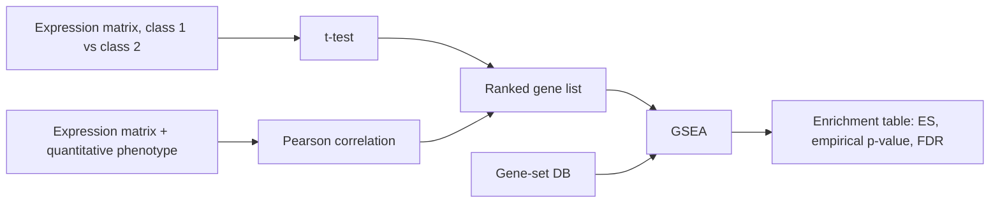
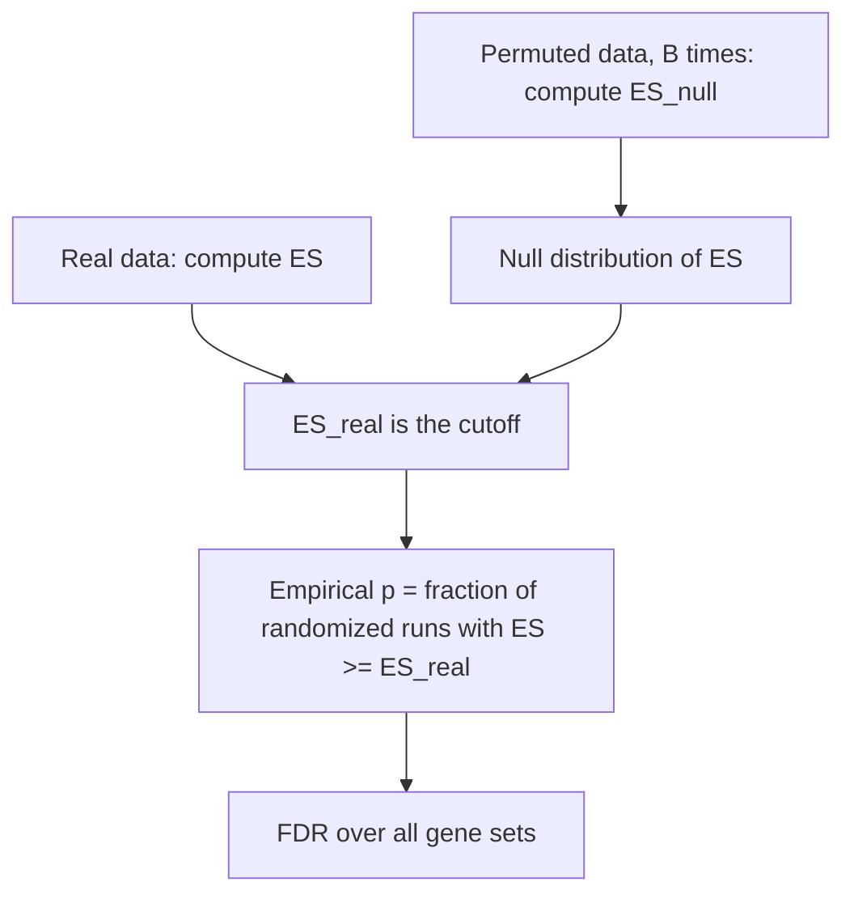

# Gene Set Enrichment Analysis (GSEA)

## Problem

**Input**: a **ranked** gene list covering the whole genome, plus a database of a priori
[[gene-set|gene sets]].
**Output**: for each set, an **enrichment score (ES)**, an empirical p-value and an FDR —
an enrichment table.

GSEA is defined in the notes as a method to identify **classes of genes that are
over-represented in a large set of genes** and may have an association with different
phenotypes; equivalently, a method that determines whether an **a priori defined set of
genes shows statistically significant differences between two biological states**.

## Idea

[[fishers-exact-test|Fisher's exact test]] needs a threshold, and thresholds throw away
information. GSEA uses the **whole distribution**: it never cuts the gene list, it walks
down it.

Rank every gene by a differential statistic, then walk from the most up-regulated gene to
the most down-regulated one, keeping a running sum:

- every gene **present** in the set gives a **positive** contribution;
- every gene **absent** from the set gives a **negative** contribution.

If the set's members are scattered uniformly, the walk wanders around zero. If they
cluster at one end, the walk makes a large excursion. The **maximal running value is the
enrichment score**, and a high ES means high **local enrichment** — the set is
concentrated in one end of the ranking. The question the picture asks is: *is the
distribution uniform, or is it enriched at either end?*

### Where the ranking comes from

- **Two-class comparison** — a **t-test** per gene between class 1 and class 2 gives the
  ranked gene list.
- **Quantitative phenotype** — a **Pearson correlation** of each gene against the
  phenotype gives the ranked gene list.

Either way the ranked list, not a thresholded subset, is what enters GSEA.

## Pseudocode

```text
ENRICHMENT-SCORE(L, S):
  // L = whole gene list, ranked from most UP to most DOWN; N ← |L|
  // S = gene set; Nh ← |L ∩ S|
  hit  ← + c_hit         // positive contribution, one per member of S
  miss ← - c_miss        // negative contribution, one per gene not in S
  running ← 0; ES ← 0
  for i ← 1 to N:
    if L[i] ∈ S: running ← running + hit
    else:        running ← running + miss
    if |running| > |ES|: ES ← running      // keep the maximal deviation
  return ES                                // "max running ES score → final ES score"

GSEA(L, DB, B):
  // B = number of permutations
  for each gene set S in DB:
    ES[S] ← ENRICHMENT-SCORE(L, S)

  // 1) null-hypothesis distribution from randomized data
  for b ← 1 to B:
    L_b ← RANDOMIZE(L)                     // permute phenotype labels, re-rank
    for each gene set S in DB:
      ES_null[S, b] ← ENRICHMENT-SCORE(L_b, S)

  // 2) empirical p-value: the real ES is the cutoff
  for each gene set S in DB:
    p[S] ← |{ b : ES_null[S, b] ≥ ES[S] }| / B

  // 3) FDR across all gene sets
  q ← FALSE-DISCOVERY-RATE(ES, ES_null)    // uses the performance of ALL sets
  return table of (S, ES[S], p[S], q[S]) ordered by decreasing ES
```

The four steps named in the notes map onto the blocks above: **1)** calculate the ES
score, **2)** generate the ES distribution for the null hypothesis using permutations,
**3)** calculate the empirical p-value, **4)** calculate the FDR.

> The notes fix only the **signs** of the two contributions, not their magnitudes. For
> the walk to return to zero at the end of the list — the property that makes ES
> comparable between sets — the two must balance, `c_hit · Nh = c_miss · (N − Nh)`.
> That balance condition is derived here, not transcribed.

## Worked example

A ranked list of `N = 10` genes and a set `S` of `Nh = 3`. Taking
`c_hit = (N − Nh)/Nh = 7/3 ≈ 2.33` and `c_miss = 1` so the walk ends at zero:

| rank | 1 | 2 | 3 | 4 | 5 | 6 | 7 | 8 | 9 | 10 |
|---|---|---|---|---|---|---|---|---|---|---|
| in `S`? | ✓ | ✓ | − | ✓ | − | − | − | − | − | − |
| running | 2.33 | 4.67 | 3.67 | 6.00 | 5.00 | 4.00 | 3.00 | 2.00 | 1.00 | 0.00 |

`ES = 6.00` at rank 4: the set is concentrated at the up-regulated end. Had the three
members sat at ranks 4, 7 and 10 instead, the running sum would never rise above `0`
and its largest deviation would be `−3.00` at rank 3 — a set pushed towards the
*down*-regulated end rather than enriched at the top.

## Complexity

- One ES: `O(N)` after the list is ranked, or `O(Nh log Nh)` if only the hit positions
  are visited.
- GSEA with `B` permutations over `|DB|` sets: `O(B · |DB| · N)`. This is why GSEA is
  orders of magnitude more expensive than a Fisher test — the price of not thresholding.

## Variants & pitfalls

- **p-value versus FDR.** The notes stress the distinction: the **p-value depends only
  on the single gene set's performance**, while the **FDR depends on the performance of
  all gene sets**. Reporting p-values alone from a few thousand sets is meaningless; see
  [[multiple-testing-correction]].
- **Empirical nulls are granular.** With `B` permutations the smallest achievable
  p-value is `1/B`, so `B` must be large enough for the correction that follows.
- **What is permuted matters.** Permuting phenotype labels preserves the correlation
  structure between genes; permuting gene labels does not and gives anticonservative
  p-values.
- **Set size.** Very small and very large sets behave differently under the random walk,
  which is why implementations normalise the ES by set size (the NES).
- The lecture's conclusion on the whole family: **use whole-distribution methods wherever
  possible**, because a threshold has no natural value. The full treatment of the
  threshold critique is on [[enrichment-analysis]].

## Diagram


Two ways to rank the genes, one whole-distribution test, one enrichment table.


The permutation null and the empirical p-value read off it.

## Relations

- [[enrichment-analysis]] — the hub page; GSEA is its whole-distribution branch.
- [[fishers-exact-test]] — the threshold-dependent alternative GSEA is argued against.
- [[gene-set]] and [[gene-ontology]] — the sets being scored.
- [[multiple-testing-correction]] — supplies the FDR of step 4.
- [[statistical-testing]] — the empirical p-value is an ordinary p-value computed by
  simulation instead of from a closed form.
- [[probability-distribution]] — the permutation null is an empirically sampled
  distribution.
- [[keypathwayminer]] — the de novo alternative that drops a priori sets altogether.
- [[qq-plot]] — the same idea of comparing an observed distribution against a reference.
- [[microarray-expression-analysis]] — the assay whose expression matrix is ranked here.
- [[bootstrapping]] — GSEA's permutation null is the same resampling idea: build the distribution of a statistic from the data itself.
- [[mutual-information]] — an alternative, information-theoretic way of scoring dependence between measurements.
- [[sensitivity-correlation]] — the correlation-based statistic used instead of enrichment for ceRNA networks.

## Appears in

- [[M2L01-enrichment-analysis]]
- [[M2E01-enrichment-analysis-and-keypathwayminer]]
- [[M2E07-single-cell-rna-seq-and-dimensionality-reduction]] — used to interpret the marker genes of single-cell clusters.
- [[L10-biostatistics-and-statistical-testing]] — the module-1 lecture whose p-value and
  significance level this permutation procedure estimates empirically.

## Sources

- `raw/module2/csb_1.pdf`, p. 1 — the two GSEA definitions.
- `raw/module2/csb_1.pdf`, p. 5 — GSEA as the whole-distribution branch of enrichment
  testing.
- `raw/module2/csb_1.pdf`, p. 6 — the two-class and quantitative-phenotype routes to a
  ranked gene list; p-value versus FDR.
- `raw/module2/csb_1.pdf`, p. 7 — the four steps, the running ES score, and the empirical
  p-value estimation.
- `raw/module2/csb_1.pdf`, p. 10 — exercise: ordering by decreasing enrichment score.
- `raw/module2/csb_4.pdf`, pp. 6–7 — module 2 cross-reference on dependence statistics.
