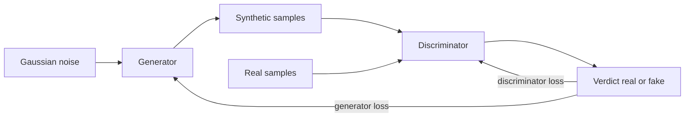

# Generative Adversarial Network

## Problem

**Input**: a set of real data samples from one class.
**Output**: a **generator** able to produce new, synthetic samples that are
indistinguishable from the real ones.

The motivation in the notes:

> Generate something from noise on a given class level to **enhance the resolution of
> an already existing one**; e.g. generate **synthetic genomic data**.

## Idea

Two networks (**GANs = generative adversarial networks**) are trained against each other:

- The **generator** takes **Gaussian noise as input** and generates a *synthetic output
  of the same dimension as the real one*.
- The **discriminator** receives **both synthetic and real data** and *tries to
  distinguish between them*.

> Each epoch the generator tries to generate more realistic samples to fool the
> discriminator, and the discriminator also gets better at distinguishing real versus
> fake.

The equilibrium of the game is the point where the discriminator can do no better than
guessing — at which the generator's distribution matches the real one.

## Pseudocode

```text
TRAIN-GAN(RealData, G, D, η, epochs):
  initialise generator G and discriminator D randomly
  for e ← 1 to epochs:
    for each mini-batch:

      // ---- 1. train the discriminator ----
      X_real ← sample a batch from RealData
      Z      ← sample Gaussian noise, same batch size
      X_fake ← G(Z)                        // synthetic, same dimension as real
      L_D ← LOSS( D(X_real), "real" ) + LOSS( D(X_fake), "fake" )
      D ← D − η · ∇_D L_D                  // make D better at telling them apart

      // ---- 2. train the generator ----
      Z      ← sample Gaussian noise
      L_G ← LOSS( D(G(Z)), "real" )        // G wins when D is fooled
      G ← G − η · ∇_G L_G                  // gradients flow THROUGH the frozen D

  return G                                  // the generator is the product
```

Both gradient steps use [[backpropagation]] and [[gradient-descent]] exactly as in an
ordinary [[neural-network]]; only the objective is adversarial.

## Worked example

The notes give no numeric trace. The use case they give is the one that matters in this
module: real patient cohorts are small and protected, so a generator trained on them can
supply **synthetic genomic data** for method development — and, applied class-wise, can
**balance** a cohort in which one class is badly under-represented, which otherwise skews
every classifier trained on it ([[M2L03-machine-learning-and-classification]]).

## Diagram



The generator turns noise into synthetic samples and the discriminator's verdict trains both players in opposite directions each epoch.

## Complexity

Two networks, so roughly twice the cost of training one of the same size, times the
number of discriminator/generator alternations per step. Convergence is **not
monotone**: unlike [[gradient-descent]] on a fixed [[cost-function]], each network's
objective moves when the other one improves.

## Variants & pitfalls

The notes ask directly: **why are GANs harder to train?**

- **Training instability** — the two objectives chase each other instead of descending a
  fixed surface.
- **Mode collapse** — *the generator fails to capture the full diversity of the real
  data*: it finds one convincing output and produces only that.
- **Difficult evaluation** — there is no held-out accuracy to quote. Unlike a classifier,
  which [[cross-validation]] and the [[roc-curve]] can score, "is this sample realistic?"
  has no ground truth.

## Relations

- [[neural-network]], [[deep-learning]] — the two players are ordinary networks.
- [[autoencoder]] — the other generative architecture in the notes; it learns the data
  distribution by reconstruction rather than by competition.
- [[backpropagation]], [[gradient-descent]], [[cost-function]] — the training mechanics,
  applied to two opposed objectives.
- [[overfitting]] — mode collapse is the generative analogue: a model that reproduces a
  fragment of its training data perfectly and nothing else.
- [[bootstrapping]] — the classical, non-parametric way of manufacturing extra samples;
  a GAN is its learned counterpart.
- [[roc-curve]], [[cross-validation]] — exactly the evaluation tools that do *not* carry
  over, which is the notes' third difficulty.
- [[single-cell-rna-seq]] — the kind of high-dimensional biological data synthetic
  generation is aimed at.

## Appears in

- [[M2L06-deep-learning]]

## Sources

- `raw/module2/csb_3.pdf`, p. 8 — GANs: motivation, synthetic genomic data, generator
  and discriminator, Gaussian noise input, the per-epoch arms race.
- `raw/module2/csb_3.pdf`, p. 9 — why GANs are harder to train: training instability,
  mode collapse, difficult evaluation.
