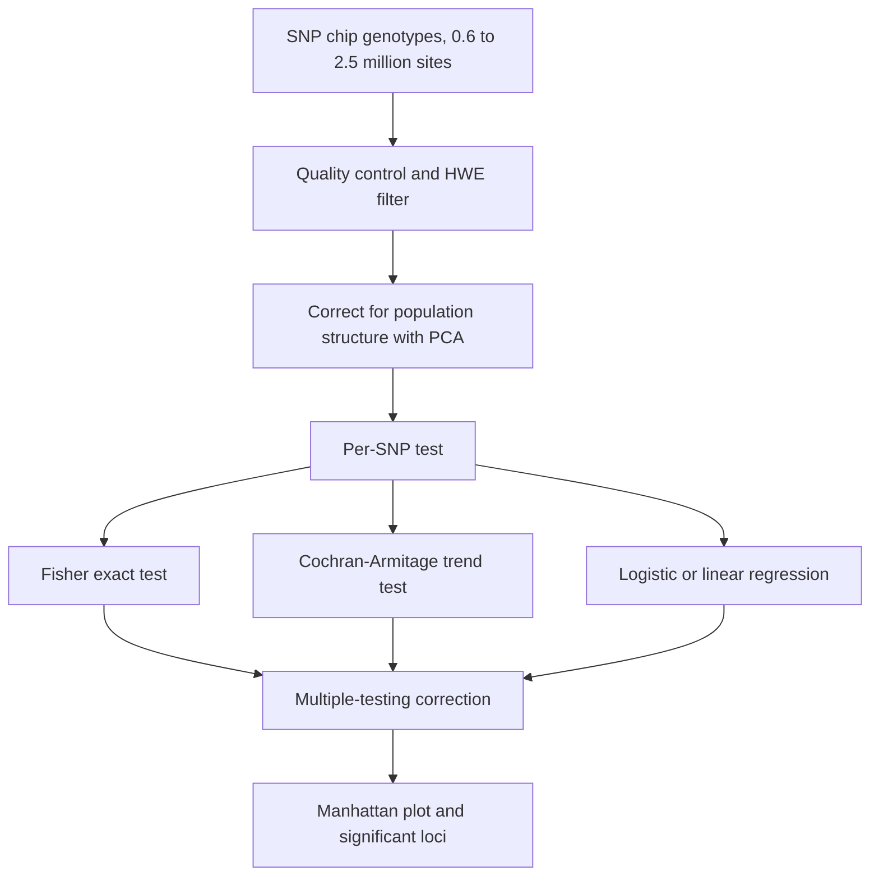

# Genome-Wide Association Study

## Problem

**Input:** genotypes at hundreds of thousands to millions of SNP positions for a set of
**cases** and **controls** (or for a quantitative phenotype).
**Output:** the loci whose allele or genotype distribution differs significantly between
the phenotype groups — i.e. the genetic variants associated with the trait.

Stated purposes from the notes:

- **Detect disease risk** ⇒ better monitoring of risk patients.
- Study of the genetic variation of the genome of an organism (*Untersuchung der
  genetischen Variation des Genoms eines Organismus*).
- **Personalized treatment** against a disease.

The motivating example is simply: *variant A increases the risk for a certain disease*,
and the reference resource is the **1000 Genomes Project**, whose goal is to identify
genetic causes of disease.

## Idea

**Data.** Ideally the full genome; in practice **SNP chips** covering ~600,000 to
~2,500,000 sites.

**Genotype coding.** Each SNP is encoded per individual as a number, and the encoding
*is* the genetic model being tested:

| genotype | | additive | recessive | dominant |
|---|---|---|---|---|
| homozygous **major** allele (`G/G`) | 0 | 0 | 0 | 0 |
| **heterozygous** (`A/G` or `G/A`) | 1 | 1 | 0 | 2 |
| homozygous **minor** allele (`A/A`) | 2 | 2 | 2 | 2 |

**Linkage.** SNPs in proximity are very often correlated — knowing `x = A` makes `y = G`
predictable. The causes are that there has not been enough time for evolution to break up
the association, and that some recombinations have lethal effects. Consequence: **only
one SNP per region of strong linkage is needed**, which is what makes a chip of a few
hundred thousand markers sufficient for three billion bases.

**Single-SNP analysis.** For one SNP, cross-tabulate genotype against phenotype:

| | genotype 0 | genotype 1 | genotype 2 |
|---|---|---|---|
| **case** | 23 | 41 | 351 |
| **control** | 104 | 208 | 103 |

Tests named in the notes:

- **Fisher's exact test** — tests a 2×2 table for bias; exact, no large-sample
  assumption.
- **Linear models / Cochran–Armitage trend test** — one allele is considered the **risk
  allele** and risks are assumed **additive**: the heterozygous genotype lies halfway
  between the two homozygous genotypes. The test fits a line through the three genotypic
  risk estimates and tests for **zero slope**. Pitfall: such a test **will not detect a
  higher disease risk of heterozygotes**, because that pattern has no slope.
- **Logistic regression** — the standard framework for a binary (case/control) outcome,
  and the natural place to add covariates such as sex, age or
  [[principal-component-analysis|PCA]] components correcting for population structure.

**Quantitative traits.** For a continuous phenotype (height, longevity, gene expression)
the same scan is run with a linear model; the result is displayed as a **Manhattan
plot**, one dot per SNP, ordered along the chromosomes. The loci that control such traits
are **QTLs**; when the trait is gene expression they are
[[expression-qtl|eQTLs]].

## Pseudocode

```text
GWAS(genotypes, phenotype, model, α):
  // genotypes: individuals × SNPs; phenotype: case/control or quantitative
  QC(genotypes)                                 // call rate, minor-allele frequency, HWE deviation
  PCs ← PCA(genotypes)                          // correct for population structure
  for each SNP s:
    X ← ENCODE(genotypes[·, s], model)          // additive 0/1/2, recessive or dominant
    if phenotype is binary:
      p[s] ← LOGISTIC-REGRESSION-TEST(X, phenotype, covariates = PCs)
      // or FISHER-EXACT(contingency table), or COCHRAN-ARMITAGE(X, phenotype)
    else:
      p[s] ← LINEAR-MODEL-TEST(X, phenotype, covariates = PCs)
  p_adj ← MULTIPLE-TESTING-CORRECTION(p, α)     // Bonferroni or Benjamini-Hochberg
  hits ← { s : p_adj[s] ≤ α }
  return hits, MANHATTAN-PLOT(p)
```

## Worked example

Using the table above, genotype 2 occurs in 351 of 415 cases (85 %) but in only 103 of
415 controls (25 %). A Fisher exact test on the collapsed 2×2 table
(genotype 2 versus genotypes 0+1) would be extremely significant. Under the additive
coding the mean genotype score is `(0·23 + 1·41 + 2·351)/415 ≈ 1.79` in cases versus
`(0·104 + 1·208 + 2·103)/415 ≈ 1.00` in controls — a clear positive trend, so the
Cochran–Armitage test would also reject the zero-slope null hypothesis.


The GWAS pipeline: one test per SNP, with population structure handled before and multiplicity after.

## Complexity

One test per SNP, so the scan is **`O(k · n)`** for `k` SNPs and `n` individuals — cheap
per test but run up to `10⁶` times. The cost is not computational but statistical: at
`α = 0.05` a million independent tests produce ~50,000 false positives, which is why
[[multiple-testing-correction]] is mandatory rather than optional
([[algorithmic-complexity]]).

## Variants & pitfalls

- **Population structure** — if cases and controls are drawn from different
  subpopulations `P1`, `P2`, every allele that differs in frequency between them looks
  associated. Remedies: match the background of cases and controls, remove SNP positions
  known for ethnic differences, and correct statistically (PCA components as covariates).
  This is the genetic analogue of a [[batch-effect]].
- **Model choice** — the additive coding is the default but is blind to
  heterozygote-specific risk; recessive and dominant codings test different patterns.
- **Association is not causation** — because of linkage, the significant SNP is usually a
  marker for the causal variant, not the causal variant itself.
- **eQTL analysis** is a GWAS repeated for the expression of every gene, which multiplies
  the testing burden again.

## Relations

- [[population-genetics]] — alleles, genotypes, SNPs and linkage.
- [[hardy-weinberg-equilibrium]] — deviation from HWE is a standard QC filter.
- [[multiple-testing-correction]] — Bonferroni and Benjamini–Hochberg control the
  genome-wide error rate.
- [[expression-qtl]] — a GWAS with gene expression as the phenotype.
- [[principal-component-analysis]] — the tool used to detect and correct population
  structure.
- [[statistical-testing]] — p-values, `α`, and the two error types.
- [[dna-mutation]] — SNPs arise from point mutations.
- [[snp]] — the variant unit the scan tests, one locus at a time.
- [[genetic-drift]] — random drift separates subpopulations and so creates the population
  structure this design has to correct for.
- [[wright-fisher-model]] — the model of that drift in a finite population.
- [[haplotype-phasing]] — phased haplotypes can be tested instead of single SNPs.
- [[bisulfite-sequencing]] — its per-site methylated/unmethylated read counts are tested
  with the same Fisher exact test on a 2×2 case/control table.

- [[epigenome-wide-association-study]] — the same design with quantifiable epigenetic
  marks instead of genotypes as the tested variable.
- [[fishers-exact-test]] — the exact test used on the 2×2 allele table here, given in
  full on its own page from module 2.

## Appears in

- [[L10-biostatistics-and-statistical-testing]]
- [[L15-gwas-eqtl-and-multiple-testing]]
- [[M2L05-network-based-disease-modules]] — module 2 projects GWAS hits onto an interaction network to recover disease modules.

## Sources

- `raw/module1/gsb_3.pdf`, pp. 25–27.
- `raw/module1/gsb_part4.pdf`, p. 9 — the EWAS definition and its relation to this
  design.
- `raw/module2/csb_1.pdf`, p. 5 — the hypergeometric formula and the null-hypothesis
  rationale of the Fisher exact test used here.
