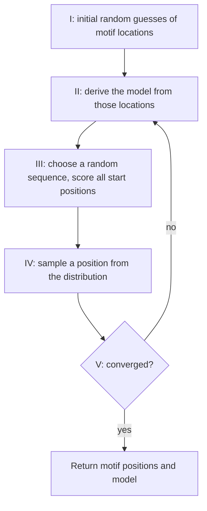
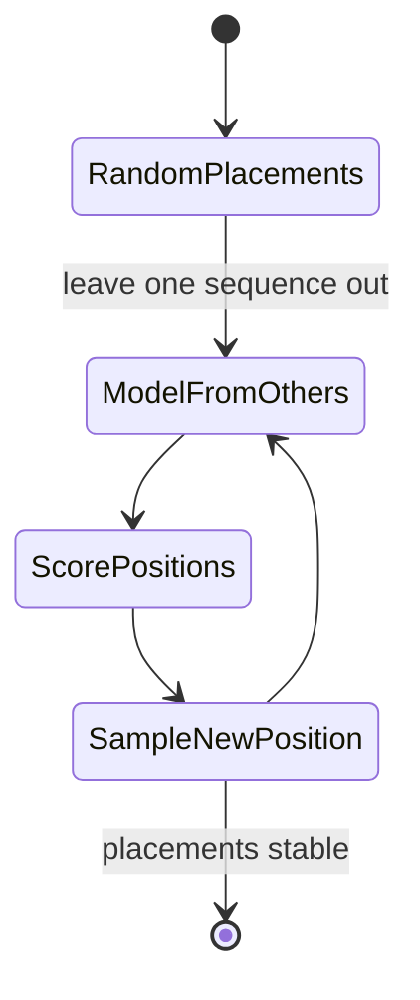

# Gibbs sampling (for motif discovery)

## Problem

**Input**: the same as [[em-motif-discovery]] — sequences `X₁ … X_n` each containing one
occurrence of an unknown [[sequence-motif]] of width `W`.
**Output**: motif start positions `a₁ … a_n` and the motif model derived from them.

## Idea

EM and MEME **can be trapped in local maxima**, and the probability of ending in one is
only *reduced* — not removed — by trying different starting points. Gibbs sampling
attacks the problem differently: it is a **random search**, the **stochastic analogue of
EM**.

The difference is in what is stored per sequence:

| | EM | Gibbs sampling |
|---|---|---|
| per sequence | a **distribution** `Z_i` over all starting points | **one specific** starting point `a_i` |
| update | reweight the whole distribution | **resample** `a_i` at random from its distribution |
| trajectory | deterministic, monotone in likelihood | stochastic, can go downhill |
| escapes local maxima | no | yes, by occasionally accepting a worse placement |

Because a sample can be drawn from the tail of the distribution, the chain can walk out
of a mediocre peak — the same reason randomisation helps in
[[ant-colony-optimization]].

## Pseudocode

```text
GIBBS-MOTIF(X, W, iterations):
  // I) initial guesses of the motif locations
  for i ← 1 to n: a[i] ← RANDOM-POSITION(1, L - W + 1)

  for t ← 1 to iterations:
    // II) derive the model from those locations
    i ← RANDOM-INDEX(1, n)                 // III) choose a random sequence X_i
    Θ ← MOTIF-MODEL(X \ {X_i}, a \ {a[i]}) // model from all the OTHER sequences
                                           //   with pseudo-counts, so no entry is 0

    // III) calculate the likelihood of all possible motif starting positions in X_i
    for j ← 1 to L - W + 1:
      p[j] ← Π_{k=1}^{W} Θ[ X[i, j+k-1], k ] / Π_{k=1}^{W} Θ[ X[i, j+k-1], 0 ]
                                           // foreground odds against background
    normalize p so that Σ_j p[j] = 1

    // IV) randomly choose a motif position FROM the probability distribution
    a[i] ← SAMPLE(p)                       // NOT argmax — this is the key difference

    // V) repeat II-IV until convergence
    if CONVERGED(a): break

  return a, MOTIF-MODEL(X, a)
```

Leaving `X_i` out while building `Θ` is what makes the step a genuine conditional
resampling: the position of sequence `i` is drawn given the positions of all the others.

## Worked example

Five sequences, `W = 3`, current placements `a = (2, 7, 4, 1, 5)`.

1. Pick sequence 3 at random; build `Θ` from the 3-mers at positions 2, 7, 1, 5 of
   sequences 1, 2, 4, 5 only.
2. Score every 3-mer of sequence 3 against `Θ` versus the background, giving, say,
   normalised weights `p = (0.05, 0.10, 0.08, 0.55, 0.12, 0.10)`.
3. **Sample**, do not maximise: position 4 is drawn with probability 0.55, but
   position 5 is still drawn 12 % of the time.
4. Repeat. Over many iterations the placements concentrate on the real motif, and the
   occasional "wrong" draw is what lets the chain abandon a false one.

Compare with EM, which would have kept all six weights and smeared the model over all
six placements at once.

## Complexity

Per iteration: `O(L · W)` to score one sequence, plus `O(n · W)` to rebuild the model —
far cheaper per step than one full EM iteration, which touches all `n` sequences. Many
more iterations are needed, and convergence is only statistical.

## Variants & pitfalls

- **Phase shift.** The chain can settle on a motif offset by one or two positions in
  some sequences; dedicated shift moves are the usual remedy.
- **No convergence guarantee.** "Repeat until convergence" means "until the placements
  stop moving", judged empirically. Different seeds give different answers; run it
  repeatedly.
- **Pseudo-counts are still mandatory.** A zero in `Θ` makes a placement impossible
  forever, exactly as in [[em-motif-discovery]].
- **Still one motif per sequence.** Gibbs sampling as presented fixes EM's
  local-maximum problem, not its modelling restrictions.

## Diagram


The five numbered steps of the lecture's Gibbs sampler, with sampling replacing EM's weighted average.


Viewed as a Markov chain, the state is the vector of motif placements.

## Relations

- [[em-motif-discovery]] — the deterministic counterpart; Gibbs sampling is its
  stochastic analogue.
- [[expectation-maximization]] — the general framework being randomised.
- [[sequence-motif]] and [[planted-motif-problem]] — the target and the formal problem.
- [[position-weight-matrix]] — the model being resampled.
- [[markov-chain]] — the sampler *is* a Markov chain over placement vectors.
- [[ant-colony-optimization]] — the other randomised search in this module.
- [[sequence-logo]] — how the final motif is reported.
- [[baum-welch-algorithm]] — the EM instance for HMMs; Gibbs sampling is the
  stochastic alternative to that same expectation-maximisation idea.
- [[M2E02-motif-discovery-and-expectation-maximization]] — the exercise that works a
  full EM iteration by hand and contrasts it with this sampler.
- [[transcription-factor-binding-site]] — the sites this sampler is used to find.

## Appears in

- [[M2L02-sequence-motifs-and-motif-discovery]]

## Sources

- `raw/module2/csb_1.pdf`, p. 22 — the motivation (EM and MEME trapped in local
  maxima), the EM-versus-Gibbs distinction between a distribution `Z_i` and a specific
  start `a_i`, and the five-step algorithm.
