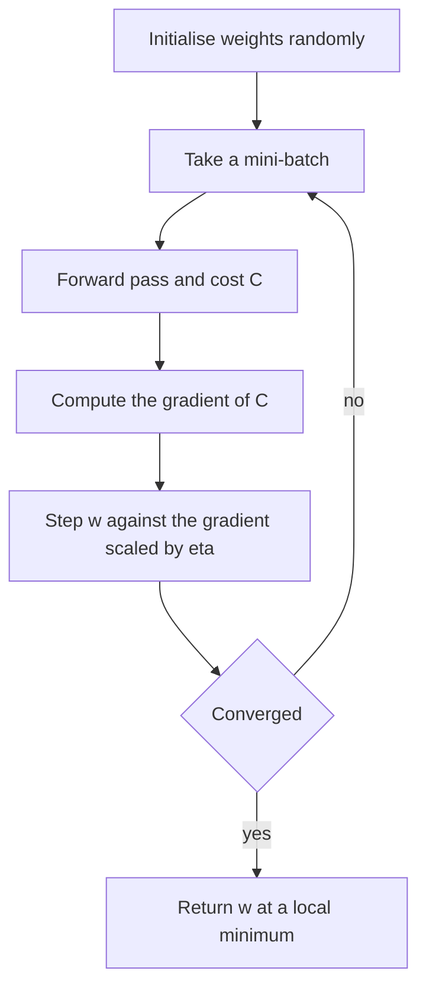

# Gradient Descent

## Problem

**Input**: a differentiable [[cost-function]] `C(w)` over the weights and biases of a
[[neural-network]], and a learning rate `η`.
**Output**: a `w` at which `C` is (locally) minimal.

## Idea

The notes ask the question that defines the method:

> **Which direction decreases `C(x,y)` most quickly?**

The answer is the **gradient** `∇C(x,y)`, which points downhill with the highest
decrease — or, as the notes phrase it, uphill with the highest increase, so one walks
along `−∇C`. Take a small step in that direction, recompute, repeat. "Small" is the
**learning rate**.

## Pseudocode

The three-line algorithm of the notes:

```text
GRADIENT-DESCENT(C, w, η):
  repeat until convergence:
    g ← ∇C(w)            // compute the gradient
    w ← w − η · g        // small step in the −∇C direction; small = learning rate
  return w
```

In practice the gradient is averaged over a **mini-batch** rather than the whole
training set:

```text
MINI-BATCH-GRADIENT-DESCENT(TrainingData, w, η, epochs, batchSize):
  initialise w randomly
  for e ← 1 to epochs:
    shuffle TrainingData
    for each mini-batch B of size batchSize:
      // ∂C/∂w^l  ←  (1/n) · Σ_{k=0}^{n−1} ∂C_k/∂w^l     with n = |B|
      g ← (1/|B|) · Σ_{(x,y) ∈ B} ∇_w COST( FORWARD-PASS(x, w), y )
      w ← w − η · g
  return w
```

The gradient `∇_w COST` itself is produced by [[backpropagation]].

## Worked example

The notes give no numeric trace, but they do give the two failure modes as a tuning
table:

| Learning rate | Consequence |
|---|---|
| **Higher** | **unstable training and poor solutions** |
| **Lower** | **slow training and sub-optimal solutions** |

and the same trade-off for the batch size:

| Batch size | Consequence |
|---|---|
| **Small batches** | **unstable** gradient estimate |
| **Big batches** | **won't fit in the GPU** |

The lesson of the pair is that both knobs trade *noise* against *cost per step*, and
neither extreme works.

## Diagram



Each update evaluates a mini-batch, computes the gradient and steps downhill by the learning rate until the cost stops improving.

## Complexity

Per step, the cost is one forward and one backward pass per sample in the batch:

```text
time  O( |B| · #weights )   per update
space O( #weights )         for w and the accumulated gradient
```

An epoch costs `O(n · #weights)` for `n` training samples, independent of the batch size;
the batch size only changes how many update steps that work is split into.

## Variants & pitfalls

- **"There are faster algorithms"** — the notes name no specific optimiser, only that
  plain gradient descent is not the end of the story. See [[open-questions]].
- **Local minima.** `C` is not convex, so the walk stops at *a* minimum. The notes'
  verdict: *local minimum okay, global minimum hard*.
- **Vanishing gradient** — "slope to 0": the update stalls. Remedies named: batch
  normalization, residual/shortcut connections.
- **Gradient explosion** — remedy named: **gradient clipping**.
- **Normalized input.** The first regularization tip in the notes is to *start with
  normalized data*, exactly the [[data-normalization]] step from module 1: on
  badly-scaled features the cost surface is a narrow valley and the walk zig-zags.

## Relations

- [[cost-function]] — the surface being descended.
- [[backpropagation]] — supplies `∇C` for a layered network.
- [[neural-network]], [[deep-learning]] — what is being trained.
- [[data-normalization]] — a precondition for a well-conditioned descent.
- [[expectation-maximization]] — the other iterative optimiser in module 2; EM's
  monotone likelihood increase replaces the explicit step size.
- [[t-sne]] — minimises a Kullback–Leibler divergence by exactly this procedure, which is
  where gradient descent reappears in [[M2L07-single-cell-rna-seq]].
- [[bias-variance-tradeoff]] — "train longer / better optimization algorithms" is the
  recipe when the problem is avoidable bias rather than variance.
- [[convolutional-neural-network]] — the optimiser used to fit kernel weights.
- [[generative-adversarial-network]] — alternating descent on two coupled costs is what makes GANs unstable.
- [[k-means]] — the alternating update is a descent on the within-cluster sum of squares.
- [[umap]] — the embedding is optimised by stochastic gradient descent.

## Appears in

- [[M2L06-deep-learning]]
- [[M2E06-deep-learning]]
- [[M2L03-machine-learning-and-classification]] — the optimiser behind the parametric classifiers of the lecture.

## Sources

- `raw/module2/csb_3.pdf`, p. 3 — the gradient question, the three-step algorithm, the
  learning rate as "small step", local versus global minimum.
- `raw/module2/csb_3.pdf`, p. 5 — `−η ∇C(w)`, the mini-batch averaging formula, batch
  size trade-off, learning-rate table, "there are faster algorithms", regularization tips.
