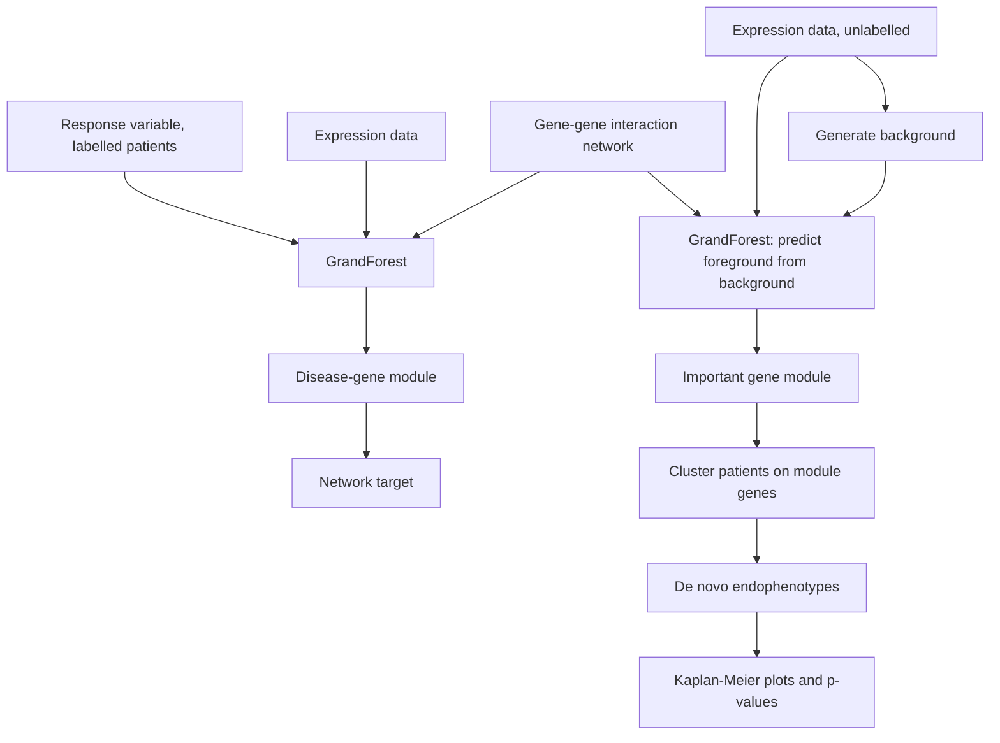

# GrandForest

## Problem

**Input**: genomic profiling data (an expression matrix over patients) **and** a
**gene–gene interaction network**; optionally a response variable.
**Output**: a **disease-gene module** — a connected set of genes in the network that
carries the signal — and, in unsupervised mode, **de novo
[[endophenotype|endophenotypes]]**.

> *An ensemble learning method for discovering disease-associated modules from genomic
> profiling data.*

## Idea

**Random Forest + Network ⇒ GrandForest.**

A [[random-forest]] **combines the output of multiple [[decision-tree|decision trees]] to
reach a single result**, and its **advantage over a single decision tree is that it
avoids and prevents overfitting by using multiple trees**. GrandForest is an **ensemble
learning method based on the random forest algorithm** in which the trees are no longer
grown over an unstructured list of features: each tree is grown **along the edges of the
[[interaction-network]]**, so the variables appearing in one tree are by construction
**connected** in the network.

The notes draw this as a network `v₁…v₈` being unrolled into a tree rooted at `v₁` whose
children are its network neighbours `v₃` and `v₅`, whose children are *their* neighbours,
and so on.

## Pseudocode

```text
GRANDFOREST-TRAIN(X, y, G, T, depth):
  // X expression matrix, y response (or background label), G gene-gene network
  for b ← 1 to T:
    S[b] ← BOOTSTRAP-SAMPLE(X)                  // as in a random forest
    v    ← random seed gene from V(G)
    tree[b] ← GROW-NETWORK-TREE(S[b], G, v, depth)
  importance ← accumulated impurity decrease per gene over all trees
  module ← the top-scoring genes, which form a connected subnetwork of G
  return tree[1..T], module

GROW-NETWORK-TREE(S, G, v, depth):
  if depth = 0 or S is pure: return leaf(S)
  N ← neighbours of the genes already used in this branch       // network constraint
  a* ← argmax_{a ∈ N} Δi( split-on(a), S )                      // node impurity drop
  (S_l, S_r) ← split S on a*
  return node(a*, GROW-NETWORK-TREE(S_l, G, a*, depth-1),
                  GROW-NETWORK-TREE(S_r, G, a*, depth-1))
```

**Supervised analysis** — patients are **labelled**:

```text
SUPERVISED(X, response, G):
  forest, module ← GRANDFOREST-TRAIN(X, response, G)
  return module                                 // disease-gene module → network → target
```

**Unsupervised analysis** — patients are **unlabelled**; the four steps of the notes:

```text
UNSUPERVISED(X, G):
  1. BG ← GENERATE-BACKGROUND(X)                // generate background from input
  2. D  ← CONCATENATE(X, BG)                    // concatenate into a single data set
       y ← foreground / background label
  3. forest, module ← GRANDFOREST-TRAIN(D, y, G)// train GF to predict FG from BG
  4. clusters ← CLUSTER( X restricted to module )  // cluster input only on module genes
  return module, clusters                       // de novo endophenotypes
```

Afterwards: **compute Kaplan–Meier plots and p-values** per cluster
([[kaplan-meier-plot]]).

## Worked example

The two pipelines as drawn in the notes:

```text
Supervised:
  Patients (labelled)
    → Experimental Data + Response Variable
    + Gene-Gene Interaction Network
    → GrandForest
    → Disease-gene module  → Network → Target

Unsupervised:
  Patients (unlabelled)
    → Experimental Data → Generate Background
    + Gene-Gene Interaction Network
    → GrandForest
    → Important gene module
    → Cluster into endophenotypes
```

The unsupervised trick is worth restating: there is no label, so GrandForest **invents
one** — foreground versus a synthetic background generated from the same data — and the
genes that distinguish real data from the background are the structured, informative
ones. Clustering the patients on *those* genes gives the endophenotypes. The notes add
that the tool **clusters the data set recursively on computed pathways** and **also
allows for survival analysis**.

## Diagram


The two GrandForest modes: supervised to a disease-gene module, unsupervised to de novo endophenotypes.

## Complexity

Same shape as a [[random-forest]]: `T` trees, each `O(depth · |neighbourhood| · n)`. The
network constraint **shrinks** the candidate set at every node from all `m` genes to the
neighbours of the current branch, so a GrandForest tree is cheaper than a random-forest
tree on the same data — and vastly better conditioned when `m ≫ n`.

## Variants & pitfalls

- The network constraint is a **strong prior**: genes absent from the interaction network
  can never enter a module, and the network's own biases (well-studied genes have more
  edges) propagate into the result.
- Unsupervised mode depends on how the **background** is generated; a badly generated
  background produces a module of artefacts.
- The discovered endophenotypes carry no labels and must be validated externally — hence
  the [[kaplan-meier-plot]].
- Compared with [[keypathwayminer]], which extracts one maximal module under exception
  parameters, GrandForest scores *every* gene and reads the module off the top of the
  ranking.

## Relations

- [[random-forest]] — the base algorithm; GrandForest is it plus a network.
- [[decision-tree]] — the base learner, here grown along network edges.
- [[interaction-network]] — the constraint that makes the modules connected.
- [[endophenotype]] — the output of the unsupervised mode.
- [[kaplan-meier-plot]] — the clinical validation of those endophenotypes.
- [[cluster-analysis]], [[k-means]] — step 4 of the unsupervised pipeline.
- [[bicon]] — the other network-constrained de novo method of this lecture, reaching the
  same goal by bi-clustering with ants.
- [[keypathwayminer]] — the module-2 part-1 de novo network enrichment method; same
  question, different search.
- [[machine-learning]] — GrandForest is explicitly presented as running in both
  supervised and unsupervised mode.
- [[enrichment-analysis]] — what one runs on the resulting module to interpret it.
- [[graph-neural-network]] — the deep-learning counterpart: network structure as an inductive bias, learned rather than imposed on a forest.
- [[random-forest]] — compare with [[deep-learning]]'s ensembling and regularization via [[dropout]].

## Appears in

- [[M2L05-network-based-disease-modules]]
- [[M2E05-grandforest-and-bicon]]
- [[M2E01-enrichment-analysis-and-keypathwayminer]] — compared with KeyPathwayMiner as a network-guided module finder.
- [[M2L01-enrichment-analysis]] — introduced as a network-guided, machine-learning route to enriched modules.
- [[M2L03-machine-learning-and-classification]] — the network-guided random-forest variant built on these ideas.

## Sources

- `raw/module2/csb_part2.pdf`, p. 21 — the main idea of graph-based random forest, the
  network-to-tree unrolling, and `Random Forest + Network ⇒ GrandForest`.
- `raw/module2/csb_part2.pdf`, p. 22 — the supervised and unsupervised pipelines, the
  four unsupervised steps, recursive clustering on computed pathways, survival analysis
  and Kaplan–Meier plots.
- `raw/module2/csb_part2.pdf`, p. 24 — the exercise definitions of supervised and
  unsupervised analysis.
