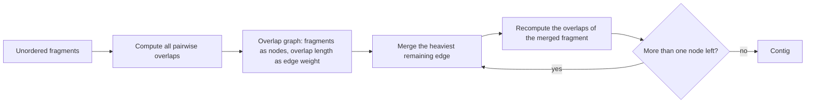

# Greedy Assembly

## Problem

**Input**: a set of unordered sequence fragments (reads) from
[[shotgun-sequencing]].
**Output**: a single reconstructed sequence (contig) consistent with the fragments.

## Idea

Build an **overlap graph**: nodes are fragments, and a directed edge from *u* to *v*
carries as its weight the length of the longest suffix of *u* that equals a prefix of
*v*. Then repeatedly take the **heaviest** edge still available and merge its two
fragments into one longer fragment, until a single node remains. The strategy is greedy:
it always takes the locally best merge without reconsidering.

## Pseudocode

```text
OVERLAP(u, v):
  // longest suffix of u that equals a prefix of v
  best ← 0
  for L ← 1 to min(|u|, |v|) - 1:
    if SUFFIX(u, L) = PREFIX(v, L):
      best ← L
  return best

GREEDY-ASSEMBLY(F):
  // F = set of fragments; nodes of the overlap graph
  N ← F
  // (I) compute all pairwise overlaps
  for each u in N:
    for each v in N with v ≠ u:
      W[u,v] ← OVERLAP(u, v)

  // (II) and (III): merge heaviest edge, repeat
  while |N| > 1:
    (u*, v*) ← argmax over u ≠ v in N of W[u,v]
    if W[u*,v*] = 0: break                  // nothing left to join
    m ← u* + SUFFIX-AFTER(v*, W[u*,v*])     // merge: u* plus the non-overlapping tail of v*
    N ← N \ {u*, v*} ∪ {m}
    RECOMPUTE-OVERLAPS(W, N, m)

  return the single element of N
```

## Worked example

Fragments: `ATTTGC`, `GACCTA`, `AGAGAC`, `TTGCGC`, `GCAGAG`, `CCTAAG`.

Round 1 — the heaviest edges all have weight 4:

| Merge | Overlap | Result |
|---|---|---|
| `GCAGAG` + `AGAGAC` | `AGAG` (4) | `GCAGAGAC` |
| `ATTTGC` + `TTGCGC` | `TTGC` (4) | `ATTTGCGC` |
| `GACCTA` + `CCTAAG` | `CCTA` (4) | `GACCTAAG` |

Round 2 — `GCAGAGAC` + `GACCTAAG` overlap `GAC` (3) → `GCAGAGACCTAAG`.

Round 3 — `ATTTGCGC` + `GCAGAGACCTAAG` overlap `GC` (2) →
**`ATTTGCGCAGAGACCTAAG`**.

The full derivation is in [[E02-greedy-assembly]].

## Complexity

- Computing all pairwise overlaps for `n` fragments of length up to `k` costs
  `O(n² · k)`.
- Each merge removes one node, so there are `O(n)` rounds; with recomputation the total
  is `O(n³ · k)` in the naive implementation.
- The underlying *exact* formulation — visit every fragment node exactly once, i.e. find
  a **Hamiltonian path** — is **NP-hard**, which is precisely why a greedy heuristic is
  used (see [[algorithmic-complexity]]).

## Variants & pitfalls

- **Repeat regions**: greedy optimises locally, so two copies of a repeat are collapsed
  into one and the sequence between them is lost or misordered. This is the dominant
  failure mode named in the notes.
- In NGS data, repeats additionally show **increased coverage**, which can be used to
  detect them but also inflates their fragment count.
- Ties between equally heavy edges are resolved arbitrarily and can change the result.
- The alternative formulation that avoids all-against-all overlap computation is
  [[de-bruijn-assembly]].

## Diagram


The greedy loop: always merge the locally best overlap, never reconsider an earlier merge.

## Relations

- [[shotgun-sequencing]] — produces the fragments.
- [[hamiltonian-and-eulerian-paths]] — the exact Hamiltonian formulation, visiting every
  read node once, that this greedy heuristic only approximates.
- [[L09-sequence-alignment-and-homology]] — the overlap graph is built with free-end-gap
  alignments.
- [[de-bruijn-assembly]] — the Eulerian alternative, polynomial rather than NP-hard.
- [[de-bruijn-graph]] — the data structure that alternative is built on.
- [[dna-mutation]] — duplications and translocations create the repeats that break this
  method.
- [[algorithmic-complexity]] — the Hamiltonian/NP-hard argument.
- Appears in [[L04-genome-assembly]] and [[E02-greedy-assembly]].

- [[travelling-salesman-problem]] — the same NP-hard Hamiltonian core, stated as an optimisation problem.
- [[ant-colony-optimization]] — the module-2 metaheuristic for exactly this class of intractable search, where greedy heuristics are the cheap alternative.

## Sources

- `raw/module1/gsb_part1.pdf`, pp. 15–18.
- `raw/module1/gsb_part2.pdf`, p. 11 — overlap detection as an alignment application.
