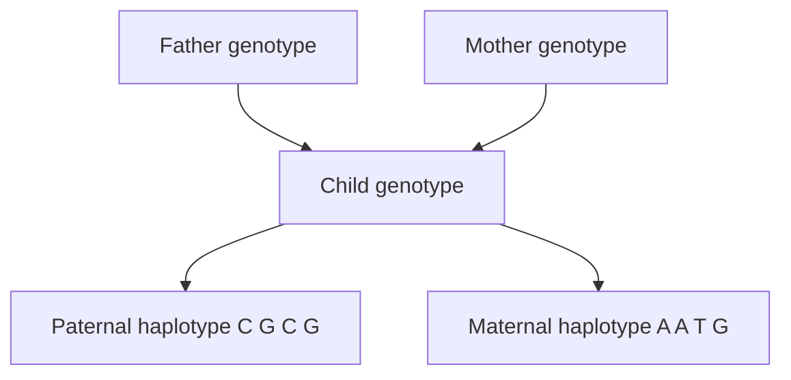

# Haplotype Phasing

## Problem

A genotyping assay reports, for each locus, the **unordered pair** of alleles an
individual carries — `G/T`, `A/C`, … — but not which allele sits on which of the two
chromosomes. **Phasing** is the reconstruction of that assignment.

**Input:** genotype data for a large number of individuals, or sequencing data.
**Output:** the pair of **haplotypes** — the two chromosome copies, each a string of
alleles.

The notes state the task twice:

- reconstruct a pair of chromosomes given **genotype data** for many individuals;
- reconstruct a pair of chromosomes given **sequencing data**.

## Idea

A homozygous locus is already phased: both chromosomes carry the same allele. Only
**heterozygous** loci are ambiguous, and each one doubles the number of possible
assignments. With `h` heterozygous sites there are `2^h` labelled phasings, i.e. `2^(h−1)`
distinct unordered chromosome pairs.

Two sources of information resolve the ambiguity:

- **Family (trio) data** — comparing a child's genotype with the parents' genotypes shows
  which allele came from which parent (*von wem kam das Allel*). The alleles inherited
  from the father form the **paternal haplotype**, those from the mother the **maternal
  haplotype**.
- **Population data** — haplotypes are shared between individuals because of linkage
  ([[population-genetics]]); the phasing that explains many individuals with few distinct
  haplotypes is the likely one.

## Pseudocode

```text
ENUMERATE-PHASINGS(G):
  // G[1..m]: genotypes, each an unordered allele pair
  H ← { ("", "") }                          // set of partial haplotype pairs
  for i ← 1 to m:
    (x, y) ← G[i]
    H' ← ∅
    for each (h1, h2) in H:
      if x = y:
        H' ← H' ∪ { (h1·x, h2·x) }          // homozygous: no choice
      else:
        H' ← H' ∪ { (h1·x, h2·y), (h1·y, h2·x) }   // heterozygous: two orientations
    H ← H'
  return H                                   // 2^h entries for h heterozygous loci

PHASE-TRIO(Gf, Gm, Gc):
  // Gf, Gm, Gc: father's, mother's and child's genotypes at m loci
  for i ← 1 to m:
    (x, y) ← Gc[i]
    if x ∈ Gf[i] and y ∈ Gm[i] and not (y ∈ Gf[i] and x ∈ Gm[i]):
      paternal[i] ← x ; maternal[i] ← y     // unambiguous
    else if y ∈ Gf[i] and x ∈ Gm[i] and not (x ∈ Gf[i] and y ∈ Gm[i]):
      paternal[i] ← y ; maternal[i] ← x
    else:
      mark locus i as unresolved            // both parents could have given either allele
  return paternal, maternal
```

## Worked example

**Enumeration.** Genotypes `A`, `{T,G}`, `{C,A}`, `C`, `G`, `{C,A}` — three heterozygous
loci, so `2³ = 8` labelled phasings of the variable positions:

```text
T C C | T C A | T A C | T A A | G C C | G C A | G A C | G A A
G A A | G A C | G C A | G C C | T A A | T A C | T C A | T C C
```

The right-hand four are the left-hand four with the chromosomes swapped, so there are
four genuinely different chromosome pairs.

**Trio phasing.**

```text
father: (C,A) (G,G) (C,T) (G,G)
mother: (A,A) (G,A) (T,T) (G,G)
child:  (A,C) (A,G) (T,C) (G,G)
```

- Locus 1: the mother can only give `A`, so the child's `C` is paternal →
  paternal `C`, maternal `A`.
- Locus 2: the father can only give `G`, so the child's `A` is maternal →
  paternal `G`, maternal `A`.
- Locus 3: the mother can only give `T`, so the child's `C` is paternal →
  paternal `C`, maternal `T`.
- Locus 4: both are `G/G` — homozygous, paternal `G`, maternal `G`.

```text
paternal haplotype: C G C G
maternal haplotype: A A T G
```


A trio resolves each heterozygous site by asking which parent could have supplied the allele.

## Complexity

Naive enumeration is **`O(2^h)`** in the number `h` of heterozygous loci — exponential,
hence unusable genome-wide ([[algorithmic-complexity]]). Trio phasing is **`O(m)`** in
the number of loci. Population-based phasing programs use hidden Markov models over
reference haplotype panels; the notes do not cover them.

## Variants & pitfalls

- A locus where **both parents are heterozygous with the same pair** cannot be phased
  from the trio alone.
- Sequencing-based phasing ties alleles together only when they fall on the **same
  read**; read length therefore bounds the phasable distance
  ([[next-generation-sequencing]]).
- Phasing errors propagate into any downstream haplotype association analysis.

## Relations

- [[population-genetics]] — supplies genotypes, loci and linkage.
- [[genome-wide-association-study]] — haplotypes can be tested instead of single SNPs.
- [[hardy-weinberg-equilibrium]] — genotype frequencies underlying the ambiguity.
- [[next-generation-sequencing]] — read-based phasing information.
- [[snp]] — heterozygous SNPs are exactly the ambiguous positions phasing has to assign
  to the two chromosomes.

## Appears in

- [[L14-population-genetics]]
- [[E11-population-genetics-and-multiple-testing]]

## Sources

- `raw/module1/gsb_3.pdf`, pp. 23, 32–33.
