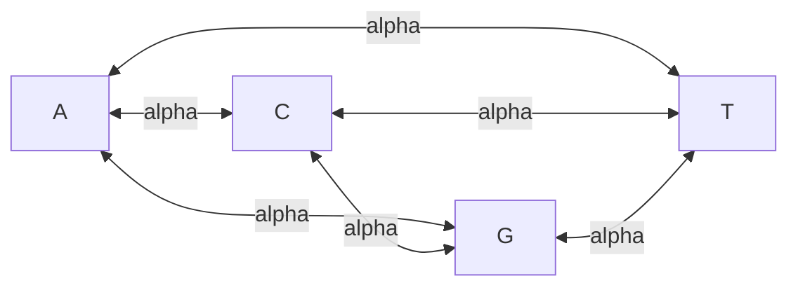

# Jukes–Cantor Model

## Problem

**Input**: an alignment of two homologous DNA sequences, summarised by the observed
fraction of differing positions `p`.
**Output**: a corrected estimate of the [[evolutionary-distance]] — the expected number
of substitutions per site, including those hidden by multiple hits.

## Idea

Model substitution as a continuous-time [[markov-chain]] on the four bases in which
**every substitution is equally likely**. One rate parameter `α` then describes the whole
process, and the rate matrix `Q^JC` is as symmetric as it can be: `α` everywhere off the
diagonal, and `−3α` on the diagonal so that each row sums to zero.

```text
            to  A     C     G     T
      from
        A      -3α    α     α     α
        C       α    -3α    α     α
        G       α     α    -3α    α
        T       α     α     α    -3α
```

### Reading the margins of `Q`

The notes give two rules, which are the two conservation laws of the model:

```text
row sum = 0      ⟺  the sequence length stays constant
                    (whatever leaves a base must arrive at another base)
column sum = 0   ⟺  the base composition stays constant
                    (inflow equals outflow for every base)
```

For `Q^JC` both hold, so Jukes–Cantor conserves length *and* composition. A matrix whose
columns do **not** sum to zero describes a drift in base composition — the GC-biased
example in the exercise, where the rate `γ` into `G` and `C` exceeds `α`.

## Pseudocode

```text
JUKES-CANTOR-DISTANCE(S1, S2):
  L ← alignment length of S1 and S2
  D ← 0
  for i ← 1 to L:
    if S1[i] ≠ S2[i]: D ← D + 1          // count mismatching columns
  p ← D / L                              // p-distance: biased LOW

  // correct for multiple hits under the one-rate, 4-state model
  if p ≥ 3/4: return ∞                   // saturated: no information left
  d ← −(3/4) · ln( 1 − (4/3) · p )
  return d
```

> The correction formula `d = −¾ ln(1 − 4p/3)` is the standard Jukes–Cantor distance.
> **The notes give the rate matrix but not this formula** — only the Poisson correction
> `d_P = −ln(1−p)` is written out. Recorded in [[open-questions]].

```text
BUILD-DISTANCE-MATRIX(MSA):
  n ← number of sequences
  for i ← 1 to n:
    for j ← 1 to i−1:
      D[i,j] ← JUKES-CANTOR-DISTANCE(MSA[i], MSA[j])
  return D                               // input for UPGMA or Neighbor-Joining
```

## Worked example

From the exercise: an alignment of length `L = 50` in which `S1` and `S2` differ at
3 positions.

```text
p = 3/50 = 0.06
Poisson:        d_P = −ln(1 − 0.06)             = 0.0619
Jukes–Cantor:   d   = −0.75 · ln(1 − 0.08)      = 0.0625
```

At small `p` all three numbers nearly coincide — the corrections only matter once
sequences are distant, which is exactly when the p-distance's bias becomes large.

## Diagram



Every base can change into every other base at the same rate alpha, which is the single parameter of the model.

## Complexity

```text
one pair:        O(L)
full matrix:     O(n² · L)  time,  O(n²)  space
```

## Variants & pitfalls

### Assumptions (shared with [[kimura-two-parameter-model]])

The notes list them under *"assumptions of Jukes–Cantor and Kimura"*:

1. **Only substitutions are considered** — no insertions or deletions.
2. **Positions evolve independently of each other.**
3. **Substitution probabilities depend only on the current state** — the Markov property.
4. **The same mutation rate applies to all positions.**
5. **The base composition is 1 : 1 : 1 : 1.**

> **note: not always applies to real data** — the notes' own caveat.

### Where each assumption breaks

- Assumption 4 fails at every real locus: third codon positions, [[cpg-island]]s and
  functional sites evolve at wildly different rates.
- Assumption 5 fails for any GC-biased genome; the exercise's `γ > α` matrix is the
  explicit counterexample.
- Assumption 1 is why the model needs an **alignment**: indels are removed as gaps
  before counting.
- Ignoring the excess of transitions is the specific failure
  [[kimura-two-parameter-model]] repairs.

## Relations

- [[kimura-two-parameter-model]] — the two-rate extension; same assumptions minus the
  equal-rate one.
- [[evolutionary-distance]] — the hierarchy from p-distance to Poisson to JC to K2P.
- [[transition-and-transversion]] — the distinction JC deliberately ignores.
- [[upgma]], [[neighbor-joining]] — consume the distance matrix this produces.
- [[markov-chain]] — `Q^JC` is the generator of a continuous-time Markov chain; the
  "depends only on the current state" assumption is the Markov property from module 1.
- [[hidden-markov-model]] — the same state-transition machinery, there with hidden
  states.
- [[substitution-matrix]] — empirical PAM/BLOSUM matrices versus this mechanistic one.
- [[phylogenetic-tree-reconstruction]] — the "model" step of the four-step procedure.
- [[molecular-clock]] — a single global `α` is exactly a clock.
- [[bootstrap-tree-assessment]] — the distance correction applied inside each bootstrap replicate.
- [[molecular-evolution]] — the simplest substitution model of molecular evolution.
- [[maximum-likelihood]] — an explicit substitution model like this one is what a likelihood tree score needs in order to evaluate `P(data | tree, model)`.

## Appears in

- [[M2L08-molecular-evolution-and-phylogeny]]
- [[M2E08-phylogenetics]]

## Sources

- `raw/module2/csb_3.pdf`, p. 28 — the Jukes–Cantor rate matrix `Q^JC` with `−3α` on the
  diagonal, and the row-sum / column-sum rules.
- `raw/module2/csb_3.pdf`, p. 29 — the five assumptions of Jukes–Cantor and Kimura with
  the "not always applies to real data" caveat.
- `raw/module2/csb_3.pdf`, p. 37 — the exercise: the normal `Q^JC` and the GC-biased
  variant with `γ > α`.
- `raw/module2/csb_3.pdf`, p. 38 — `p(S1,S2) = 3/50` for the worked numbers.
