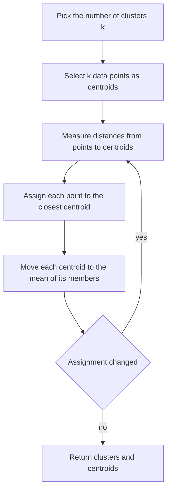

# k-Means

## Problem

**Input**: a set of unlabelled data objects described by **feature vectors**, and a
number of clusters `k` **fixed a priori**.
**Output**: a partition of the objects into `k` clusters, each represented by a
**centroid**.

k-means is a **partitional**, prototype-based [[cluster-analysis|clustering]] algorithm.

## Idea

Alternate two steps until nothing changes: **assign** every point to its nearest
centroid, then **move** every centroid to the mean of the points assigned to it. Each
step can only decrease the within-cluster error, so the loop converges — though not
necessarily to the global optimum.

## Pseudocode

The five numbered steps of the notes, with the repeat loop over III–V:

```text
K-MEANS(X, k):
  I.   pick k, the number of clusters to generate
  II.  select k data points as cluster centers (centroids)
       C ← { c_1, …, c_k }
  repeat until convergence:
    III. measure the distance between each point and the centroids
         // e.g. Euclidean distance
    IV.  for each data point x ∈ X:
           assign x to the cluster with the closest centroid:
             S[ argmin_{c_j ∈ C} dist(c_j, x)² ] ← S[·] ∪ { x }
    V.   for each cluster i:
           c_i ← (1/|S_i|) · Σ_{x ∈ S_i} x        // mean of all assigned points
  return C, S
```

**Choosing `k` when it is unknown — the elbow method:**

```text
ELBOW-METHOD(X, k_max):
  for k ← 1 to k_max:
    (C, S) ← K-MEANS(X, k)
    SSE[k] ← Σ_i Σ_{x ∈ S_i} dist(c_i, x)²   // sum of squared distances between the
                                             // centroid and each member of that cluster
  plot SSE[k] against k
  return the k at the elbow point of the curve
```

> **Elbow method**: perform the algorithm with different values of `k`. At each
> evaluation the **sum of squared error (SSE)** is computed and then plotted; the best
> value of `k` is at the **elbow point**.

## Worked example

The exercise data:

```text
x1 = (1,2)   x2 = (5,8)   x3 = (7,3)   x4 = (6,4)   x5 = (4,7)
```

**Iteration 1** — initial centroids `x1`, `x3`, `x4`. Euclidean distances of the two
unassigned points:

| | to `x1 = (1,2)` | to `x3 = (7,3)` | to `x4 = (6,4)` | → cluster |
|---|---|---|---|---|
| `x2 = (5,8)` | 7.21 | 5.39 | **4.12** | 3 |
| `x5 = (4,7)` | 5.83 | 5.00 | **3.61** | 3 |

```text
Cluster 1: x1
Cluster 2: x3
Cluster 3: x4, x2, x5
```

**Update the centroids** with `c_i = (1/|S_i|) Σ_{x ∈ S_i} x`:

```text
c1' = (1,2)
c2' = (7,3)
c3' = ( (5+6+4)/3 , (8+4+7)/3 ) = ( 5 , 6.33 )
```

**Iteration 2** — reassign against `c1' c2' c3'`:

| point | nearest centroid |
|---|---|
| `x1 = (1,2)` | `c1'` |
| `x3 = (7,3)` | `c2'` (distance 0) |
| `x4 = (6,4)` | `c2'` (1.41 vs 2.54 to `c3'`) |
| `x2 = (5,8)` | `c3'` |
| `x5 = (4,7)` | `c3'` |

```text
Cluster 1: x1          Cluster 2: x3, x4        Cluster 3: x2, x5
c1 = c1_old = (1,2)    c2 = (6.5, 3.5)          c3 = (4.5, 7.5)
```

**Iteration 3** — the assignment is the **same** → **STOP**. Only the distances to the
final centroids are updated. The final picture: a singleton at `(1,2)` and two clusters
centred at `(6.5, 3.5)` and `(4.5, 7.5)`.

## Diagram



The assign step and the centroid update alternate until no point changes cluster.

## Complexity

```text
O(t · k · n)        t = number of iterations, k = clusters, n = data points
```

— *fast for low-dimensional data*, as the notes put it. Space is `O(n + k)`.

## Variants & pitfalls

**Pros**

- (+) easy implementation and interpretation
- (+) fast for low-dimensional data, `O(t·k·n)`

**Cons**

- (−) to reach convergence it may need to be **run multiple times with different**
  initializations
- (−) **lacks consistency** — different runs, different answers
- (−) **sensitive to noise and outliers**
- (−) the **number of clusters must be known**
- (−) **no guaranteed global convergence**
- (−) **not suitable for complex data structures** — it works best for clustering a
  **convex shape**
- (−) **problematic if objects are not described by feature vectors** — exactly the case
  where [[transclust]] is used instead, since it needs only a similarity function

**Further points from the exercise**

- k-means is **very sensitive to the initial seed**; a **bad initialization can lead to
  poor convergence**.
- Without a gold standard, estimate the number of clusters with the **elbow method**.
- With a gold standard, evaluate the result with the **[[f-measure]]**, where **1 is best
  and 0 is worst**.

## Relations

- [[cluster-analysis]] — k-means is its prototype-based representative.
- [[transclust]] — the graph-based alternative: no feature vectors, no fixed `k`, but an
  NP-hard objective.
- [[f-measure]] — the external evaluation of a k-means result.
- [[machine-learning]] — unsupervised learning, no labels.
- [[expectation-maximization]] — the same alternating "assign, then re-estimate" loop
  with the same local-maximum problem; EM uses soft weights where k-means uses a hard
  assignment.
- [[descriptive-statistics]] — the centroid is a mean and the SSE a sum of squared
  deviations.
- [[principal-component-analysis]] — routinely applied first, because k-means degrades in
  high dimensions.
- [[grandforest]] — clusters patients on module genes, a network-informed use of the same
  step.
- [[upgma]] — hierarchical agglomerative clustering, which keeps the whole merge tree instead of a flat partition.
- [[t-sne]], [[umap]] — embeddings run before clustering; neither is a clustering itself.
- [[single-cell-analysis-workflow]], [[single-cell-rna-seq]] — clustering as the cell-type calling step.
- [[cost-function]] — the within-cluster sum of squares is a cost minimised by alternating descent, as in [[gradient-descent]].
- [[autoencoder]] — a non-linear embedding that clustering can be applied to.
- [[cytomcs]] — the same local-search pattern: improve until no change helps, then restart or perturb to escape a local optimum.

## Appears in

- [[M2L04-clustering]]
- [[M2E04-k-means-and-transclust]]

## Sources

- `raw/module2/csb_part2.pdf`, p. 13 — the five steps, the assignment and update rules,
  the elbow method and SSE.
- `raw/module2/csb_part2.pdf`, p. 14 — pros and cons, the `O(t·k·n)` bound.
- `raw/module2/csb_part2.pdf`, pp. 17–18 — the five-point worked example and the
  closing remarks on convex shapes, the elbow method, the F-measure and seed sensitivity.

- `raw/module2/csb_4.pdf`, pp. 13–14 — CytoMCS local search and perturbation.
