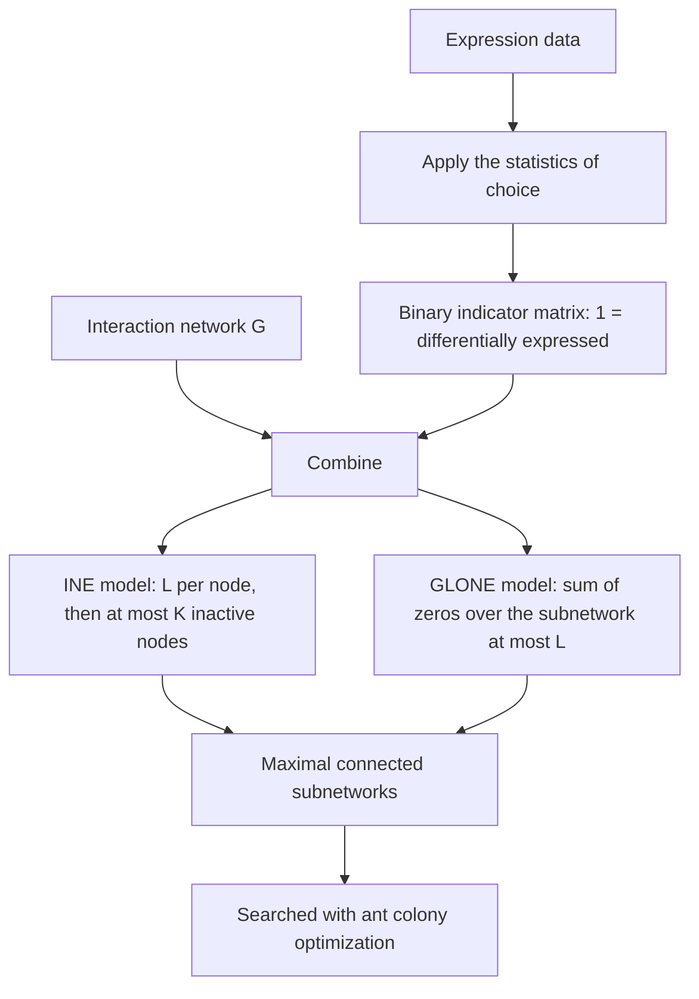

# KeyPathwayMiner (INEs and GLONE)

## Problem

**Input**: an [[interaction-network]] `G = (V, E)` whose nodes are genes, plus a binary
**indicator matrix** `A` with one row per gene and one column per sample/patient, where
`A[g, s] = 1` means gene `g` is *differentially expressed* ("active") in sample `s`.
**Output**: all **maximal connected subnetworks** of `G` that are differentially
expressed almost everywhere, in the precise sense fixed by two parameters `K` and `L`.

This is **de novo network enrichment**: *look at the graph, not at the genes any more,
and identify network enrichments*. No a priori [[gene-set]] is needed — the set is
discovered.

## Idea

A real pathway is rarely perfectly dysregulated: a few of its genes will look normal
(measurement noise, redundancy), and a few patients will not show the dysregulation at
all. So the definition must tolerate exceptions. KeyPathwayMiner formalises two kinds:

- **Gene exceptions (`K`)** — how many nodes of the extracted subnetwork may be *not*
  active.
- **Case exceptions (`L`)** — in how many samples/patients a node may fail to be
  differentially expressed and still count as active.

The two models in the lecture differ in **where `L` is applied**:

| Model | `L` applied | Goal |
|---|---|---|
| **INEs** — Individual Node Exceptions | **per node, individually** | find all maximal connected subnetworks where all but at most `K` nodes/genes are differentially expressed in all but at most `L` samples/patients |
| **GLONE** — GLobal Node Exceptions | **globally, summed over the subnetwork** | find all maximal connected subnetworks where **all** nodes/genes are differentially expressed in all but at most `L` samples/patients in total |

Under INEs a node is **active** if it has **at most `L` zeros** in its row; under GLONE
there is no per-node verdict at all — the zeros of every node in the candidate
subnetwork are summed and that single sum must not exceed `L`.

## Pseudocode

```text
KPM-INE(G, A, K, L):
  // 1. apply the statistics of choice to the expression data → binary matrix A
  // 2. find all genes that are NOT 'active', i.e. have more than L zeros
  for each node v in V(G):
    zeros[v] ← number of samples s with A[v, s] = 0
    active[v] ← (zeros[v] ≤ L)                 // L is checked per node, individually

  // 3. extract all MAXIMAL connected components in which at most K nodes are inactive
  R ← ∅
  for each connected subgraph H ⊆ G:
    if |{ v ∈ V(H) : active[v] = false }| ≤ K and IS-MAXIMAL(H, G, K, L):
      R ← R ∪ { H }
  return R

IS-MAXIMAL(H, G, K, L):
  for each node u ∈ V(G) \ V(H) adjacent to V(H):
    if H + u still satisfies the K/L constraint: return false   // H can grow → not maximal
  return true

KPM-GLONE(G, A, L):
  for each node v in V(G):
    zeros[v] ← number of samples s with A[v, s] = 0   // for every node, count zeros
  R ← ∅
  for each connected subgraph H ⊆ G:
    if Σ_{v ∈ V(H)} zeros[v] ≤ L and IS-MAXIMAL(H, G, ·, L):    // the sum must be ≤ L
      R ← R ∪ { H }
  return R
```

Enumerating "each connected subgraph" is of course not what an implementation does — the
search space is exponential. KeyPathwayMiner therefore searches it with
[[ant-colony-optimization]], the metaheuristic introduced on the same lecture page.

```text
KPM-SEARCH(G, A, K, L):
  // the practical solver
  problem ← KPM-INE or KPM-GLONE constraint as the validity predicate
  return ANT-COLONY-OPTIMIZATION(G, validity = problem, quality = |V(H)|)
```

## Worked example

Indicator matrix for 11 genes across 5 patients (`1` = differentially expressed):

| gene | P1 | P2 | P3 | P4 | P5 | zeros |
|---|---|---|---|---|---|---|
| A | 1 | 1 | 1 | 0 | 0 | 2 |
| B | 0 | 0 | 0 | 0 | 1 | 4 |
| C | 0 | 1 | 1 | 1 | 1 | 1 |
| D | 0 | 0 | 0 | 1 | 0 | 4 |
| E | 1 | 1 | 0 | 0 | 1 | 2 |
| F | 1 | 1 | 1 | 1 | 1 | 0 |
| G | 1 | 0 | 0 | 0 | 0 | 4 |
| H | 0 | 0 | 1 | 0 | 0 | 4 |
| I | 1 | 1 | 1 | 1 | 1 | 0 |
| J | 0 | 0 | 0 | 1 | 1 | 3 |
| K | 0 | 1 | 0 | 0 | 1 | 3 |

**INE activity**, node active ⟺ `zeros ≤ L`:

| `L` | active nodes | inactive nodes |
|---|---|---|
| `L = 1` | C, F, I | A, B, D, E, G, H, J, K |
| `L = 3` | A, C, E, F, I, J, K | B, D, G, H |

With `L = 3, K = 2`, the subnetwork `{A, C, D, E, F, H, I, J, K}` has exactly two
inactive nodes (`D`, `H`) and is connected, so it is a solution — provided no neighbour
can still be added. Dropping `J` and `K` from it would *not* be a solution: it would
satisfy the constraint but would no longer be **maximal**.

The full worked case, including the graph and the three invalid candidates, is in
[[M2E01-enrichment-analysis-and-keypathwayminer]].

## Complexity

- Computing `zeros[v]` and the activity flags: `O(|V| · #samples)`.
- Finding maximal connected subgraphs under a cardinality constraint is **NP-hard** —
  the number of connected subgraphs of a graph is exponential in `|V|`. This is why the
  method is paired with a metaheuristic rather than an exact algorithm, exactly as the
  [[travelling-salesman-problem]] is.
- GLONE is the cheaper constraint to *evaluate* (one sum per candidate) but has the same
  exponential search space.

## Variants & pitfalls

- **INEs are more permissive than GLONE at the same `L`.** Under INEs every node gets
  its own budget of `L` zeros; under GLONE one noisy node can exhaust the budget for the
  whole subnetwork. A GLONE solution with parameter `L` is generally much smaller.
- **Maximality is part of the definition.** A valid-but-extendable subnetwork is *not* a
  solution. Most mistakes in the exercise are of this kind.
- **Solutions are not unique.** With `K` exceptions there are usually several different
  maximal subnetworks; which ones an ACO run returns depends on the random seed.
- **The binary matrix hides everything.** Step 1, "apply the statistics of choice", is
  where all the thresholding happens — which brings back the whole threshold critique of
  [[enrichment-analysis]] through the back door.
- **Network bias.** Well-studied proteins have more edges, so hub genes are
  over-represented in results from any [[interaction-network]].

## Diagram


De novo network enrichment: statistics turn expression into a binary matrix, the two models turn the matrix plus the network into a search problem.

## Relations

- [[interaction-network]] — the graph the search runs on.
- [[ant-colony-optimization]] — the metaheuristic that actually performs the search.
- [[travelling-salesman-problem]] — the same class of intractable combinatorial
  optimisation.
- [[enrichment-analysis]] — the a priori, set-based alternative that KPM replaces.
- [[gene-set]] — here the set is an *output*, not an input.
- [[gene-set-enrichment-analysis]] — scores given sets; KPM discovers them.
- [[statistical-testing]] — "the statistics of choice" in step 1 is an ordinary per-gene
  test.
- [[algorithmic-complexity]] — supplies the NP-hardness framing.
- [[grandforest]], [[bicon]] — the module-2 successors that extract a connected disease module, one by a network-guided [[random-forest]], the other by ants.
- [[transclust]] — a sibling NP-hard graph objective from the same course.
- [[endophenotype]] — what GrandForest's unsupervised mode turns such a module into.
- [[graph-neural-network]] — the deep-learning alternative to combinatorial search over a network.
- [[rna-interference]] — RNAi screens supply exactly the case/control hit matrices KPM consumes.
- [[sponge]] — another network-construction tool, built from correlation rather than from case/control data.
- [[network-alignment]] — the complementary question: not which subnetwork is active, but which nodes correspond across networks.
- [[evolutionary-algorithm]] — the population-based metaheuristic alternative to KPM's ant colony approach.

## Appears in

- [[M2L01-enrichment-analysis]]
- [[M2E01-enrichment-analysis-and-keypathwayminer]]
- [[M2L05-network-based-disease-modules]]
- [[M2L10-network-alignment]]

## Sources

- `raw/module2/csb_1.pdf`, p. 8 — de novo network enrichment, the INEs model, its goal
  and its three steps, and the activity rule.
- `raw/module2/csb_1.pdf`, p. 9 — the GLONE model and its global `L`.
- `raw/module2/csb_1.pdf`, pp. 12–13 — the worked exercise: graph, indicator matrix,
  activity columns for `L = 1` and `L = 3`, INE candidates for `K = 2, L = 3` and
  `K = 1, L = 1`, and GLONE candidates for `L = 10` and `L = 15`.

- `raw/module2/csb_4.pdf`, pp. 3, 11–15 — module 2 cross-reference: RNAi screens and network alignment metaheuristics.
