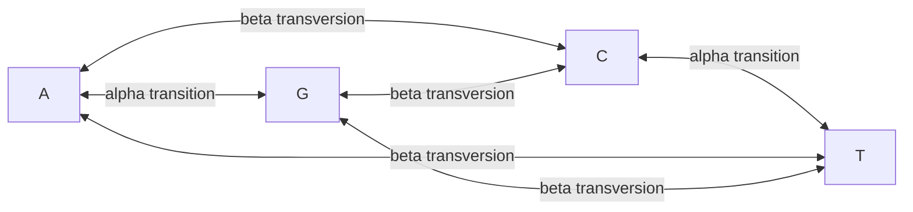

# Kimura Two-Parameter Model

## Problem

**Input**: an alignment of two homologous DNA sequences.
**Output**: an [[evolutionary-distance]] that corrects for multiple hits **and** for the
fact that [[transition-and-transversion|transitions are more common than transversions]].

## Idea

Jukes–Cantor's single rate `α` forces every substitution to be equally likely, which the
data contradict. Kimura splits the rate in two:

- **`α`** — the rate of a **transition** (`A↔G`, `C↔T`)
- **`β`** — the rate of a **transversion** (the four cross-class exchanges)

Each base has **one** possible transition and **two** possible transversions, so the
diagonal must be `−(α + 2β)` for the rows to sum to zero:

```text
            to   A        C        G        T
      from
        A     -(α+2β)     β        α        β
        C        β     -(α+2β)     β        α
        G        α        β     -(α+2β)     β
        T        β        α        β     -(α+2β)
```

Correspondingly, the observed differences are counted in **two** bins rather than one:

```text
P = share of positions showing a TRANSITION
Q = share of positions showing a TRANSVERSION
p = P + Q                                   // the plain p-distance
```

and the distance formula has one logarithm per bin:

```text
d_K2P = − ½ · ln( 1 − 2P − Q )  −  ¼ · ln( 1 − 2Q )
```

## Pseudocode

```text
K2P-DISTANCE(S1, S2):
  L ← alignment length
  n_ts ← 0; n_tv ← 0
  for i ← 1 to L:
    a ← S1[i]; b ← S2[i]
    if a = b: continue
    if {a,b} = {A,G} or {a,b} = {C,T}:
      n_ts ← n_ts + 1                       // transition: same chemical class
    else:
      n_tv ← n_tv + 1                       // transversion: purine <-> pyrimidine
  P ← n_ts / L
  Q ← n_tv / L

  if (1 − 2P − Q) ≤ 0 or (1 − 2Q) ≤ 0:
    return ∞                                // saturated
  d ← −0.5 · ln(1 − 2P − Q) − 0.25 · ln(1 − 2Q)
  return d
```

Setting `α = β` collapses `Q` back onto the Jukes–Cantor matrix, so
[[jukes-cantor-model]] is the special case `P = Q/2`.

## Worked example

Take the exercise's alignment length `L = 50` with 3 differing positions, and suppose
2 of them are transitions and 1 a transversion:

```text
P = 2/50 = 0.04      Q = 1/50 = 0.02      p = 0.06   ✓ matches p(S1,S2) = 3/50

1 − 2P − Q = 1 − 0.08 − 0.02 = 0.90
1 − 2Q     = 1 − 0.04        = 0.96

d = −0.5 · ln(0.90) − 0.25 · ln(0.96)
  =  0.0527 + 0.0102
  =  0.0629
```

Slightly above the Jukes–Cantor estimate of `0.0625` for the same `p`, because the
transition-heavy composition implies more hidden reversions. The notes do **not** give
the transition/transversion split for this alignment, so the split above is an
illustration of the formula, not a recorded result.

## Diagram



Transitions within a chemical class run at rate alpha while the cross-class transversions run at the separate rate beta.

## Complexity

```text
one pair:        O(L)
full matrix:     O(n² · L)  time,  O(n²)  space
```

Identical to [[jukes-cantor-model]]: the second parameter costs one extra counter.

## Variants & pitfalls

- **The same five assumptions as Jukes–Cantor** (only substitutions, independent
  positions, Markov property, equal rate at all positions, 1:1:1:1 base composition) —
  K2P relaxes exactly *one* of the implicit ones, the equality of substitution types.
  The *"not always applies to real data"* caveat still stands.
- **It still assumes equal base composition.** The notes name **Felsenstein** as the
  model that relaxes this, but mark it **not presented**.
- **Saturation**: when `1 − 2P − Q ≤ 0` the logarithm is undefined — the sequences are
  too diverged for the model to say anything.
- **More parameters, more variance.** Estimating `P` and `Q` from one finite alignment is
  noisier than estimating `p` alone: the [[bias-variance-tradeoff]] again.

## Relations

- [[jukes-cantor-model]] — the one-parameter special case; shares the assumption list.
- [[transition-and-transversion]] — the asymmetry this model exists to capture.
- [[evolutionary-distance]] — where K2P sits in the model hierarchy.
- [[upgma]], [[neighbor-joining]] — consume the resulting matrix.
- [[markov-chain]] — `Q^K2P` generates a continuous-time Markov chain on four states.
- [[substitution-matrix]] — the empirical alternative to a parameterised rate matrix.
- [[phylogenetic-tree-reconstruction]] — the model choice in step 2 of the procedure.
- [[bias-variance-tradeoff]] — more parameters, less bias, more variance.
- [[dna-mutation]] — transitions and transversions are the two mutation classes the model separates.
- [[molecular-evolution]] — separates transitions from transversions in the evolutionary model.
- [[maximum-likelihood]] — an explicit substitution model like this one is what a likelihood tree score needs in order to evaluate `P(data | tree, model)`.

## Appears in

- [[M2L08-molecular-evolution-and-phylogeny]]
- [[M2E08-phylogenetics]]

## Sources

- `raw/module2/csb_3.pdf`, p. 28 — the Kimura rate matrix `Q^K2P`, `P` and `Q` as the
  shares of transitions and transversions, `p = P + Q`, and
  `d = −½ln(1−2P−Q) − ¼ln(1−2Q)`.
- `raw/module2/csb_3.pdf`, p. 29 — the shared assumptions and the caveat.
- `raw/module2/csb_3.pdf`, p. 37 — the exercise matrix with distinct transition and
  transversion rates, and Felsenstein named as not presented.
