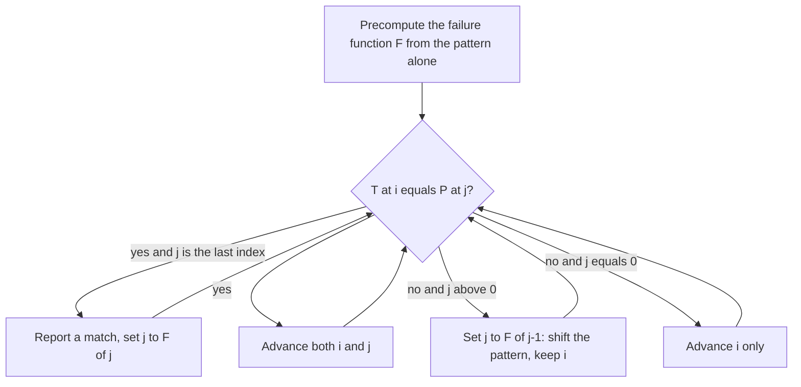

# Knuth–Morris–Pratt

## Problem

**Input**: a text `T` of length `n` and a pattern `P` of length `m`.
**Output**: every position at which `P` occurs exactly in `T`.

Brute force re-reads text characters after every mismatch and costs `O(m · n)`.
Knuth–Morris–Pratt (KMP) removes that redundancy and runs in `O(m + n)`.

## Idea

When a mismatch occurs after some characters have already matched, those matched
characters are *known*. Instead of sliding the pattern one position and comparing again,
slide it **as far right as possible without missing a possible match**. The legal shift
is determined entirely by the pattern itself: it is the length of the longest proper
prefix of the already-matched part that is also a suffix of it.

That quantity is the **failure function**

> `F(j)` = the size of the largest prefix of `P(0..j)` that is also a suffix of
> `P(1..j)`.

It is precomputed once in `O(m)`. On a mismatch `P[j] ≠ T[i]` with `j > 0`, the algorithm
sets `j ← F(j−1)` and keeps `i` where it is — the text pointer **never moves backwards**.
This is prefix searching in the sense of [[string-matching]].

## Pseudocode

Indices are **0-based**, as in the lecture notes.

```text
COMPUTE-FAILURE-FUNCTION(P):
  // F[j] = length of the longest proper prefix of P[0..j] that is also its suffix
  m ← LENGTH(P)
  F[0] ← 0
  i ← 1                                   // position being filled
  j ← 0                                   // length of the current candidate border
  while i < m:
    if P[i] = P[j]:
      F[i] ← j + 1                        // border grows by one
      i ← i + 1
      j ← j + 1
    else if j > 0:
      j ← F[j - 1]                        // fall back to the next shorter border
    else:
      F[i] ← 0                            // no border at all
      i ← i + 1
  return F

KMP-MATCH(T, P):
  n ← LENGTH(T)
  m ← LENGTH(P)
  F ← COMPUTE-FAILURE-FUNCTION(P)
  i ← 0                                   // index in T, never decreases
  j ← 0                                   // index in P
  while i < n:
    if T[i] = P[j]:
      if j = m - 1:
        report match at position i - m + 1
        j ← F[j]                          // continue, allowing overlapping matches
        i ← i + 1
      else:
        i ← i + 1
        j ← j + 1
    else if j > 0:
      j ← F[j - 1]                        // shift the pattern, keep i
    else:
      i ← i + 1                           // mismatch on the first character
  return "no further match"
```

## Worked example

Pattern `P = abaaba`, text ending in `…abaabx`.

| `j` | 0 | 1 | 2 | 3 | 4 | 5 |
|---|---|---|---|---|---|---|
| `P[j]` | a | b | a | a | b | a |
| `F[j]` | 0 | 0 | 1 | 1 | 2 | 3 |

Matching against `…abaabx`: the first five characters `abaab` match, then `x ≠ a` at
`j = 5`. Instead of restarting, the algorithm sets `j ← F[4] = 2`, which corresponds to
sliding the pattern three positions right and resuming the comparison at `P[2]` — without
re-reading any character of the text.

A full trace on a biological alphabet is carried out in [[E05-kmp-string-matching]].

## Complexity

- **Preprocessing**: `O(m)` time, `O(m)` space for the failure function.
- **Search**: `O(n)` — `i` only increases, and each decrease of `j` is paid for by an
  earlier increase.
- **Total**: `O(m + n)`, independent of the text content. Repetitive strings are handled
  exactly like any other input (see [[algorithmic-complexity]]).

## Variants & pitfalls

- The failure function is a property of the **pattern alone**, so it can be reused across
  many texts — useful when scanning one motif against many genomes.
- KMP is *guaranteed* linear but is often **slower in practice** than
  [[boyer-moore-string-search]], and can even be slower than naive search, because it
  never skips text characters: every character is read at least once.
- Worst case for the comparison count inside one window is `m − 1` comparisons, e.g.
  text `abceabce` with pattern `abcd`.
- Off-by-one errors in `F` are the usual bug: `F[0]` is always `0`, and the border must be
  a **proper** prefix.

## Diagram


The matching loop: on a mismatch the failure function supplies the longest reusable border, so the text pointer never moves backwards.

## Relations

- [[string-matching]] — the problem and the paradigm this implements.
- [[boyer-moore-string-search]] — the suffix-searching alternative, compared directly in
  [[L08-exact-string-matching]].
- [[algorithmic-complexity]] — the `O(m + n)` argument.
- [[sequence-alignment]] — what is used instead when matches may be inexact.
- [[suffix-tree]], [[suffix-array]] — preprocess the **text** rather than the pattern,
  the complementary strategy.

## Appears in

- [[L07-algorithms-and-complexity]]
- [[L08-exact-string-matching]]
- [[E05-kmp-string-matching]]

## Sources

- `raw/module1/gsb_part2.pdf`, pp. 2–6, 9.
- `raw/module1/gsb_3.pdf`, p. 13 — text indexing as the alternative to pattern
  preprocessing.
