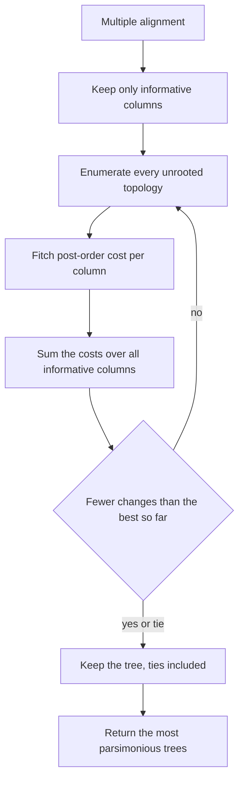

# Maximum Parsimony

## Problem

**Input**: a multiple alignment of homologous sequences — **not** a distance matrix.
**Output**: the topology (or topologies) requiring the **fewest character-state changes**
to explain the data.

The notes' characterisation: *alignment-based*, *considers all possible topologies*,
*results in **multiple unrooted trees***, *no explicit model of evolution*, *considers
character-state changes rather than distances*.

## Idea

Occam's razor applied to columns of an alignment. Every candidate tree implies some
minimum number of substitutions needed to produce the observed leaf states; the best tree
is the one needing the fewest, summed over all alignment columns.

Because it reads the columns directly, parsimony **loses no information to a distance
summary** — but for the same reason it has **no model**, and therefore no correction for
multiple hits.

### Informative positions

Most columns are useless and are discarded first. A position is **informative** when

> **at least 2 different nucleotides occur at least 2 times each.**

- A **constant** column (`AAAA`) costs 0 changes on every topology — no discrimination.
- A **singleton** column (`AAAC`) costs exactly 1 change on every topology — again no
  discrimination.
- A column such as `AACC` costs 1 change on the topology grouping the two `A`s against
  the two `C`s, and 2 on the other two topologies — it **votes**.

Only informative positions can distinguish topologies, so only they are counted.

## Pseudocode

```text
MAXIMUM-PARSIMONY(MSA):
  // ---- 1. keep only the columns that can discriminate ----
  I ← ∅
  for each column c of MSA:
    counts ← how often each nucleotide occurs in c
    if at least 2 nucleotides have count ≥ 2:
      I ← I ∪ {c}                           // informative position

  // ---- 2. score every topology ----
  best ← ∞;  BestTrees ← ∅
  for each unrooted topology T over the taxa:      // (2n-5)! / (2^(n-3) (n-3)!) of them
    score ← 0
    for each column c ∈ I:
      score ← score + FITCH-COST(T, c)
    if score < best:
      best ← score;  BestTrees ← {T}
    else if score = best:
      BestTrees ← BestTrees ∪ {T}           // ties are kept: MULTIPLE trees
  return BestTrees, best

FITCH-COST(T, c):                           // minimum changes for one column
  root T arbitrarily                        // the count does not depend on the rooting
  cost ← 0
  for each node v of T in POSTORDER:
    if v is a leaf:
      S[v] ← { c[v] }                       // the observed nucleotide
    else:
      let x, y be the children of v
      if S[x] ∩ S[y] ≠ ∅:
        S[v] ← S[x] ∩ S[y]
      else:
        S[v] ← S[x] ∪ S[y]
        cost ← cost + 1                     // a change must happen on this branch
  return cost
```

## Worked example

Four taxa, one informative column:

```text
taxon:   1  2  3  4
base:    A  A  C  C
```

The three unrooted topologies over four taxa, and the cost of this column on each:

| Topology | Cost |
|---|---|
| `((1,2),(3,4))` | **1** — one change on the central branch |
| `((1,3),(2,4))` | 2 |
| `((1,4),(2,3))` | 2 |

The column therefore votes for `((1,2),(3,4))`. A full analysis sums such votes over
every informative column; the winning topology is the one with the lowest total.

Verify with Fitch on `((1,2),(3,4))`: `S = {A} ∩ {A} = {A}` for the first internal node
and `{C} ∩ {C} = {C}` for the second, each at cost 0; at the root
`{A} ∩ {C} = ∅`, so `S = {A,C}` and `cost = 1`. ✓

## Diagram



Informative columns are scored by Fitch on every candidate topology and the trees needing the fewest changes are kept.

## Complexity

```text
number of topologies:  (2n − 5)! / ( 2^(n−3) · (n − 3)! )     — super-exponential
cost of one topology:  O(n · |I|)                              with Fitch
exhaustive total:      O( (2n−5)!! · n · |I| )                 — intractable beyond ~10 taxa
```

This is the price of *"considers all possible topologies"*, and the reason
[[upgma]] and [[neighbor-joining]] — both `O(n³)` — dominate in practice. Real
implementations replace the exhaustive loop with branch-and-bound or heuristic topology
search, which the notes do not develop.

## Variants & pitfalls

- **Multiple optimal trees are the normal outcome**, not an anomaly — the notes list it
  as a defining property. They are usually summarised by a consensus tree.
- **No model means no correction for multiple hits**; parsimony systematically
  underestimates change on long branches and is prone to **long-branch attraction** — the
  same failure mode as UPGMA, arrived at from the opposite direction.
- **The trees are unrooted**; a root needs an outgroup.
- **Discarding non-informative columns is valid** for ranking topologies, but means the
  parsimony *score* is not a count of all the evolution that happened.
- The notes also name **maximum likelihood** as a further alignment-based method,
  without developing it — see [[open-questions]].

## Relations

- [[upgma]], [[neighbor-joining]] — the distance-based alternatives; the comparison table
  in [[phylogenetic-tree-reconstruction]] sets them against this method.
- [[phylogenetic-tree]] — the tree-counting formula that makes the search intractable.
- [[sequence-alignment]] — the input is an alignment, used column by column.
- [[evolutionary-distance]] — what parsimony deliberately does *not* compute.
- [[bootstrap-tree-assessment]] — how the chosen topology is evaluated.
- [[algorithmic-complexity]] — a textbook case of a super-exponential search space.
- [[dynamic-programming]] — Fitch's post-order pass is dynamic programming over the tree,
  the same principle as [[needleman-wunsch]] over a matrix.
- [[travelling-salesman-problem]] — the other combinatorial-explosion problem of
  module 2.
- [[maximum-likelihood]] — the further alignment-based method the notes name here; it scores the data under an explicit model, where parsimony counts changes without one.

## Appears in

- [[M2L08-molecular-evolution-and-phylogeny]]
- [[M2E08-phylogenetics]]

## Sources

- `raw/module2/csb_3.pdf`, p. 33 — maximum parsimony as alignment-based, considering all
  topologies, yielding multiple unrooted trees, with no explicit model of evolution,
  working on character-state changes, and the definition of an informative position.
- `raw/module2/csb_3.pdf`, p. 30 — the distance-based versus alignment-based comparison.
