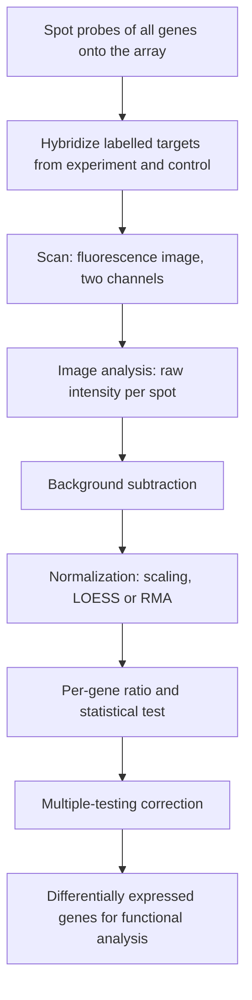

# Microarray Expression Analysis

## Problem

**Input**: RNA from two samples — typically an experimental condition and a control.
**Output**: a quantitative measure of mRNA abundance per gene, and the ratio between the
two conditions — i.e. comparative gene-expression analysis.

## Idea

A **microarray** is a solid substrate onto which probes representing genes are
synthesised or attached. Labelled target molecules derived from the samples are washed
over it; each target hybridises to its complementary probe. The **hybridisation level**
is reported by fluorescence and quantified by **image analysis**. Many array types exist;
they share this principle and differ in operational detail.

In **cDNA (two-colour) technology**, the experimental and the control sample are labelled
with different dyes, overlaid on the same array, and compete for every spotted probe.
Three outcomes per spot:

1. the gene is expressed only in the **control**,
2. the gene is expressed only in the **experiment**,
3. it is expressed in **both** — and the readout is the **ratio** of expression.

## Pseudocode

```text
MICROARRAY-EXPERIMENT(sample_exp, sample_ctrl, array):
  // wet lab
  clones ← DNA-CLONES(genes)
  probes ← PCR-AMPLIFY(clones)
  array  ← SPOT(probes)                      // probes attached to the substrate
  t_e ← PREPARE-AND-LABEL(sample_exp,  dye1)
  t_c ← PREPARE-AND-LABEL(sample_ctrl, dye2)
  HYBRIDIZE(array, t_e ∪ t_c)
  img ← SCAN(array)                          // fluorescence image, two channels
  return IMAGE-ANALYSIS(img)                 // raw intensity per spot per channel

ANALYSE-EXPRESSION(raw, design):
  // (1) pre-processing
  x ← BACKGROUND-SUBTRACTION(raw)
  x ← NORMALIZE(x)                           // scaling, LOESS or RMA
  x ← COLLAPSE-AND-IMPUTE(x)                 // merge replicate probes, fill missing

  // (2) per-gene comparison
  for each gene g:
    ratio[g] ← x[g, experiment] / x[g, control]
    p[g]     ← STATISTICAL-TEST(x[g, ·], design)
  q ← MULTIPLE-TESTING-CORRECTION(p)

  // (3) interpretation
  DE ← { g : q[g] < alpha and |log2 ratio[g]| > threshold }
  return BIOLOGICAL-INTERPRETATION(FUNCTIONAL-ANALYSIS(DE))

NORMALIZE(x):
  // assumption: no global changes in gene expression between samples
  // scaling: divide each array by a per-array factor so medians agree
  // LOESS:   fit intensity-dependent bias and subtract it
  // RMA:     background-correct, quantile-normalise, median-polish summarise
  return adjusted x
```

## Worked example

A tumour sample (dye 1) and matched healthy tissue (dye 2) are co-hybridised. Before
normalisation the tumour channel is globally brighter because more RNA was loaded, and
almost every gene appears upregulated. After scaling so that the two channels have the
same median intensity, only a few hundred genes retain a `|log₂ ratio| > 1`; those are
the candidate differentially expressed genes that go into functional analysis.

## Complexity

- The analysis is linear in the number of spots for pre-processing and per-gene testing:
  `O(#genes · #arrays)`.
- LOESS fitting is the expensive step, being a local regression over all spots of an
  array.

## Variants & pitfalls

- **Why normalise**: to adjust the intensities from each array so that meaningful
  biological comparisons can be made. The confounders named in the notes are unequal
  quantities of starting RNA; differences in labelling and hybridisation efficiency;
  differences in detection efficiency between the fluorescent dyes; and systematic bias.
- **Without normalisation, many genes will appear to be upregulated when in reality they
  are not.**
- The normalisation **assumption** — no global change in expression between samples — is
  violated when a treatment really does shift the whole transcriptome; then
  spike-in controls are needed.
- Arrays can only measure genes whose probes are on the array; novel transcripts are
  invisible. [[rna-seq]] removes that limitation.
- Cross-hybridisation between similar sequences blurs paralogous genes.

## Diagram


The two-colour microarray pipeline from spotted probes to a list of differentially expressed genes.

## Relations

- [[rna-seq]] — the sequencing-based successor measuring counts instead of intensities.
- [[statistical-testing]] — the `STATISTICAL-TEST` and `alpha` steps above: null and
  alternative hypothesis, p-value, significance level and the two error types.
- [[descriptive-statistics]] — the summaries each gene's replicate values are reduced to.
- [[gene-regulation]] — expression differences are the phenotype of regulation.
- [[central-dogma]] — the method measures the mRNA station.
- [[genome-organization]] — probe design depends on exon structure.
- [[data-normalization]] — what the normalisation stage of this pipeline actually does:
  log transform and standardization.
- [[batch-effect]] — arrays processed on different days carry a bias that normalisation
  does **not** remove.
- [[principal-component-analysis]] — the quality-control view of the sample matrix.
- [[multiple-testing-correction]] — one test per gene means thousands of tests, so
  Bonferroni or Benjamini–Hochberg is required.
- [[probability-distribution]] — expression values are modelled as approximately normal,
  which is the assumption the per-gene test rests on.
- [[z-score]] — standardization of the intensities is what the normalisation stage of
  this pipeline produces.
- [[gene-set]] — the unit the expression values are aggregated into once the array has
  been analysed.
- [[gene-knockout]] — the perturbation whose effect this assay reads out.
- [[fishers-exact-test]] — the threshold-based test applied to the significant genes.
- [[gene-set-enrichment-analysis]] — the whole-distribution alternative applied to the
  ranked list.
- [[bicon]] — consumes exactly such an expression matrix, together with an [[interaction-network]].
- [[single-cell-analysis-workflow]] — the same preprocessing logic (QC, normalization, batch correction) one resolution further down.
- [[rna-interference]] — large RNAi screens produce the same plate-wise, batch-prone data that microarray pipelines were built for.

## What happens next: enrichment

Module 2 picks the pipeline up exactly where this page stops. The **gene expression
table** produced here is the input to an **enrichment test**, which — fed with a priori
knowledge from **gene-set databases** — produces an **enrichment table** that is then
read for interpretation and hypothesis generation. The experimental design chosen at the
top of this pipeline determines the enrichment route: a **two-class** design yields a
ranked list via a t-test, a **time-course** design yields gene clusters, and other
designs (e.g. a linear model) yield a set of significant genes. See
[[enrichment-analysis]], [[fishers-exact-test]] and [[gene-set-enrichment-analysis]].

## Appears in

- [[L02-gene-expression-and-regulation]]
- [[L06-expression-profiling]]
- [[L10-biostatistics-and-statistical-testing]]
- [[L11-normalization-pca-and-batch-effects]]
- [[E01-cell-biology-and-gene-expression]]
- [[M2L01-enrichment-analysis]]
- [[M2L05-network-based-disease-modules]]
- [[M2L04-clustering]] — its expression matrix is the input to module-2 clustering.

## Sources

- `raw/module1/gsb_part1.pdf`, pp. 4, 24–25.
- `raw/module1/gsb_part2.pdf`, pp. 25–29 — the statistical testing vocabulary behind the
  testing stage of this pipeline.
- `raw/module1/gsb_3.pdf`, pp. 1, 3–4, 29–30 — normalization, PCA-based quality control,
  batch effects and multiple-testing correction.
- `raw/module2/csb_1.pdf`, pp. 1, 3–4 — the microarray experiment as the entry point of
  the enrichment workflow and the three experimental designs.

- `raw/module2/csb_4.pdf`, p. 3 — quality control, normalization and batch correction of genome-wide screens.
