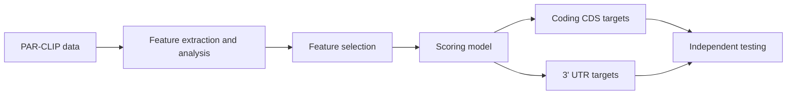

# miRNA target prediction

## Problem

**Input**: a [[microrna|miRNA]] sequence (or a whole miRNA catalogue such as miRBase),
the transcript sequences of a genome, and — in the better methods — expression data and
experimental binding data.
**Output**: a ranked list of **target genes**, i.e. transcripts carrying a functional
binding site for that miRNA.

The question is posed in the notes as: *miRNAs are increasingly recognised as biomarkers
and therapeutic targets — **how do we identify target genes?*** The answer:
**computational prediction is needed**, e.g. **miRanda**.

## Idea

A miRNA recognises its target through a short **seed** match in the 3′ UTR. A match that
short occurs by chance in almost every transcript, so sequence alone is not enough.
Four features are combined:

1. **miRNA seed pairing** — the core match.
2. **Conservation of miRNA binding sites** — a site preserved across species is more
   likely functional ([[homology]]).
3. **Hybridization energy** — the thermodynamic stability of the miRNA–mRNA duplex.
4. **Accessibility of binding sites** — a site buried in RNA secondary structure cannot
   be bound.

### The specificity/sensitivity trade-off

The notes tabulate the two sources of evidence:

| Method | Specificity | Sensitivity |
|---|---|---|
| **CLIP-Seq** (experimental) | **good** | **bad** |
| **Computational prediction** | **bad** → many false positives | **good** |

Neither is usable alone: the experiment misses real sites, the prediction invents fake
ones. The resolution is to **use the examples found in experimental data in machine
learning to learn patterns of "good" binding sites**, and thereby **allow for better
prediction of binding sites not seen in experiments**. A second benefit: it **allows for
binding sites also in the coding region of a gene**, not just the 3′ UTR.

### Tissue specificity

**miRNAs are short**, so sequence-based prediction has a **high false-positive rate**.
The main biological reason is that **the miRNA and the target gene may not be expressed
at the same time in the same place**. **Tissue-specific expression data can therefore be
used to remove false positives** — a filter that reappears as step 1 of [[sponge]].

## Pseudocode

```text
PREDICT-TARGETS(miRNA, transcripts, expression, θ):
  candidates ← ∅
  for each transcript T in transcripts:
    for each position p in 3'UTR(T) and CDS(T):
      if SEED-MATCH(miRNA, T, p):
        c  ← CONSERVATION(T, p)                 // cross-species alignment
        e  ← HYBRIDIZATION-ENERGY(miRNA, T, p)  // free energy of the duplex
        a  ← ACCESSIBILITY(T, p)                // openness of local RNA structure
        s  ← SEED-SCORE(miRNA, T, p)
        candidates ← candidates ∪ { (T, p, feature-vector(s, c, e, a)) }

  // Tissue-specific filter: both partners must actually co-occur
  for each (T, p, x) in candidates:
    if not CO-EXPRESSED(miRNA, T, expression):
      candidates ← candidates \ { (T, p, x) }   // removes false positives

  for each (T, p, x) in candidates:
    score[T,p] ← MODEL(x)                       // learned, see below
  return { (T,p) : score[T,p] ≥ θ } sorted by score descending

LEARN-BINDING-MODEL(PAR_CLIP_data):
  // The pipeline of p. 5
  F      ← FEATURE-EXTRACTION-AND-ANALYSIS(PAR_CLIP_data)
  F'     ← FEATURE-SELECTION(F)                 // keep the informative features
  MODEL  ← TRAIN-SCORING-MODEL(F')              // separates CDS and 3'UTR targets
  report ← INDEPENDENT-TEST(MODEL)              // held-out evaluation
  return MODEL
```

`LEARN-BINDING-MODEL` is an instance of supervised [[machine-learning]]; the held-out
evaluation is the [[cross-validation]]/test-split discipline of
[[M2L03-machine-learning-and-classification]], and the quality of the resulting scorer is
read off a [[roc-curve]].

## Worked example

A miRNA with seed `ACCUUGA` has, by chance alone, a complementary 7-mer roughly once
every `4⁷ ≈ 16 000` nucleotides. A human 3′ UTR set of ~`3 × 10⁷` nucleotides therefore
contains about **2 000 chance matches** with no biological meaning whatsoever. Requiring
conservation across mammals might cut this by an order of magnitude; requiring
co-expression in the tissue under study cuts it again. This is the same arithmetic that
forces a threshold on a [[position-weight-matrix]] scan, and the same conclusion: a short
degenerate pattern is not evidence by itself.

## Complexity

- Seed scanning is a [[string-matching]] problem over all transcripts: `O(Σ|T|)` per
  miRNA with an indexed text ([[suffix-array]]), `O(m · Σ|T|)` naively for `m` miRNAs.
- Hybridization energy and accessibility require RNA folding over a local window, which
  is cubic in the window length — hence the window is kept small.
- The learned model is evaluated once per surviving candidate, so it is negligible.

## Variants & pitfalls

- **False positives dominate.** The whole method is organised around suppressing them.
- **CLIP-Seq has poor sensitivity**: an absent peak is not evidence of an absent site, so
  experimental data must not be used as a complete negative set when training.
- **Seed-only predictions ignore the coding region**; the ML route recovers those sites.
- **miRNA families** share a seed ([[microrna]]), so a prediction can rarely distinguish
  family members.
- The final pipeline stage on p. 5 is partly illegible in the scan; see
  [[open-questions]].

## Diagram


The machine-learning pipeline of p. 5, which learns from experimental binding data what a good site looks like.

## Relations

- [[microrna]] — the molecule whose targets are predicted, and the source of the four
  features.
- [[competing-endogenous-rna]] — predicted binding sites are the miRNA response elements
  that create the competition.
- [[sponge]] — consumes a target annotation (e.g. TargetScan) produced this way.
- [[machine-learning]] — the learned scoring model; feature selection, training, testing.
- [[roc-curve]] — how specificity and sensitivity are traded off formally.
- [[position-weight-matrix]] — the same degeneracy problem for transcription-factor
  sites.
- [[transcription-factor-binding-site]] — the transcriptional analogue.
- [[homology]] — cross-species conservation as the second feature.
- [[chip-seq]] — CLIP-Seq is its RNA-binding counterpart: immunoprecipitate, sequence,
  call peaks.
- [[rna-seq]] — supplies the tissue-specific expression used as a filter.
- [[rna-interference]] — the process whose specificity this prediction problem tries to reconstruct computationally.
- [[small-interfering-rna]] — needs no prediction at all, because its complementarity is perfect.

## Appears in

- [[M2L09-non-coding-rnas]]
- [[M2E09-non-coding-rnas-and-sponge]]

## Sources

- `raw/module2/csb_4.pdf`, p. 4 — miRNA in disease, miRanda, the four features, tissue
  specificity and the false-positive problem.
- `raw/module2/csb_4.pdf`, p. 5 — the CLIP-Seq versus computational-prediction table and
  the PAR-CLIP machine-learning pipeline.
- `raw/module2/csb_4.pdf`, p. 10 — target prediction suffers from false positives
  (exercise).
