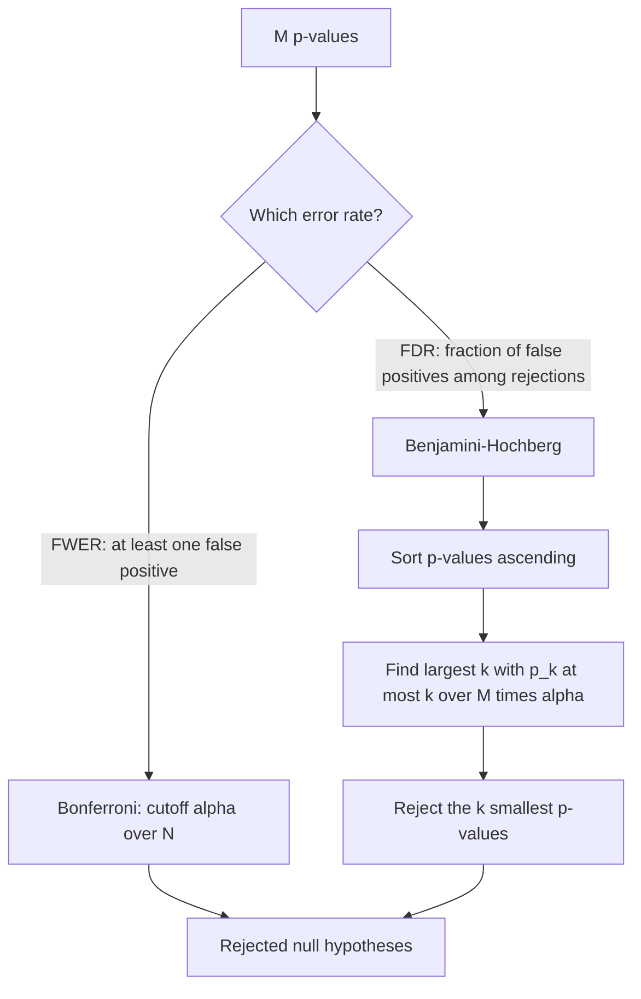

# Multiple Testing Correction

## Problem

**Input:** `M` p-values from `M` simultaneous hypothesis tests and a target error rate
`α`.
**Output:** the subset of null hypotheses that may be rejected while keeping a stated
error rate under control.

The reason this is needed: **under the null hypothesis p-values are uniformly
distributed**. With the usual cutoff `α = 0.05`, `P(FP) = α`, so performing many tests
means a fraction `α` of them will have a positive result **by chance**. Testing 20,000
genes ([[rna-seq]], [[microarray-expression-analysis]]) or a million SNPs
([[genome-wide-association-study]]) at `α = 0.05` produces 1,000 and 50,000 false
positives respectively, even when nothing at all is going on.

## Idea

Two different error rates can be controlled.

- **FWER — family-wise error rate**: the probability of **at least one** false positive
  among all tests. Very strict.
- **FDR — false discovery rate**: the **fraction of false positives among the rejected
  null hypotheses**. Less strict, and the right notion when the output is a candidate
  list for follow-up.

The outcome of `M` tests is summarised by:

| | called not significant | called significant | total |
|---|---|---|---|
| **H₀ true** | `U` | `V` | `M₀` |
| **H₀ false** | `T` | `S` | `M₁` |
| **total** | `M − R` | `R` | `M` |

What one wants to find is the `H₀`-false row. The false discovery rate is the expected
ratio of false hypotheses among those called significant:

```text
FDR = E( V / R )
```

**Bonferroni correction** controls the FWER by tightening the cutoff:

```text
N  = number of hypothesis tests
α  = level at which the FWER is to be controlled
p_i = p-value of the i-th test
reject H0_i  ⟺  p_i ≤ α / N
```

**Benjamini–Hochberg** controls the FDR, using the bound
`FDR ≤ (M₀/M) · α ≤ α`.

## Pseudocode

```text
BONFERRONI(p[1..N], α):
  cutoff ← α / N                      // same stricter cutoff for all tests
  return { i : p[i] ≤ cutoff }

BENJAMINI-HOCHBERG(p[1..M], α):
  SORT p ascending so that p[1] ≤ p[2] ≤ … ≤ p[M]      // (I)
  k ← max { j : p[j] ≤ (j / M) · α }                    // (II) largest index below its own line
  if no such j: return ∅
  return { 1, …, k }                                    // (III) reject the k smallest p-values
```

Step III is what distinguishes BH from a naive per-test comparison: **all** tests with a
p-value below `p[k]` are rejected, including any that individually fail their own
`(j/M)·α` bound.

## Worked example

`α = 0.05`, `M = 10` tests, p-values sorted ascending:

| k | p_k | (k/M)·α | p_k ≤ (k/M)·α ? |
|---|---|---|---|
| 1 | 0.001 | 0.005 | yes |
| 2 | 0.009 | 0.010 | yes |
| 3 | 0.012 | 0.015 | yes |
| 4 | 0.018 | 0.020 | yes |
| 5 | 0.025 | 0.025 | yes |
| 6 | 0.040 | 0.030 | no |
| 7 | 0.070 | 0.035 | no |
| 8 | 0.120 | 0.040 | no |
| 9 | 0.260 | 0.045 | no |
| 10 | 0.350 | 0.050 | no |

The largest `k` with `p_k ≤ (k/M)·α` is **`k = 5`**, so the null hypotheses of the **five
smallest p-values** are rejected; those are the significant results.

For comparison, Bonferroni would use the single cutoff `0.05/10 = 0.005` and reject only
**one** test (`p = 0.001`) — the stringency difference in one line.


Two corrections for the same problem, differing in which error rate they promise to control.

## Complexity

Bonferroni is `O(N)`; Benjamini–Hochberg is `O(M log M)`, dominated by the sort
([[algorithmic-complexity]]).

## Variants & pitfalls

- **Bonferroni loses power**: with many hypotheses tested the cutoff becomes so small
  that true effects are missed — the type II error explodes while the type I error is
  held down ([[statistical-testing]]).
- **BH offers a good trade-off between stringency and power** and is the default for
  large numbers of tests.
- BH assumes the tests are independent or positively dependent; strongly correlated
  tests — e.g. SNPs in linkage — make the bound conservative.
- Reporting raw p-values from a genome-wide scan without stating the correction is
  meaningless.

## Relations

- [[statistical-testing]] — supplies p-values, `α` and the two error types this page
  rescales.
- [[genome-wide-association-study]] — up to `10⁶` simultaneous tests; the canonical
  application.
- [[expression-qtl]] — one scan per gene multiplies the testing burden further.
- [[microarray-expression-analysis]], [[rna-seq]] — one test per gene over the whole
  transcriptome.
- [[position-weight-matrix]] — a genome-wide motif scan faces the same multiplicity when
  choosing its score threshold.

- [[peak-calling]] — a genome-wide ChIP-Seq scan is millions of Poisson tests, so MACS2
  adds an explicit FDR estimation step.
- [[epigenome-wide-association-study]] — hundreds of thousands of methylation sites
  tested at once.
- [[probability-distribution]] — under the null hypothesis p-values are uniformly
  distributed, which is exactly why many tests produce chance hits.
- [[snp]] — a chip of up to a million SNPs is the canonical source of the multiplicity.
- [[bisulfite-sequencing]] — its millions of per-cytosine p-values need FDR control
  before the DMR scan applies its `p ≤ α` rule.
- [[gene-set-enrichment-analysis]] — step 4 of GSEA is an FDR calculation over all gene
  sets tested. The notes state the distinction crisply: *the p-value depends only on the
  single gene set's performance; the FDR depends on the performance of all gene sets.*
- [[enrichment-analysis]] — thousands of GO terms are tested at once, so correction is
  not optional.
- [[fishers-exact-test]] — the per-set p-value that then needs correcting.
- [[overfitting]] — the same disease in another guise: a result selected out of many looks better than it is, and must be discounted for the selection.
- [[single-cell-analysis-workflow]] — differential expression over thousands of genes and many clusters makes correction unavoidable.
- [[bootstrap-tree-assessment]] — branch support values are read with the same caution as uncorrected p-values.
- [[rna-interference]] — a genome-wide screen tests every gene, so its statistical analysis needs correction.
- [[sponge]] — tests millions of gene pairs, which is precisely why its null model must be precomputed and reusable.

## Appears in

- [[L06-expression-profiling]]
- [[L10-biostatistics-and-statistical-testing]]
- [[L15-gwas-eqtl-and-multiple-testing]]
- [[E11-population-genetics-and-multiple-testing]]
- [[M2L01-enrichment-analysis]]

## Sources

- `raw/module1/gsb_3.pdf`, pp. 29–30, 34.
- `raw/module1/gsb_part4.pdf`, p. 6 — FDR estimation as step IV of MACS2; p. 9 — the
  epigenome-wide testing burden.
- `raw/module2/csb_1.pdf`, pp. 6–7 — FDR as the fourth step of GSEA and its contrast
  with the per-set p-value.

- `raw/module2/csb_4.pdf`, pp. 3, 8–9 — statistical analysis of genome-wide screens and of genome-wide ceRNA inference.
