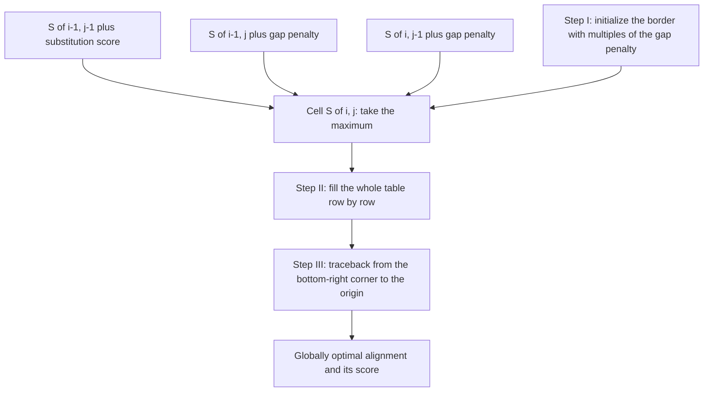

# Needleman–Wunsch

## Problem

**Input**: two sequences `X = x₁…x_m` and `Y = y₁…y_n`, a substitution score `r(a, b)`
and a gap penalty `g` (negative).
**Output**: the **globally optimal** alignment — the end-to-end alignment of the two
complete sequences with the maximum possible score — together with that score.

## Idea

The optimal alignment of two prefixes can end in only three ways: `x_i` aligned with
`y_j`, `x_i` aligned with a gap, or a gap aligned with `y_j`. Each case reuses the
optimal alignment of a shorter prefix pair, so the **overlapping subproblems** property
(Bellman's principle) holds and **dynamic programming** applies: fill a table of optimal
prefix alignments, then read the answer off the corner.

```text
S(i, j) = max { S(i-1, j-1) + r(x_i, y_j)   // substitution
                S(i-1, j)   + g             // x_i aligned to a gap
                S(i,   j-1) + g }           // gap aligned to y_j
```

The notes split the procedure into three steps: **I Initialization**, **II Score
calculation**, **III Traceback**.

## Pseudocode

```text
NEEDLEMAN-WUNSCH(X, Y, r, g):
  m ← LENGTH(X); n ← LENGTH(Y)

  // Step I: initialization — border gaps are charged linearly
  S[0,0] ← 0
  B[0,0] ← "done"
  for i ← 1 to m:
    S[i,0] ← i * g
    B[i,0] ← "up"                       // consume a character of X
  for j ← 1 to n:
    S[0,j] ← j * g
    B[0,j] ← "left"                     // consume a character of Y

  // Step II: score calculation
  for i ← 1 to m:
    for j ← 1 to n:
      diag ← S[i-1, j-1] + r(X[i], Y[j])
      up   ← S[i-1, j]   + g
      left ← S[i,   j-1] + g
      S[i,j] ← MAX(diag, up, left)
      B[i,j] ← ARGMAX(diag, up, left)   // "diag", "up" or "left"

  // Step III: traceback from the bottom-right corner to the origin
  i ← m; j ← n
  alnX ← ""; alnY ← ""
  while B[i,j] ≠ "done":
    if B[i,j] = "diag":
      alnX ← X[i] + alnX; alnY ← Y[j] + alnY; i ← i - 1; j ← j - 1
    else if B[i,j] = "up":
      alnX ← X[i] + alnX; alnY ← "-"  + alnY; i ← i - 1
    else:
      alnX ← "-"  + alnX; alnY ← Y[j] + alnY; j ← j - 1

  return (S[m,n], alnX, alnY)
```

## Worked example

`X = ACGT`, `Y = AGT`, match `+1`, mismatch `−1`, `g = −2`.

| | – | A | G | T |
|---|---|---|---|---|
| **–** | 0 | −2 | −4 | −6 |
| **A** | −2 | **1** | −1 | −3 |
| **C** | −4 | −1 | 0 | −2 |
| **G** | −6 | −3 | **0** | −1 |
| **T** | −8 | −5 | −2 | **1** |

Traceback from `S[4,3] = 1`:

```text
A C G T
A - G T
```

The `C` is an insertion in `X`. A protein-sequence example with three consecutive gaps is
worked through in [[E07-alignment-and-homology]].

## Complexity

- Time `O(m · n)` — one constant-time maximum per cell.
- Space `O(m · n)` for the score and traceback matrices; `O(min(m, n))` if only the score
  is wanted (Hirschberg's trick recovers the alignment in linear space, not covered in
  the notes).
- Exhaustive enumeration of all alignments would be exponential; this is the standard
  demonstration of dynamic programming in the course
  (see [[algorithmic-complexity]]).

## Variants & pitfalls

- **[[smith-waterman]]** is the same recursion with two changes — zero initialisation and
  a `0` in the maximum — and gives the optimal **local** alignment.
- **Semi-global** and **free-end-gaps** alignments are obtained by *not* charging the
  border gaps, i.e. initialising the first row and/or column with zeros but still tracing
  back from an edge rather than from the global maximum.
- The result depends entirely on the [[substitution-matrix]] and gap scheme chosen; a
  different matrix can produce a different optimal alignment.
- The optimal alignment need not be **unique**: ties in the maximum give several
  equally scoring tracebacks.
- Global alignment is the wrong tool for sequences that share only a domain — the forced
  end-to-end alignment drowns the real signal.

## Diagram


Three incoming options per cell, and the three steps of the procedure: initialize, fill, trace back.

## Relations

- [[sequence-alignment]] — the general framework and the alignment types.
- [[dynamic-programming]] — the design pattern this algorithm is the course's standard
  example of.
- [[forward-algorithm]] — the same table filling with probabilities summed over
  predecessor states instead of scores maximised over three neighbours.
- [[smith-waterman]] — the local counterpart.
- [[substitution-matrix]] — supplies `r` and `g`.
- [[homology]] — what a high-scoring alignment is evidence for.
- [[blast]] — the heuristic used when the database is too large for this.
- [[algorithmic-complexity]] — dynamic programming and the `O(m · n)` bound.
- [[viterbi-algorithm]] — the same fill-and-traceback dynamic program, with probabilities
  instead of similarity scores and a max over state predecessors instead of over three
  matrix neighbours.
- [[evolutionary-distance]] — the alignment it produces is what `p = D/L` is counted over in [[M2L08-molecular-evolution-and-phylogeny]].
- [[maximum-parsimony]] — dynamic programming over a tree instead of a matrix.
- [[backpropagation]] — the same reuse-of-subresults principle in a different setting.
- [[network-alignment]] — the same idea one level up: a global, one-to-one correspondence, but between graphs instead of strings, and without a dynamic-programming solution.

## Appears in

- [[L05-sequence-comparison-and-networks]]
- [[L07-algorithms-and-complexity]]
- [[L09-sequence-alignment-and-homology]]
- [[E07-alignment-and-homology]]

## Sources

- `raw/module1/gsb_part2.pdf`, pp. 13–14, 18.
- `raw/module1/gsb_part4.pdf`, p. 17 — the Viterbi recursion and backtrack, the
  probabilistic analogue of this algorithm.

- `raw/module2/csb_4.pdf`, p. 11 — global network alignment as the graph analogue of global sequence alignment.
