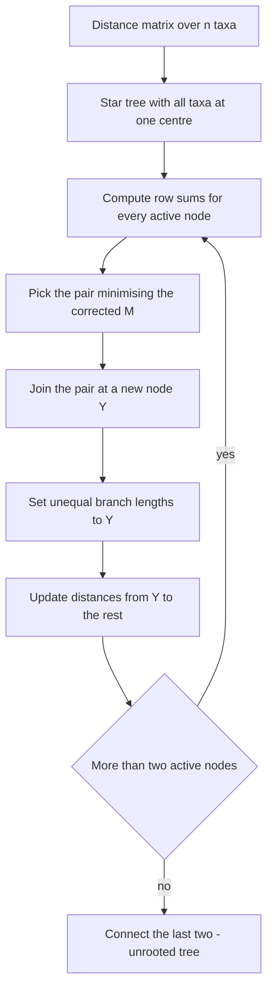

# Neighbor-Joining

## Problem

**Input**: a matrix `D` of pairwise [[evolutionary-distance|evolutionary distances]] over
`n` taxa.
**Output**: an **unrooted additive** [[phylogenetic-tree]] with branch lengths.

The notes' characterisation: *distance-based*, *does **not** assume a
[[molecular-clock]]*, *minimum evolution*, *results in an unrooted additive tree*.

## Idea

Start from a **star-shaped tree** — every taxon hanging off one central node — and
repeatedly pull out the pair that most deserves its own internal node.

The key move is that the pair chosen is **not** simply the closest pair. Choosing the
closest pair is what UPGMA does, and it is what goes wrong when rates differ. NJ instead
corrects each distance by how far the two taxa are from *everything else*:

```text
M_ij  =  (n − 2) · d_ij  −  Σ_{k ≠ i} d_ik  −  Σ_{k ≠ j} d_jk
```

and joins the pair minimising `M_ij`. A taxon that is far from all others has a large
row sum, which is subtracted off — so a long-branch taxon is no longer attractive merely
for being far away.

This is the **minimum-evolution** criterion: at each step, choose the join that minimises
the total branch length of the resulting tree.

### Branch lengths and the update

When `i` and `j` are joined into a new node `Y`:

```text
b_iY  =  ½ · d_ij  +  ( 1 / (2(n − 2)) ) · ( Σ_{k≠i} d_ik  −  Σ_{k≠j} d_jk )
b_jY  =  d_ij  −  b_iY
```

The two branch lengths are deliberately **unequal** — this is exactly where NJ differs
from UPGMA's `d_ij/2` on both sides, and it is why the result is additive rather than
ultrametric.

Distances from the new node to the rest:

```text
d_YK  =  ½ · ( d_iK  +  d_jK  −  d_ij )
```

## Pseudocode

```text
NEIGHBOR-JOINING(D, taxa):
  T ← a star tree: every taxon attached to one central node
  L ← taxa                                   // the set of active nodes
  n ← |L|

  while n > 2:
    for each i ∈ L:  R_i ← Σ_{k ∈ L, k ≠ i} d(i, k)      // row sums

    // choose the pair, corrected for distance to everything else
    (i, j) ← argmin_{i ≠ j ∈ L}  ( (n − 2) · d(i,j) − R_i − R_j )

    create node Y in T, joined to i and to j
    b(i, Y) ← 0.5 · d(i,j) + ( R_i − R_j ) / ( 2·(n − 2) )
    b(j, Y) ← d(i,j) − b(i, Y)               // NOT equal to b(i,Y)

    for each K ∈ L \ {i, j}:
      d(Y, K) ← 0.5 · ( d(i,K) + d(j,K) − d(i,j) )

    L ← ( L \ {i, j} ) ∪ {Y}
    n ← n − 1

  // two nodes left: connect them directly
  let L = {u, v};  b(u, v) ← d(u, v)
  return T                                    // UNROOTED: root with an outgroup
```

## Worked example

The notes give the star-decomposition picture rather than a numeric trace: five taxa
`1…5` all attached to one centre, then taxa `1` and `2` pulled onto a new internal node
`Y` with the rest still radiating from the centre.

The essential check is the one `d_YK = ½(d_iK + d_jK − d_ij)` encodes. If the distances
really are **additive** — i.e. `d_ab` equals the sum of branch lengths on the path from
`a` to `b` — then that formula recovers the true distance from the internal node to `K`
exactly, because the shared segment `d_ij` is counted once in each of `d_iK` and `d_jK`
and must be removed once. NJ is therefore **exact** on additive input, which is a
strictly weaker requirement than the ultrametricity [[upgma]] needs. The UPGMA worked
example in [[M2E08-phylogenetics]] shows the ultrametric case in full numbers.

## Diagram



Starting from a star tree, the pair with the smallest corrected criterion is repeatedly joined and the distance matrix shrunk until two nodes remain.

## Complexity

```text
iterations:          n − 2
cost per iteration:  O(n²) to build M and find its minimum
total:               O(n³) time,  O(n²) space
```

Same class as [[upgma]], and polynomial for the same reason: one greedy pass, no search
over the `(2n−5)!/(2^(n−3)(n−3)!)` topologies.

## Variants & pitfalls

- **The tree is unrooted.** A root must be added afterwards, normally with an
  **outgroup** — see [[bootstrap-tree-assessment]].
- **`M_ij`, not `d_ij`.** Using the raw minimum turns NJ back into UPGMA and reintroduces
  long-branch attraction. This is the single most common mistake.
- **Negative branch lengths** can appear when the input is not additive; they are
  usually set to zero, which signals that the distance estimates are noisy.
- **Still greedy**: like UPGMA, an early join is never revisited.
- **Garbage in, garbage out**: NJ is only as good as the substitution model that produced
  `D` ([[jukes-cantor-model]], [[kimura-two-parameter-model]]).
- The notes also name **minimal evolution** and **maximum likelihood** as further
  distance-based methods, but do not develop them — recorded in [[open-questions]].

## Relations

- [[upgma]] — the clock-assuming counterpart; compare `d_ij/2` against `b_iY ≠ b_jY`.
- [[maximum-parsimony]] — the alignment-based alternative.
- [[molecular-clock]] — the assumption NJ drops.
- [[phylogenetic-tree]] — unrooted additive trees and their `2n−3` branches.
- [[evolutionary-distance]] — the input matrix.
- [[bootstrap-tree-assessment]] — rooting with an outgroup and assessing the result.
- [[phylogenetic-tree-reconstruction]] — step 3, "method".
- [[cluster-analysis]] — NJ is agglomerative clustering with a corrected linkage
  criterion.
- [[travelling-salesman-problem]], [[ant-colony-optimization]] — module 2's other
  response to an intractable combinatorial search: a heuristic with a cheap local
  criterion.
- [[algorithmic-complexity]] — its O(n³) running time is an instance of the complexity classes catalogued there.
- [[maximum-likelihood]] — named by the notes as a further distance-based method alongside minimal evolution.

## Appears in

- [[M2L08-molecular-evolution-and-phylogeny]]
- [[M2E08-phylogenetics]]

## Sources

- `raw/module2/csb_3.pdf`, p. 32 — Neighbor-Joining as distance-based with no clock
  assumption, the star-shaped start, `M_ij = (n−2)d_ij − Σd_ik − Σd_jk`, the branch
  length formulas for `b_iY` and `b_jY`, the update `d_YK = ½(d_iK + d_jK − d_ij)`,
  minimum evolution and the unrooted additive result.
- `raw/module2/csb_3.pdf`, p. 30 — distance-based versus alignment-based methods, with
  minimal evolution and maximum likelihood named.
