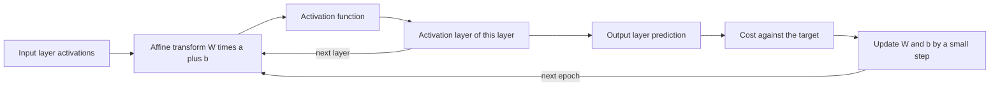

# Neural Network

## Problem

**Input**: a feature vector `x ∈ ℝ^n` (the activations of the input layer) and a set of
learned **weights** `W^(l)` and **biases** `b^(l)` for every layer `l`.
**Output**: the activations of the last layer, read as the network's prediction — "how
much the system thinks the output is".

The network is the model fitted in [[deep-learning]]; the pieces that *learn* `W` and
`b` are [[cost-function]], [[gradient-descent]] and [[backpropagation]].

## Idea

The standard structure is the **multilayer perceptron**: layers of **neurons**, each
neuron holding a number in `[0,1]` called its **activation**. Every neuron in one layer
is connected to every neuron in the next by a weight; **one layer activates the next
layer until the last**.

The intuition the notes give:

> In theory the input is broken down into minimal subproblems, then each next layer
> represents a combined subproblem, until the output can be predicted.

A single neuron computes a weighted sum of the previous layer plus a **bias**, then
squashes it with an [[activation-function]]:

```text
w₁a₁ + w₂a₂ + … + w_n a_n  ≥  x       // the bias decides where "≥ x" sits
σ(x) = 1 / (1 + e^(−x))               // sigmoid; "we are only ≥ 0"
```

In matrix form, for layer `l`:

```text
z^(l) = W^(l) · a^(l−1) + b^(l)
a^(l) = g^(l)( z^(l) )
```

written out, with `g = σ`:

```text
       ⎛ w_{0,0} … w_{0,n} ⎞ ⎛ a₀ ⎞   ⎛ b₀ ⎞
a¹ = σ ⎜   ⋮         ⋮      ⎟ ⎜ ⋮  ⎟ + ⎜ ⋮  ⎟     i.e.  a¹ = σ(W a⁰ + b)
       ⎝ w_{k,0} … w_{k,n} ⎠ ⎝ a_n ⎠   ⎝ b_k ⎠
```

`a^(l)` is called the **activation layer**.

## Pseudocode

The forward pass:

```text
FORWARD-PASS(x, W, b, g, L):
  a[0] ← x                                  // input layer activations
  for l ← 1 to L:
    z[l] ← W[l] · a[l-1] + b[l]             // affine transform
    a[l] ← g[l]( z[l] )                     // activation function, e.g. sigmoid
  return a[L]                               // the prediction
```

Training the whole network, as the notes set it out:

```text
TRAIN-NETWORK(TrainingData, L, g, η, epochs):
  initialise all weights W and biases b RANDOMLY          // step 1 of the notes
  for e ← 1 to epochs:
    for each mini-batch B ⊆ TrainingData:
      C ← 0
      for each (x, y) ∈ B:
        ŷ ← FORWARD-PASS(x, W, b, g, L)
        C ← C + COST(ŷ, y)                                // e.g. Σ (out_i − real_i)²
      C ← C / |B|                                         // average cost of the batch
      ∇C ← BACKPROPAGATION(B, W, b, g, L)
      W ← W − η · ∇_W C                                   // small step downhill
      b ← b − η · ∇_b C                                   // η = learning rate
  return W, b
```

> `C(w)`: we want the global input with the **minimal costs**, i.e. `dC/dw (w) = 0`.
> A **local minimum is okay; the global minimum is hard**.

## Worked example

**Counting the parameters of a fully connected network** — 3 inputs, 2 hidden layers of
4 neurons each, 4 outputs.

**Weights** — one per connection, so sum the products of adjacent layer sizes:

```text
#weights = Σ_l |nodes_l| · |nodes_{l+1}|
         = 3·4 + 4·4 + 4·4
         = 12 + 16 + 16
         = 44
```

**Biases** — one per neuron that is not an input neuron:

```text
#biases = Σ hidden nodes + output nodes
        = 4 + 4 + 4
        = 12
```

Shapes along the way: `W a + b = z ∈ ℝ^n`, and for every layer
`∀ l ∈ [1,L] : z^(l) = W^(l) a^(l−1) + b^(l)`, `a^(l) = g^(l)(z^(l))`.

> The notes write the same three products but total them as **48**; the stated products
> sum to **44**. See [[open-questions]].

## Diagram



One layer activates the next by an affine transform followed by an activation function, and the cost at the output drives the weight and bias updates.

## Complexity

One forward pass costs one matrix–vector product per layer:

```text
time  O( Σ_l  n_{l-1} · n_l )   = O(#weights)   per sample
space O( Σ_l  n_{l-1} · n_l )   to store W and b
```

Training multiplies this by the number of samples and epochs, and by a constant factor
of roughly two for the backward pass — which is exactly why the notes say that
**training a fully connected network is too expensive** for images and introduce the
[[convolutional-neural-network]].

## Variants & pitfalls

**More hidden layers**

- (+) fit more complex functions
- (−) more prone to [[overfitting]]

**Activation functions.** Instead of using the sigmoid function, other
[[activation-function|activation functions]] can be used: binary step, softplus,
**softmax** — the latter when you want the output to be the probability of belonging to a
particular class, which needs at least two classes.

**Training problems and the notes' regularization tips**

| Problem | Tip |
|---|---|
| Overfitting | start with **normalized data**; **[[dropout]] layers** |
| Fails to learn | **change the learning rate**; **change the architecture** |
| Slope goes to 0 (vanishing gradient) | **batch normalization**; residual connections |
| Gradient explosion | **gradient clipping** |
| Wrong objective | **different loss functions** |

## Relations

- [[deep-learning]] — the hub page; the network is its central object.
- [[activation-function]] — the non-linearity applied after each affine transform.
- [[cost-function]] — what the training loop minimises.
- [[gradient-descent]] — how it is minimised; [[backpropagation]] supplies the gradient.
- [[convolutional-neural-network]] — the architecture that replaces full connectivity
  with local filters.
- [[autoencoder]], [[generative-adversarial-network]], [[recurrent-neural-network]],
  [[graph-neural-network]] — the other architectures built from the same layer.
- [[overfitting]], [[dropout]], [[bias-variance-tradeoff]] — what goes wrong and how the
  notes propose to fix it.
- [[machine-learning]] — the notes list the neural network as the archetypal **non-linear**
  model, against [[support-vector-machine]] as the linear one.
- [[hidden-markov-model]] — the other layered probabilistic model in the wiki; both are
  trained by iteratively re-estimating parameters, but the HMM's hidden layer has an
  explicit biological meaning while a network's hidden layer does not.
- [[pooling-layer]] — a layer type in convolutional networks.

## Appears in

- [[M2L06-deep-learning]]
- [[M2E06-deep-learning]]
- [[M2L03-machine-learning-and-classification]] — introduced as one classifier family before the dedicated deep-learning lecture.

## Sources

- `raw/module2/csb_3.pdf`, p. 1 — the neuron equation and neural networks as approximate
  function finders.
- `raw/module2/csb_3.pdf`, p. 2 — multilayer perceptron, neuron activations in `[0,1]`,
  weights, bias, sigmoid, the matrix form `a¹ = σ(W a⁰ + b)`.
- `raw/module2/csb_3.pdf`, p. 3 — random initialisation, the cost function, averaging
  over training data, local versus global minimum, more hidden layers, other activation
  functions.
- `raw/module2/csb_3.pdf`, p. 4 — counting weights and biases, `z^(l)` and `a^(l)`.
- `raw/module2/csb_3.pdf`, p. 5 — learning rate, mini-batches, regularization tips.
