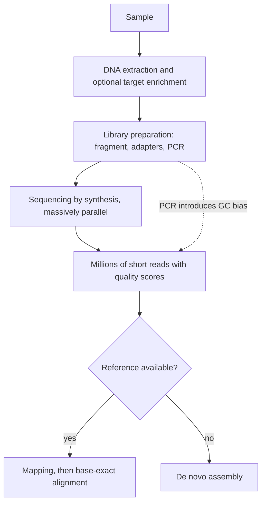

# Next-Generation Sequencing

## Problem

**Input**: a biological sample containing DNA (or RNA converted to cDNA).
**Output**: millions of short sequence reads, plus quality scores, ready for mapping,
alignment or assembly.

NGS replaces Sanger sequencing's one-fragment-at-a-time model with massively parallel
readout, which is what reduced a genome from ten years and $3 billion to under two weeks
and under $4000.

## Idea

**Sequencing by synthesis**: a single template strand is copied by DNA polymerase, which
incorporates four **differently labelled** bases. The label emitted at each incorporation
event is recorded **in real time**, so the sequence is read as it is synthesised, in
parallel across millions of templates.

**PacBio SMRT** applies the same principle to *single molecules* with fluorescently
labelled nucleotides: long reads, short run time, no amplification bias, and direct
detection of base modifications (see [[epigenetics]]) — at the cost of a large,
expensive instrument.

## Pseudocode

```text
NGS-PIPELINE(sample, reference):
  D ← DNA-EXTRACTION(sample)
  D ← GENETIC-ENRICHMENT(D)                 // e.g. target capture, optional
  L ← LIBRARY-PREPARATION(D)                // fragment, adapter-ligate, amplify by PCR
  // PCR here is the main source of GC bias

  // primary analysis: sequencing by synthesis
  R ← ∅
  for each template t in L (in parallel):
    s ← ""
    repeat:
      b ← INCORPORATE-LABELLED-BASE(t)      // polymerase adds one of A, C, G, T
      if b = NONE: break
      s ← s + DECODE-LABEL(b)               // real-time readout of the label
    R ← R ∪ {s}

  // secondary analysis
  if reference ≠ NONE:
    M ← MAP(R, reference)                   // which region does each read come from?
    A ← ALIGN(M, reference)                 // exact base-by-base placement
    return A
  else:
    return ASSEMBLE(R)                      // no reference: de novo reconstruction
```

## Worked example

A tumour exome study: DNA is extracted, exonic regions are captured during enrichment,
the library is amplified and sequenced to 100× coverage, reads are mapped to GRCh38 and
differences from the reference are called as [[dna-mutation|mutations]]. Because
enrichment and PCR precede sequencing, GC-rich first exons are systematically
under-covered and need explicit correction.

## Complexity

- Reads are produced in parallel, so wall-clock time is governed by the instrument's run
  length, not by genome size.
- Downstream cost is dominated by mapping each of `n` reads of length `k` against a
  reference of length `N`; index-based mappers achieve roughly `O(n · k)` after an
  `O(N)` index build, instead of the `O(n · k · N)` of naive scanning
  (see [[algorithmic-complexity]]).

## Variants & pitfalls

**Sources of bias (from the notes)**

- **GC-extreme regions** are under-covered — caused by the **PCR step during library
  construction**.
- **Homopolymers** (e.g. `AAAA`) are miscounted; terminator-free chemistries in
  particular cannot resolve long homopolymers.
- **Strand-specific bias**.
- **PacBio shows the lowest bias** of the platforms discussed.
- **Analysis bias** — the processing pipeline itself introduces systematic error.

**Short-read limitations**

- GC bias; mapping to repetitive elements; discriminating paralogous sequences; phasing
  alleles.

**Long-read advantages**

- Higher consensus accuracy; detection of epigenetic modifications; no amplification bias.

**Key definitions**

- **Mapping** — finding the region where a read is placed relative to a reference.
- **Alignment** — the exact positioning of each base of a read in a target region.
- **Assembly** — merging reads to reconstruct an unknown sequence.

## Diagram


The NGS pipeline from sample to reads, splitting afterwards into reference-based mapping and reference-free assembly.

## Relations

- [[shotgun-sequencing]] — the conceptual predecessor.
- [[L09-sequence-alignment-and-homology]] — read mapping to a reference genome is one of
  the four main applications of alignment.
- [[sequence-alignment]] — the step that follows mapping.
- [[de-bruijn-assembly]] — the reference-free alternative for short reads.
- [[epigenetics]] — long reads can read base modifications directly.
- [[rna-seq]] — NGS applied to the transcriptome.
- [[chip-seq]] — NGS applied to protein–DNA binding.
- [[genome-organization]] — repeats and paralogues set the difficulty of mapping.
- [[dna-mutation]] — what the mapped differences from the reference represent.
- [[haplotype-phasing]] — alleles can only be phased from a read when they lie on the
  same read, so read length bounds the phasable distance.
- [[bisulfite-sequencing]] — NGS applied to methylation, after chemical conversion of
  the mark into a sequence difference.
- [[blast]] — read mapping is the same seed-and-extend search problem, at larger scale.
- [[atac-seq]] — chromatin accessibility read out on this platform, inheriting its
  biases.
- [[hamiltonian-and-eulerian-paths]] — short reads and their repeat coverage are what
  make the Hamiltonian assembly route break down.
- Appears in [[L03-sequencing-and-genomics]], [[L14-population-genetics]] and
  [[L16-epigenetics]].
- [[single-cell-rna-seq]], [[droplet-based-single-cell-methods]] — sequencing applied one cell at a time, with [[unique-molecular-identifier]]s to undo amplification bias.

## Appears in

- [[M2L07-single-cell-rna-seq]] — single-cell RNA-Seq in module 2 is NGS plus cell barcodes and UMIs.

## Sources

- `raw/module1/gsb_part1.pdf`, pp. 12–14.
- `raw/module1/gsb_part2.pdf`, p. 11 — read mapping as an application of alignment.
- `raw/module1/gsb_3.pdf`, p. 23 — phasing from sequencing data.
- `raw/module1/gsb_part4.pdf`, pp. 5–6, 8 — ChIP-Seq and ATAC-Seq read processing, and
  the bisulfite library.
