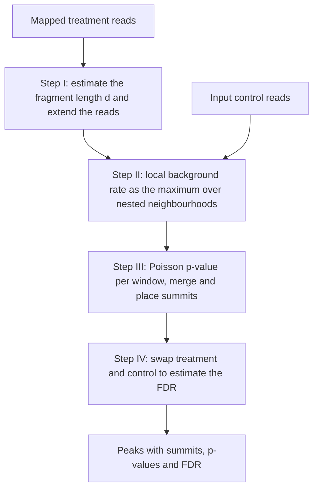

# Peak calling

## Problem

**Input**: reads from a [[chip-seq]] or ATAC-Seq experiment, mapped to a reference genome,
optionally together with an **input control** library.
**Output**: the set of **enriched (signal) regions** — "peaks" — plus, for each, a summit
position and a significance value.

Peak calling is the step that turns a pile of mapped reads into a list of biological
objects: transcription-factor binding sites, histone-modification domains, or
nucleosome-free regions.

## Idea

Reads pile up where the protein was bound. The question is therefore: *is this pile
higher than the pile we would see by chance?* The dominant tool, **MACS2** (Model-based
Analysis of ChIP-Seq), answers it with a **local Poisson model** of the background: it
estimates the expected read count for every region from the surrounding genome, computes
a p-value for the observed count, and keeps the regions that beat a threshold.

Two refinements make this work in practice:

- reads are sequenced from both ends of a fragment, so the signal appears as two offset
  strand-specific humps; MACS2 first estimates the **fragment length `d`** and shifts or
  extends reads to recover the true centre;
- the background rate is **not constant** along the genome, so a single genome-wide rate
  would over-call in biased regions; MACS2 uses a **dynamic `λ_local`**.

### MACS2 capabilities (from the exercise sheet)

- Should be used **with an input sequencing control** when calling ChIP peaks; it *can*
  run without a control, but that is not recommended.
- **Controls eliminate bias.**
- Can call peaks on **ATAC-Seq** data ([[atac-seq]]) and on **TF ChIP** data.
- Can call **narrow** peaks (transcription factors) and **broad** peaks (histone
  modifications, [[histone-modification]]).
- Identifies genome-wide locations of TF binding, histone modifications, or
  **nucleosome-free regions (NFRs)**.

## Pseudocode

```text
MACS2(M, M_ctrl, PVALUE):
  // M      ← reads of the treatment library, mapped to the genome
  // M_ctrl ← reads of the input control, may be empty

  // Step I: estimate fragment length and adjust read positions
  d ← ESTIMATE-FRAGMENT-LENGTH(M)          // offset between the plus and minus strand humps
  for each read r in M:
    if STRAND(r) = '+': r ← EXTEND(r, d)   // extend to the fragment length d
    else:               r ← EXTEND-LEFT(r, d)
  // alternative convention used in the notes: shift every read by d/2 towards the centre

  // Step II: identify the local noise level
  λ_BG ← |M| · d / |genome|                // genome-wide background rate
  for each candidate window w:
    λ_1k  ← RATE(M_ctrl, w, 1000)          // control rate in a 1 kb neighbourhood
    λ_5k  ← RATE(M_ctrl, w, 5000)
    λ_10k ← RATE(M_ctrl, w, 10000)
    λ_local[w] ← max(λ_BG, λ_1k, λ_5k, λ_10k)      // dynamic local lambda

  // Step III: identify enriched regions
  peaks ← ∅
  for each candidate window w:
    k ← COUNT(M, w)
    p ← 1 - POISSON-CDF(k - 1, λ_local[w])         // P(X ≥ k) under the local background
    if p < PVALUE:
      peaks ← peaks ∪ {w}
  peaks ← MERGE-ADJACENT(peaks)
  for each peak P in peaks:
    SUMMIT(P) ← argmax_x READ-DENSITY(M, x)        // max density position inside P

  // Step IV: estimate the false discovery rate
  swap M and M_ctrl, repeat Steps II-III           // peaks called on the swapped data are empirical false positives
  FDR(P) ← #swapped peaks at least as significant as P / #peaks at least as significant as P

  return peaks with summits, p-values and FDR
```

The dynamic `λ_local = max(λ_BG, λ_1k, λ_5k, λ_10k)` is the heart of the method: taking
the **maximum** over nested neighbourhoods *reduces the influence of local biases* and is
*robust against occasional low tag counts in small regions* — a small window with
accidentally few control reads can never make the background look unrealistically quiet.

## Worked example

A 400 bp window carries `k = 180` treatment reads. The genome-wide rate predicts
`λ_BG = 4` reads for a window of that size; the control library gives `λ_1k = 6`,
`λ_5k = 11` and `λ_10k = 9`. The dynamic background is therefore
`λ_local = max(4, 6, 11, 9) = 11`, not 4 — the region is intrinsically read-rich. Even
against the conservative `λ = 11`, `P(X ≥ 180)` under a Poisson distribution is
vanishingly small, so the window is called, and the summit is placed at the position of
maximum read density after the `d`-extension.

Had the naive `λ_BG = 4` been used, a neighbouring window with only 20 reads would also
have been called — a local-bias false positive.

## Complexity

- Fragment-length estimation: one pass over the mapped reads, `O(|M|)` after sorting by
  position.
- Background estimation and scanning: `O(|genome| / w)` windows, each with a constant
  number of neighbourhood rate lookups if cumulative read counts are precomputed, so
  `O(|M| + |genome| / w)` overall.
- FDR estimation by sample swapping roughly doubles the work.

## Variants & pitfalls

### Quality measures (p. 5)

| Measure | What it says |
|---|---|
| **FRiP** — fraction of reads in peaks | how much of the library is signal rather than background; the acceptable value **depends on the data type** |
| **PBC** — PCR bottleneck coefficient | a measure of **library complexity**; a low value means the library is dominated by PCR duplicates |
| **Relative strand cross-correlation** | `0` = no signal, `> 1` = highly enriched experiment |
| **NSC** — normalized strand cross-correlation | `> 1.1` = more enrichment, `1` = no enrichment |
| **IDR** — irreproducible discovery rate | measures **consistency between replicates** in high-throughput experiments; the most significant peaks show high consistency, low-significance peaks low consistency, so IDR identifies **artifacts** |

### Pitfalls

- **Running without a control**: local chromatin accessibility and shearing bias produce
  read pile-ups that look exactly like binding.
- **One shape does not fit all**: *different peaks have different shapes* — sharp for
  transcription factors, broad and kilobase-scale for histone marks — so the narrow and
  broad modes are not interchangeable.
- **Multiple testing**: a genome-wide scan performs millions of Poisson tests, so the
  raw p-value threshold must be accompanied by the Step IV FDR estimate; compare
  [[multiple-testing-correction]].
- The `d`-extension assumes a single dominant fragment length; libraries with a broad
  size distribution blur the summit.

## Diagram


The four MACS2 steps, with the dynamic local lambda of Step II as the heart of the method.

## Relations

- [[chip-seq]] — the assay whose reads are the input; peak calling is its final step.
- [[epigenetics]] — peak calling turns ChIP-Seq reads into the regions that carry an
  epigenetic mark.
- [[epigenome-wide-association-study]] — peak intensities are among the quantifiable
  marks it associates with a phenotype.
- [[bisulfite-sequencing]] — the methylation counterpart: the same find-the-enriched-
  region problem, run on C-versus-T ratios instead of read pile-ups.
- [[histone-modification]] — broad-peak mode is the one used for histone marks.
- [[transcription-factor-binding-site]] — narrow-peak mode locates TFBS, which are then
  modelled by a [[position-weight-matrix]].
- [[probability-distribution]] — the Poisson distribution supplies the background model.
- [[statistical-testing]] — each window is a hypothesis test with a p-value.
- [[multiple-testing-correction]] — the FDR of Step IV is the genome-scale correction.
- [[chromatin]] — ATAC-Seq peaks are open-chromatin / nucleosome-free regions.
- [[atac-seq]] — the accessibility assay the notes name as a MACS2 input; its sub-
  nucleosomal fragments are what gets peak-called.
- [[f-measure]], [[roc-curve]] — peak callers are scored with the same precision/recall pair and the same cutoff sweep that module 2 uses for classifiers.

## Appears in

- [[L05-sequence-comparison-and-networks]]
- [[L16-epigenetics]]
- [[E12-epigenetics-and-peak-calling]]

## Sources

- `raw/module1/gsb_part4.pdf`, p. 5 (definition, quality measures, MACS2 overview),
  p. 6 (the four algorithm steps, dynamic lambda, reads to peaks), p. 11 (MACS2
  capabilities and IDR, from the exercise sheet).
