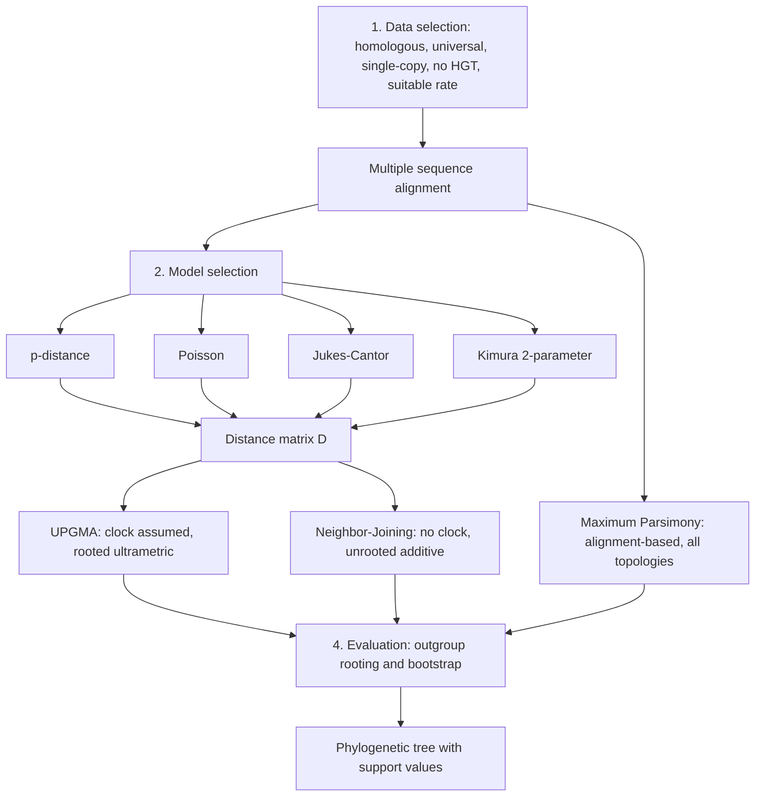

# Phylogenetic Tree Reconstruction

## Problem

**Input**: a set of taxa and sequence data.
**Output**: a [[phylogenetic-tree]] together with a statement of how much of it can be
believed.

This page is the **umbrella procedure**; the individual algorithms live in [[upgma]],
[[neighbor-joining]] and [[maximum-parsimony]].

## Idea

The notes break reconstruction into **four steps**:

### 1. Data selection

Which sequences go on the tree at all. The requirements:

- **homologous sequences** — see [[homology]]
- **occurring in all investigated species** — otherwise the matrix has holes
- **in a single copy** — avoids comparing paralogs; see [[gene-tree-and-species-tree]]
- **no horizontal gene transfer** — a transferred gene cannot be placed on a tree
- a **suitable rate of evolution**: too slow and there is no signal between close taxa,
  too fast and the sites saturate between distant ones

### 2. Model selection

Which substitution model converts differences into distance:
[[evolutionary-distance|p-distance]], Poisson, [[jukes-cantor-model]],
[[kimura-two-parameter-model]].

### 3. Method selection

| | **Distance-based** | **Alignment-based** |
|---|---|---|
| Input | a distance matrix | the alignment columns |
| Examples | **UPGMA**, **Neighbor-Joining**, *minimal evolution*, *maximum likelihood* | **Maximum Parsimony**, *maximum likelihood* |
| Model of evolution | explicit | **none** (parsimony) |
| Works on | distances | **character-state changes** |
| Topologies examined | one, built greedily | **all** |
| Output | one tree | possibly **multiple** trees |
| Speed | `O(n³)` | super-exponential |

### 4. Evaluation

How reliable is the result — [[bootstrap-tree-assessment]], plus locating the root with
an **outgroup**.

## Pseudocode

```text
RECONSTRUCT-PHYLOGENY(species, criterion):
  // ---- 1. data selection ----
  genes ← sequences that are homologous
                     AND present in every species in species
                     AND single-copy
                     AND free of horizontal gene transfer
                     AND evolving at a rate suited to the depth of the question
  MSA ← MULTIPLE-ALIGN(genes)

  // ---- 2 and 3. model and method ----
  if criterion = DISTANCE:
    for each pair (i, j):
      D[i,j] ← MODEL-DISTANCE(MSA[i], MSA[j])    // JC, K2P, Poisson, p
    if a molecular clock is assumed:
      T ← UPGMA(D)                               // rooted ultrametric
    else:
      T ← NEIGHBOR-JOINING(D)                    // unrooted additive
  else:
    T ← MAXIMUM-PARSIMONY(MSA)                   // unrooted, possibly several

  // ---- 4. evaluation ----
  if T is unrooted:
    T ← ROOT-WITH-OUTGROUP(T, outgroup)
  support ← BOOTSTRAP(MSA, criterion, B)
  return T, support
```

## Worked example

The exercise runs the pipeline end to end on a small alignment: an MSA of length
`L = 50` is used to fill a distance matrix `D` by `p = D/L` — giving
`p(S1,S2) = 3/50` — and that matrix is then fed to [[upgma]], which produces the rooted
ultrametric tree over taxa A–F traced in [[M2E08-phylogenetics]].

## Diagram


The four-step reconstruction pipeline, with the distance-based and alignment-based routes rejoining at evaluation.

## Complexity

Dominated by the method chosen in step 3: `O(n³)` for the distance-based route against a
super-exponential topology search for parsimony. Step 4 multiplies whichever cost by the
number of bootstrap replicates `B`.

## Variants & pitfalls

- **Step 1 decides the answer more often than step 3 does.** A paralog slipped into the
  data set, or a horizontally transferred gene, will produce a confident and wrong tree
  regardless of the algorithm.
- **The model and the method must agree**: using UPGMA after choosing a model that allows
  rate variation is internally inconsistent.
- **An unevaluated tree is not a result.** Without bootstrap values, a tree's internal
  branches carry no stated confidence.
- The notes name **minimal evolution** and **maximum likelihood** but do not develop
  either — recorded in [[open-questions]].

## Relations

- [[upgma]], [[neighbor-joining]], [[maximum-parsimony]] — the three methods of step 3.
- [[jukes-cantor-model]], [[kimura-two-parameter-model]], [[evolutionary-distance]] —
  step 2.
- [[bootstrap-tree-assessment]] — step 4.
- [[homology]], [[gene-tree-and-species-tree]] — the criteria of step 1.
- [[phylogenetic-tree]], [[molecular-evolution]], [[molecular-clock]] — the objects and
  assumptions throughout.
- [[sequence-alignment]], [[blast]] — how the homologous set is assembled in practice.
- [[substitution-matrix]] — the module-1 scoring model whose evolutionary assumptions
  reappear here as explicit substitution models.
- [[maximum-likelihood]] — the step-3 method the notes list in both the distance-based and the alignment-based column.

## Appears in

- [[M2L08-molecular-evolution-and-phylogeny]]
- [[M2E08-phylogenetics]]

## Sources

- `raw/module2/csb_3.pdf`, p. 30 — the four steps of reconstruction, the data selection
  criteria, and the distance-based versus alignment-based comparison.
- `raw/module2/csb_3.pdf`, pp. 31–33 — the three methods.
- `raw/module2/csb_3.pdf`, p. 34 — rooting by outgroup and bootstrap evaluation.
- `raw/module2/csb_3.pdf`, p. 38 — the exercise: building `D` from an MSA with `p = D/L`.
