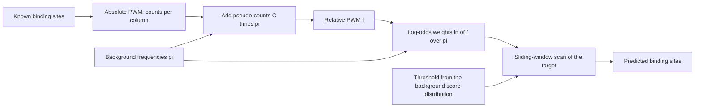

# Position Weight Matrix

## Problem

**Input:** a set of known binding sites of one transcription factor, all of length `M`,
plus a background model of the genome.
**Output:** a **position weight matrix (PWM)**, also called **position-specific scoring
matrix (PSSM)**, and with it a score for every position of a target sequence, so that
all substrings scoring above a threshold are reported as predicted
[[transcription-factor-binding-site|binding sites]].

A PWM is the common representation of motifs in biological sequences. Its number of
columns is the motif length `M`; columns are indexed `j ∈ [0, M−1]` as in the notes.

## Idea

A transcription factor does not bind one word but a family of similar words, so a single
consensus string throws away information. A PWM instead stores, **per position**, how
often each nucleotide was observed. Scoring a candidate then asks: is this substring more
likely under the motif model (foreground) than under the background?

**Background model.** `π_i ∈ [0,1]` for `i ∈ {A, T, C, G}` with `Σ_i π_i = 1` — the
composition of the genome being scanned.

**Absolute PWM (count matrix).** `f*_ij ∈ ℕ`: how many of the sample binding sites carry
nucleotide `i` at column `j`.

**Relative PWM.** Normalize each column:

```text
f'_ij = f*_ij / Σ_a f*_aj
```

**Pseudo-counts.** A nucleotide unseen in a small sample would get probability 0 and veto
every candidate containing it. Add a share of the background:

```text
f^P_ij = f*_ij + C · π_i          // C: total pseudo-count mass
f_ij   = f^P_ij / Σ_a f^P_aj
```

**Scoring — log-odds.** For a window of the target running from `start` to `end`:

```text
S_{start,end} = Σ_{j=start}^{end}  ln( f_{nuc(j), j} / π_{nuc(j)} )
```

where `nuc(j)` is the nucleotide at index `j` of the window. Positive contributions mean
the base is more frequent in the motif than in the background.


Construction of a PWM from known sites and its use as a scoring scheme for a genome-wide scan.

## Pseudocode

```text
BUILD-PWM(sites, π, C):
  // sites: N binding sites, each of length M; π: background; C: pseudo-count mass
  M ← |sites[1]|
  for j ← 0 to M-1:
    for each a in {A, T, C, G}:
      count[a,j] ← number of sites with nucleotide a at column j     // absolute PWM
      p[a,j]     ← count[a,j] + C · π[a]                             // pseudo-counts
    total ← Σ_a p[a,j]
    for each a in {A, T, C, G}:
      f[a,j] ← p[a,j] / total                                        // relative PWM
      W[a,j] ← ln( f[a,j] / π[a] )                                   // log-odds weights
  return W

SCAN(T, W, th):
  // T: target sequence of length N, W: M columns, th: score threshold
  M ← columns(W)
  hits ← ∅
  for start ← 0 to |T| - M:
    S ← 0
    for j ← 0 to M-1:
      S ← S + W[ T[start + j], j ]
    if S > th: hits ← hits ∪ { (start, S) }
  return hits
```

**Lookahead scoring** — abort a window as soon as it cannot possibly reach the
threshold:

```text
PRECOMPUTE-LOOKAHEAD(W, th):
  M ← columns(W)
  for d ← 0 to M-1:
    σ[d] ← Σ_{j=d+1}^{M-1} max_a W[a,j]     // best possible remaining score after column d
    th[d] ← th - σ[d]                       // intermediate threshold
  return th[·]

SCAN-LOOKAHEAD(T, W, th[·]):
  hits ← ∅
  for start ← 0 to |T| - M:
    S ← 0
    for d ← 0 to M-1:
      S ← S + W[ T[start + d], d ]
      if S < th[d]: break                   // prefix can no longer reach th
    if d = M-1 and S > th: hits ← hits ∪ { (start, S) }
  return hits
```

The equivalence that makes this correct is `S_d ≥ th_d ⟺ S_{0,M−1} ≥ th` for the best
possible completion.

**Column reordering** — evaluate the most discriminative ("most dangerous") columns
first:

```text
ORDER-COLUMNS(W, π):
  for j ← 0 to M-1:
    Mx[j] ← max_a W[a,j]                 // highest score of column j
    E[j]  ← Σ_a W[a,j] · π[a]            // expected score of column j under background
  return columns sorted by ( Mx[j] - E[j] ) descending
```

## Worked example

Seven known sites over `M = 3` columns, background `π = (A 0.23, T 0.25, C 0.25,
G 0.27)`. Absolute PWM:

| | j=0 | j=1 | j=2 |
|---|---|---|---|
| **A** | 0 | 2 | 2 |
| **T** | 6 | 0 | 0 |
| **C** | 1 | 5 | 5 |
| **G** | 0 | 0 | 0 |

Consensus: **TCC**. Relative PWM (without pseudo-counts):

| | j=0 | j=1 | j=2 |
|---|---|---|---|
| **A** | 0 | 2/7 | 2/7 |
| **T** | 6/7 | 0 | 0 |
| **C** | 1/7 | 5/7 | 5/7 |
| **G** | 0 | 0 | 0 |

```text
P(TCC | foreground) = 6/7 · 5/7 · 5/7 ≈ 0.437      // high
P(TCC | background) = 0.25 · 0.25 · 0.25 ≈ 0.0156  // low
```

The candidate is ~28× more likely under the motif than under the background, so its
log-odds score is clearly positive. Note that without pseudo-counts any candidate
containing `G` scores `−∞`.

**Choosing the threshold.** Two score distributions are compared:

- `λ_B(X)` — the score distribution on random sequences drawn from the background.
- `λ_T(X)` — the score distribution on sequences drawn from the PWM model (foreground).

With `P_Z(X ≥ s) = Σ_{i=s}^{max} P_Z(X = i)`, two rules are given:

```text
p-value: p = P_B(X ≥ s)              // probability of reaching score s by chance
         choose th = s such that P_B(X ≥ s) = p, typically p ≈ 0.05
balanced: choose s with P_B(X ≥ s) = P_T(X ≤ s)   // equal false-positive and false-negative rates
```

If `p ≤ 0.05` the null hypothesis is rejected and `H₁` accepted
([[statistical-testing]]).

## Complexity

The naive moving window is **`O(M · N)`** for a motif of length `M` on a sequence of
length `N` — too slow at genome scale when repeated for hundreds of factors.

- **Lookahead** does not change the worst case but cuts the average cost drastically,
  because most windows die after a few columns.
- **Column reordering** by `M_j − E_j` makes them die even earlier.
- Indexing the target with a [[suffix-tree]] removes the repeated rescanning of shared
  prefixes altogether: identical substrings are scored once.

**PWM scoring on a suffix tree**

1. Allocate memory.
2. Construct the suffix tree of the target sequence.
3. Depth-first search, calculating the prefix scores `p(x ≤ d)` along the edge labels.
4. Analyse the scores at each node:
   - if the score at a node already reaches `th`, **all** substrings represented by that
     subtree reach `th`;
   - if the score falls below the intermediate threshold `th_d`, the whole subtree branch
     can be **ignored**.

## Variants & pitfalls

- **PWM vs PSSM** — the same object; "PSSM" emphasises that the stored entries are
  scores rather than frequencies.
- **Base of the logarithm.** Module 1 writes the log-odds with the natural logarithm,
  `S = Σ ln(f_ij / π_i)`; module 2 writes the same weight in bits,
  `s = log₂(P_ij / π_j)`. The two differ only by the constant factor `1/ln 2`, so they
  rank candidates identically and only the numeric value of the threshold changes. Bits
  are the usual convention, because they match the units of
  [[information-content]] and of a [[sequence-logo]].
- **Independence assumption** — a PWM treats columns as independent, which is only an
  approximation of real protein–DNA contacts.
- **Sample size** — few known sites make the counts unstable; pseudo-counts are
  mandatory, and the choice of `C` matters.
- **Background** — using a uniform background on a GC-skewed genome inflates scores.
- The graphical rendering of a relative PWM is a **sequence logo**, where letter height
  encodes information content.

## Relations

- [[transcription-factor-binding-site]] — what the matrix models.
- [[suffix-tree]] — index that accelerates the genome-wide scan.
- [[string-matching]] — the exact-matching paradigm a PWM replaces for degenerate motifs.
- [[substitution-matrix]] — the alignment analogue: both are log-odds scoring schemes.
- [[statistical-testing]] — supplies the p-value interpretation of the threshold.
- [[chip-seq]] — delivers the sequences from which PWMs are built; [[peak-calling]]
  defines the regions those sequences come from.
- [[hidden-markov-model]] — the richer motif model: a PWM treats positions independently,
  an HMM adds states, transitions and gaps.
- [[markov-chain]] — models dependence between neighbouring positions, which a PWM
  deliberately ignores.
- [[baum-welch-algorithm]] — the EM counterpart of the PWM's direct frequency counting,
  including the same pseudo-count regularisation.
- [[promoter]] — promoters are built from tolerant, degenerate sites, which is why they
  are searched with a PWM instead of exact matching.
- [[suffix-array]] — the flattened index whose skip array prunes whole blocks of
  suffixes during a scan.
- [[multiple-testing-correction]] — a genome-wide motif scan faces the same multiplicity
  when its score threshold is chosen.
- [[algorithmic-complexity]] — the `O(M · N)` sliding window and the lookahead and column
  reordering that cut its average cost.
- [[atac-seq]] — scanning a PWM over accessible peaks is what assigns a factor to an
  open region.
- [[sequence-motif]] — module 2's general name for what a PWM models.
- [[sequence-logo]] — the same `P_ij` and `π_j` rendered as a picture, using entropy
  instead of log-odds.
- [[information-content]] — the entropy-based scoring of a profile column.
- [[em-motif-discovery]] — where `Θ`, a positional probability matrix, is **estimated**
  rather than assumed; its M-step is the count-normalisation step below.
- [[gibbs-sampling]] — the sampling counterpart that resamples the same model.
- [[expectation-maximization]] — the estimation procedure that learns such a matrix
  when the alignment of occurrences is unknown.
- [[roc-curve]] — the score threshold of a PWM scan is swept exactly like a classifier cutoff, trading recall against false positives.
- [[convolutional-neural-network]] — a convolution kernel scanning a sequence is a learned PWM; the lecture makes the analogy explicit.
- [[mirna-target-prediction]] — the same problem shape: a short, degenerate pattern scored genome-wide, with the same false-positive consequences.
- [[maximum-likelihood]] — the complete-data case, where the ML estimate is simply the normalised count table.

## Module 2: the matrix hierarchy and where it comes from

Module 2 names the three stages explicitly as a progression of motif representations,
below regular expressions (a consensus such as `AAGAAA`, or a degenerate pattern such as
`A[A/T]BW`):

| representation | content |
|---|---|
| **Positional Count Matrix (PCM)** | raw residue counts per position |
| **Positional Probability Matrix (PPM)** | counts normalised per column, with a **pseudo-count** |
| **Positional Weight Matrix (PWM)** | `s = log₂(P_ij / π_j)`, the log-odds against the background `π` |

The decisive module-2 addition is that the PPM need not come from a known alignment at
all: [[em-motif-discovery]] estimates it from unaligned sequences by treating the motif
position as a latent variable, and [[sequence-logo]] renders the result. The pseudo-count
is no longer a convenience but a necessity — in EM a zero probability is **absorbing**
and permanently excludes that residue from that position.

## Appears in

- [[L12-binding-sites-and-position-weight-matrices]]
- [[L13-suffix-trees-and-arrays]]
- [[L17-markov-chains-and-hidden-markov-models]]
- [[E09-binding-sites-pwm-and-pca]]
- [[M2L02-sequence-motifs-and-motif-discovery]]
- [[M2E02-motif-discovery-and-expectation-maximization]]
- [[M2L06-deep-learning]] — a CNN kernel over a sequence is a learned PWM; module 2 fits what module 1 counted.

## Sources

- `raw/module1/gsb_3.pdf`, pp. 6–9, 14.
- `raw/module1/gsb_part4.pdf`, pp. 13–15 — Markov and hidden Markov models as the
  sequence models with memory.
- `raw/module2/csb_1.pdf`, pp. 15, 19–21 — the four motif representations with the
  log-odds formula and pseudo-count, and the estimation of `Θ` by EM.

- `raw/module2/csb_4.pdf`, pp. 4–5 — seed matching and its false-positive rate.
