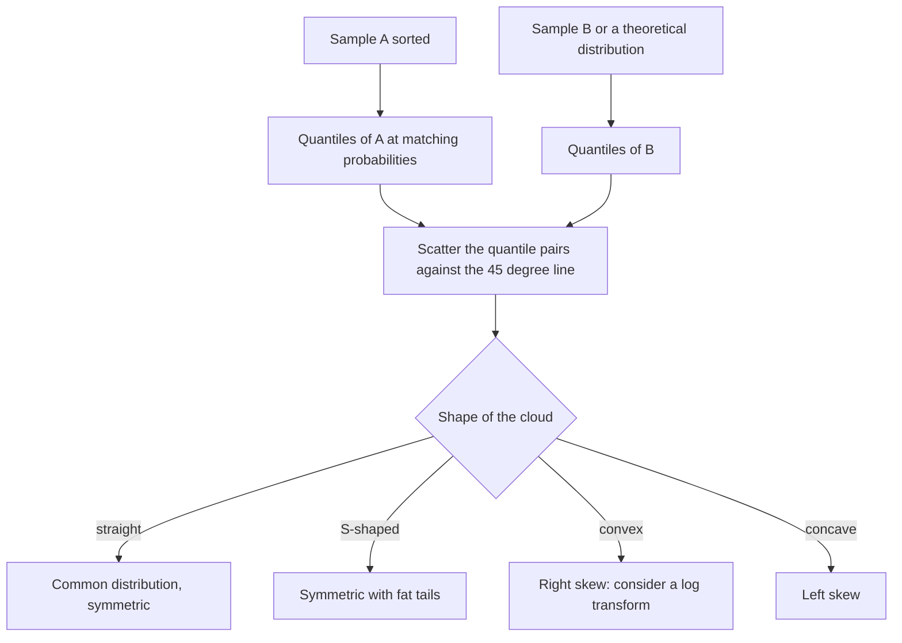

# QQ-Plot

## Problem

**Input**: two datasets (or one dataset and one theoretical distribution).
**Output**: a graphical answer to the question whether they come from populations with a
**common distribution**.

## Idea

If two populations share a distribution, then their quantiles must agree. So compute the
quantiles of both datasets and plot one against the other. A 45° reference line is drawn:

- points fall **approximately along the line** → the two sets come from populations with
  the same distribution;
- points deviate systematically from the line → the populations have **different**
  distributions.

A **probability plot** is the same idea with the quantiles of the second sample replaced
by the quantiles of a *theoretical* distribution — the usual way to check the normality
assumption that [[statistical-testing]] relies on.

## Pseudocode

```text
QQ-PLOT(A, B):
  // A, B = the two samples; quantiles are compared pairwise
  a ← SORT-ASCENDING(A)
  b ← SORT-ASCENDING(B)
  k ← MIN(LENGTH(a), LENGTH(b))          // sample sizes need not be equal
  points ← ∅
  for i ← 1 to k:
    p ← (i - 0.5) / k                    // the p-quantile position
    qa ← QUANTILE(a, p)                  // interpolate if the index is fractional
    qb ← QUANTILE(b, p)
    points ← points ∪ {(qa, qb)}
  DRAW-SCATTER(points)
  DRAW-LINE(slope ← 1, intercept ← 0)    // the 45 degree reference line
  return points

QUANTILE(sorted_x, p):
  // the x-quantile: the value k such that p of the values are smaller
  n ← LENGTH(sorted_x)
  pos ← p * n + 0.5
  lo ← FLOOR(pos); hi ← CEIL(pos)
  if lo < 1:  return sorted_x[1]
  if hi > n:  return sorted_x[n]
  return sorted_x[lo] + (pos - lo) * (sorted_x[hi] - sorted_x[lo])
```

## Worked example

Two sketches are given in the notes:

- a **bad fit** — the point cloud bends away from the 45° line, so the two samples come
  from populations with different distributions;
- a **good fit** — the points lie tightly along the line, so a common distribution is
  plausible.

Reading the deviation is informative in itself: a parallel shift off the line indicates a
**shift in location** (different means), while a change of slope indicates a **shift in
scale** (different standard deviations).

## Complexity

- Dominated by the two sorts: `O(n log n + m log m)`; the quantile interpolation is
  `O(min(n, m))` (see [[algorithmic-complexity]]).

## Variants & pitfalls

**Advantages**

- The **sample sizes need not be equal** — quantiles are computed at matching
  probabilities, not at matching indices.
- Many distributional aspects — shifts in location, shifts in scale, differences in
  tail behaviour — can be tested **simultaneously** in a single picture.

**Pitfalls**

- It is a *graphical* check, not a test: it returns no p-value.
- Small samples produce noisy plots whose tails deviate from the line even when the
  distributions agree.

**Reading the shape** (part 3 of the notes)

| distribution | QQ-plot |
|---|---|
| symmetric | straight line |
| symmetric with fat tails | S-shape |
| positive (right) skew | convex curve |
| negative (left) skew | concave curve |

A convex or concave plot is the signal to apply a log transform — see
[[data-normalization]].

## Diagram


Quantiles are plotted against quantiles, and the shape of the deviation from the reference line is the conclusion.

## Relations

- [[descriptive-statistics]] — quantiles, the quantity being plotted.
- [[probability-distribution]] — the normal assumption this checks.
- [[statistical-testing]] — "test assumption not met" is one of the causes of a wrong
  decision; this is how the assumption is inspected.
- [[data-normalization]] — a curved QQ-plot is what motivates a transform; a straight one
  confirms it worked.
- [[z-score]] — a straight plot is the check that the mean and standard deviation a
  z-score is built from describe the data at all.
- Appears in [[L10-biostatistics-and-statistical-testing]] and
  [[E08-test-errors-and-z-score]].

- [[gene-set-enrichment-analysis]] — compares a real score against a permutation null, the same observed-versus-expected logic plotted here.

## Sources

- `raw/module1/gsb_part2.pdf`, pp. 22, 24.
- `raw/module1/gsb_3.pdf`, p. 2 — the mapping from QQ-plot shape to distribution shape.
