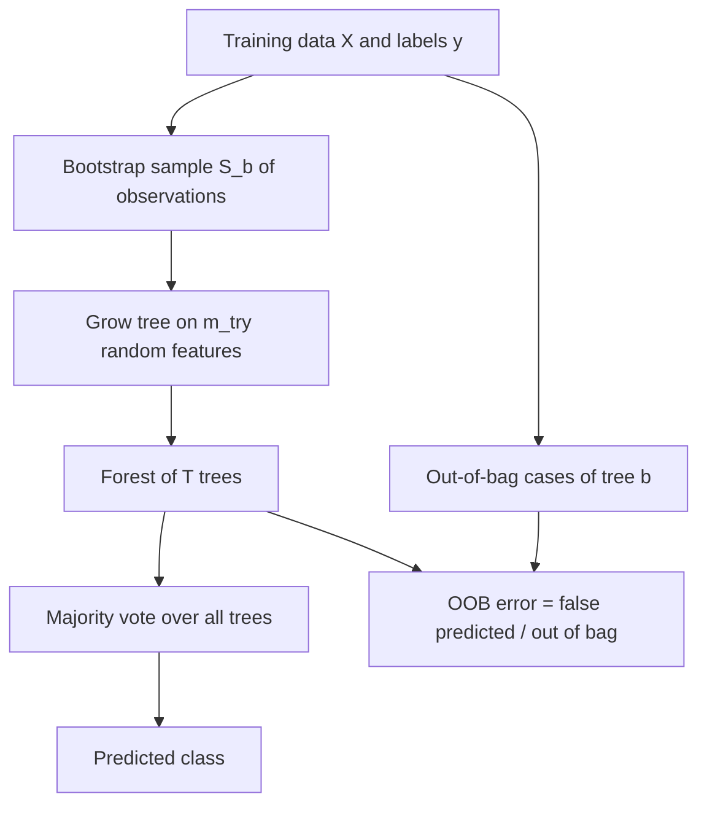

# Random Forest

## Problem

**Input**: a labelled dataset with many variables — typically far more genes than
patients.
**Output**: a classifier, **plus** a ranking of which variables are important for the
classification, **plus** an unbiased estimate of its own generalization error.

## Idea

Grow **hundreds of [[decision-tree|decision trees]]**, each on a **[[bootstrapping|
bootstrap]] sample of the observations** and on a **subset of the features**, and
**aggregate their outputs to reach a single result**. The advantage over a single
decision tree: it **avoids and prevents overfitting by using multiple trees**.

**Features** listed in the notes:

- popular classification method
- runs efficiently
- gives information of **what variables are important** in the classification
- **unbiased estimate of the generalization error during forest building** — the
  **out-of-bag (OOB) error rate**
- **robust to [[overfitting]]**
- **robust to unbalanced class sizes**

## Pseudocode

```text
RANDOM-FOREST-TRAIN(X, y, T, m_try):
  for b ← 1 to T:
    S[b]   ← BOOTSTRAP-SAMPLE(X)               // subset of observations, with replacement
    OOB[b] ← X \ S[b]                          // the out-of-bag cases of tree b
    tree[b] ← GROW-TREE(S[b], m_try)           // subset of features at every node
  return tree[1..T], OOB[1..T]

GROW-TREE(S, m_try):
  if S is pure: return leaf labelled with the class of S
  A ← random subset of m_try attributes
  a* ← argmax_{a ∈ A} Δi( split-on(a), S )     // node impurity drop
  (S_l, S_r) ← split S on a*
  return node(a*, GROW-TREE(S_l, m_try), GROW-TREE(S_r, m_try))

RANDOM-FOREST-PREDICT(forest, x):
  votes ← [ CLASSIFY(tree[b], x) for b ← 1 to T ]
  return MAJORITY(votes)                       // aggregate to a single result

OUT-OF-BAG-ERROR(forest, X, y):
  wrong ← 0; counted ← 0
  for each case x_i ∈ X:
    B_i ← { b : x_i ∈ OOB[b] }                 // trees that did not see x_i
    if B_i ≠ ∅:
      ŷ_i ← MAJORITY( CLASSIFY(tree[b], x_i) for b ∈ B_i )
      counted ← counted + 1
      if ŷ_i ≠ y_i: wrong ← wrong + 1
  return wrong / counted                       // #false predicted / #out of bag
```

**Feature selection**, the two stages of the notes:

```text
RF-FEATURE-SELECTION(X, y):
  // I. Preliminary ranking and elimination
  rank ← sort variables in decreasing order of RF importance scores (Gini index)
  V    ← cancel from rank the variables of small importance
         // leaves a reduced number of remaining variables

  // II. Variable selection
  // (a) for interpretation
  for k ← 1 to |V|:
    M[k] ← RANDOM-FOREST-TRAIN( X restricted to the k first variables of V, y )
  V_int ← the variable set of the model with the smallest OOB error

  // (b) for prediction
  current ← ∅
  for v in V_int in order:                     // ascending sequence of RF models
    candidate ← current ∪ { v }                // invoke and test variables stepwise
    if OOB( RANDOM-FOREST-TRAIN(candidate) ) improves: current ← candidate
  return current                               // the vars of the last model are selected
```

## Worked example

The out-of-bag mechanics on the notes' tabular example:

```text
Data:        (Loud,  Drunk)      → Victory
Resample:    (Loud,  Drunk)      → Victory       // drawn into the bootstrap sample
Out of bag:  (Quiet, Not-Drunk)  → Loss          // never drawn
                                   predicted: Victory  ✗

correct OOB = #false predicted / #out of bag
Tree OOB    = the average error for each case, calculated using predictions from
              the trees that do not contain that case in their respective
              bootstrap sample
```

**ROC comparison** from the exercise: two classifiers are drawn as TP rate against FP
rate. Curve **1** reaches a **TP rate of 100 % at an FP rate of only 25 %** — all
positive samples predicted positive — while curve **2** reaches only **37 % TP at the
same 25 % FP**. Curve 1 is the better classifier; see [[roc-curve]].

## Diagram


Each tree sees its own bootstrap sample and feature subset, the forest votes to a single result, and the cases a tree never saw supply the out-of-bag error.

## Complexity

`T` trees × the cost of growing one tree. Because each tree uses only `m_try` of the `m`
attributes and a bootstrap sample, a forest is cheaper than `T` full trees, and the trees
are **embarrassingly parallel**. The OOB estimate costs nothing extra — it reuses the
cases each tree never saw, which is why no separate [[cross-validation]] run is needed.

## Variants & pitfalls

- Importance scores from the **Gini index** are biased towards variables with many
  distinct values; the notes use them nonetheless as the preliminary ranking.
- The two variable-selection goals give **different answers**: *interpretation* keeps a
  larger, partly redundant set; *prediction* keeps the smallest set that still improves
  the OOB error.
- "Robust to overfitting" is not "immune": with very few observations and tens of
  thousands of genes, the OOB estimate is the only honest number available.
- A forest loses the single tree's readability — this is the trade for stability.
- [[grandforest]] modifies the split selection so that trees are grown **along the edges
  of an [[interaction-network]]**.

## Relations

- [[decision-tree]] — the base learner being ensembled.
- [[bootstrapping]] — supplies the per-tree sample and the out-of-bag remainder.
- [[node-impurity]] — both the split criterion and the importance score.
- [[overfitting]] — what the ensemble is robust to.
- [[cross-validation]] — the external alternative to the internal OOB estimate.
- [[roc-curve]] — how the finished classifier is scored.
- [[machine-learning]] — named in the notes as the standard example of a **non-linear**
  method.
- [[grandforest]] — random forest + network ⇒ a new, graph-constrained forest.
- [[support-vector-machine]] — the linear counterpart taught in the same lecture.
- [[principal-component-analysis]] — the module-1 alternative route to "which variables
  matter", by variance rather than by predictive importance.
- [[deep-learning]] — the contrasting model class for the same supervised problems.
- [[bootstrap-tree-assessment]] — bagging over trees of a very different kind, with the same statistical idea.
- [[dropout]], [[bias-variance-tradeoff]] — ensembling and regularization in the neural setting.
- [[highly-variable-genes]] — feature selection, here by variance rather than by importance.
- [[keypathwayminer]] — contrasted as a non-network learner on the same omics data.

## Appears in

- [[M2L03-machine-learning-and-classification]]
- [[M2L05-network-based-disease-modules]]
- [[M2E03-machine-learning-and-classification]]

## Sources

- `raw/module2/csb_part2.pdf`, p. 7 — features, multiple trees, the two-stage feature
  selection, and the out-of-bag example with its error definitions.
- `raw/module2/csb_part2.pdf`, p. 10 — the exercise: aggregation over hundreds of trees,
  subsets of features and observations, and the ROC comparison.
- `raw/module2/csb_part2.pdf`, p. 21 — random forest as the basis of GrandForest.
