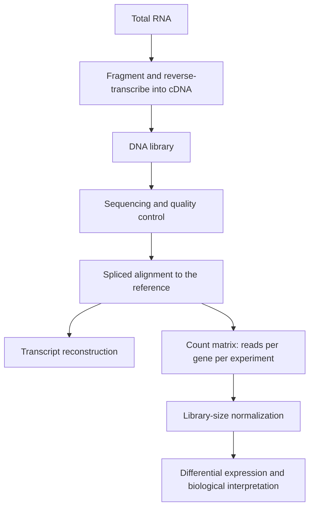

# RNA-Seq

## Problem

**Input**: total RNA from one or more samples.
**Output**: a **count matrix** `N` of size n × m, where `N[i,j]` is the number of reads
from gene *i* sequenced in experiment *j* — plus, optionally, the transcript structures
themselves.

## Idea

Instead of hybridising RNA to a fixed set of probes as in
[[microarray-expression-analysis]], convert the RNA into a sequencing library and count
reads. Because nothing is pre-specified, RNA-Seq supports three applications named in the
notes: **transcript quantification**, **transcript discovery**, and **expression
profiling**.

## Pseudocode

```text
RNA-SEQ(samples, reference, annotation):
  // wet lab
  L ← ∅
  for j ← 1 to |samples|:
    rna  ← EXTRACT-RNA(samples[j])
    frag ← FRAGMENT(rna)                      // split RNA into short pieces
    cdna ← REVERSE-TRANSCRIBE(frag)
    L[j] ← BUILD-DNA-LIBRARY(cdna)

  // primary analysis
  for j ← 1 to |samples|:
    R[j] ← SEQUENCE(L[j])                     // see NGS-PIPELINE
    R[j] ← QUALITY-CONTROL(R[j])              // trim adapters, drop low-quality reads

  // secondary analysis
  for j ← 1 to |samples|:
    M[j] ← SPLICED-ALIGN(R[j], reference)     // reads may span exon-exon junctions
    T[j] ← RECONSTRUCT-TRANSCRIPTS(M[j], annotation)

  // build the count matrix N of size n x m
  for i ← 1 to n:                             // genes
    for j ← 1 to m:                           // experiments
      N[i,j] ← | { r in M[j] : r maps to gene i } |

  N' ← NORMALIZE-LIBRARY-SIZE(N)              // counts are not comparable raw
  DE ← DIFFERENTIAL-EXPRESSION(N', design)
  return BIOLOGY(DE)
```

## Worked example

Three tumour and three control samples are sequenced. Gene *i* receives
`N[i, ·] = (820, 760, 900, 110, 95, 130)` reads. After scaling each column by its library
size the tumour mean is ≈ 8× the control mean, giving `log₂ fold change ≈ 3`; a
count-based test turns that into a p-value, and the gene enters the differentially
expressed set.

A read that maps half to the end of exon 2 and half to the start of exon 3 can only be
placed by **spliced** alignment — an ungapped mapper would discard it, biasing junction
coverage downwards.

## Complexity

- Library construction and sequencing are parallel; see
  [[next-generation-sequencing]].
- Spliced alignment is the dominant computational step, roughly linear in the number of
  reads after building an `O(|reference|)` index.
- Building `N` is one pass over the mapped reads: `O(Σ|M[j]|)`.

## Variants & pitfalls

- Raw counts are **not** comparable across samples: deeper libraries give larger counts
  for every gene, so library-size normalisation is mandatory — the same logical trap as
  array normalisation in [[microarray-expression-analysis]].
- Longer transcripts collect more reads, so within-sample comparisons between genes
  require length normalisation as well.
- Highly expressed transcripts can dominate the library and suppress the detection of
  rare ones.
- Reads from paralogous genes are ambiguous, inheriting the short-read limitations listed
  in [[next-generation-sequencing]].
- Transcript reconstruction from short reads is itself an assembly problem — the RNA case
  named in [[L04-genome-assembly]].

## Diagram


The RNA-Seq pipeline, in which spliced alignment is needed because reads cross exon-exon junctions.

## Relations

- [[microarray-expression-analysis]] — the hybridisation-based predecessor.
- [[statistical-testing]] — how a count difference becomes a significant result.
- [[descriptive-statistics]] — read counts are the discrete quantitative data type.
- [[next-generation-sequencing]] — the underlying sequencing technology.
- [[central-dogma]] — RNA-Seq measures the mRNA station.
- [[genome-organization]] — exon/intron structure is why spliced alignment is needed.
- [[gene-regulation]] — differential expression is the observable consequence.
- [[data-normalization]] — count matrices are log-transformed and standardized before
  modelling.
- [[batch-effect]] — library preparation and sequencing runs are batches.
- [[principal-component-analysis]] — the standard first look at a count matrix.
- [[expression-qtl]] — RNA-Seq expression values are the phenotype of an eQTL scan.
- [[multiple-testing-correction]] — one test per gene over the whole transcriptome.
- [[splicing]] — the reason reads span exon–exon junctions and mapping must be spliced.
- [[gene-set]] — the functional unit the differentially expressed genes are mapped onto.
- [[gene-knockout]] — the perturbation whose transcriptional consequences are measured.
- [[bicon]] — takes such an expression matrix plus an [[interaction-network]] and returns patient subgroups.
- [[single-cell-rna-seq]] — the same assay at single-cell resolution; bulk measures an average that hides heterogeneity. See [[M2L07-single-cell-rna-seq]].
- [[unique-molecular-identifier]], [[droplet-based-single-cell-methods]], [[single-cell-analysis-workflow]] — the machinery that makes per-cell counting possible.
- [[non-coding-rna]] — the non-coding half of the transcriptome that expression profiling also captures.
- [[microrna]] — small RNAs whose expression is profiled alongside mRNA in ceRNA analyses.
- [[mirna-target-prediction]] — uses expression data as a tissue-specificity filter on predicted binding sites.

## What happens next: functional interpretation

A list of differentially expressed genes is not yet a biological result. Module 2's
answer is [[enrichment-analysis]]: relate the list, or the full ranked list, to
pre-defined gene sets, or abandon pre-defined sets and search an interaction network
directly. The same differentially expressed genes also drive motif discovery — their
upstream sequences are the input to [[em-motif-discovery]]. See
[[M2L01-enrichment-analysis]] and [[M2L02-sequence-motifs-and-motif-discovery]].

## Appears in

- [[L04-genome-assembly]]
- [[L06-expression-profiling]]
- [[L10-biostatistics-and-statistical-testing]]
- [[L11-normalization-pca-and-batch-effects]]
- [[L15-gwas-eqtl-and-multiple-testing]]
- [[M2L07-single-cell-rna-seq]] — the module-2 lecture that replaces this bulk assay
  with per-cell measurement.
- [[M2L01-enrichment-analysis]]
- [[M2L05-network-based-disease-modules]]
- [[M2L09-non-coding-rnas]]

## Sources

- `raw/module1/gsb_part1.pdf`, p. 26.
- `raw/module1/gsb_part2.pdf`, pp. 19, 25–29 — data types and the statistics applied to
  count data.
- `raw/module1/gsb_3.pdf`, pp. 1, 3–4, 27–30 — normalization, PCA, eQTL analysis and
  multiple testing.
- `raw/module2/csb_1.pdf`, pp. 1, 14 — differentially expressed genes as the input to
  enrichment analysis and to motif discovery.

- `raw/module2/csb_4.pdf`, pp. 4, 9 — expression data used to remove false-positive miRNA targets and to build ceRNA networks.
