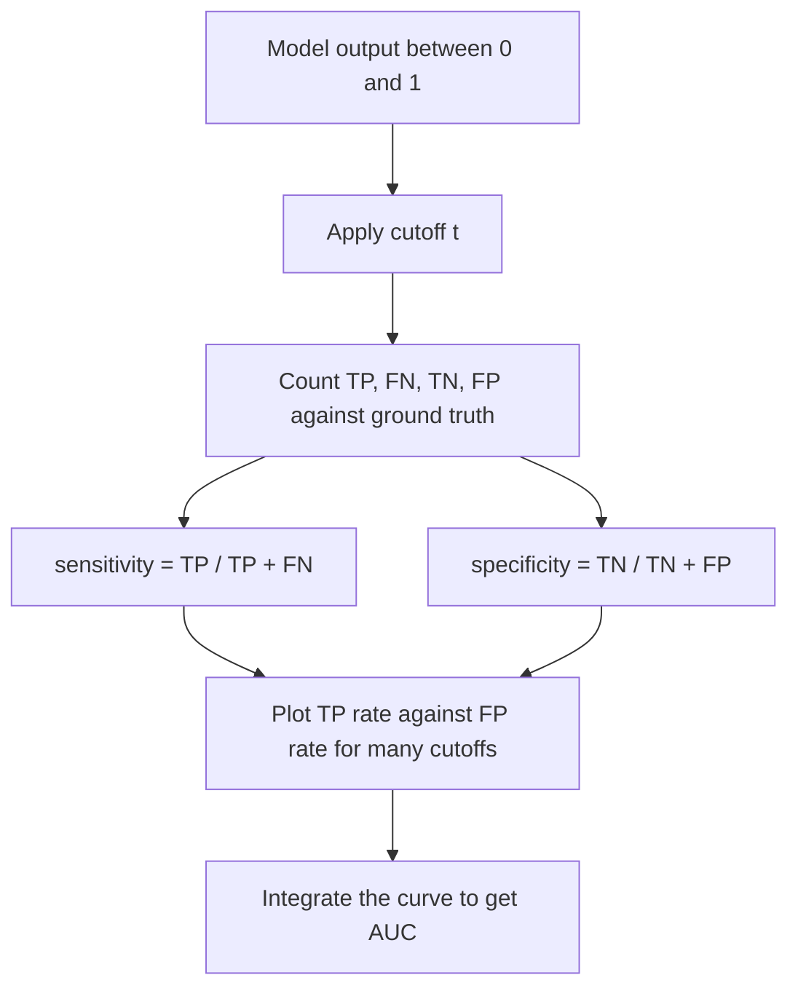

# ROC Curve and AUC

## Problem

**Input**: a trained binary classifier that produces, for each sample, an **output
between 0 and 1**, plus **test data with known class labels** (the *ground truth*),
containing both positive and negative samples.
**Output**: a curve showing the classifier's behaviour at **every possible cutoff**, and
a single summary number, the **AUC**.

## Idea

A classification model generates an output between 0 and 1 for each sample. A **cutoff**
`t` turns that output into a label:

```text
1 = positive
0 = negative        with cutoff t
```

Comparing those labels to the original class labels gives the four counts:

| | Meaning |
|---|---|
| **TP** | positive sample, predicted positive ✓ |
| **FN** | positive sample, predicted negative ✗ |
| **TN** | negative sample, predicted negative ✓ |
| **FP** | negative sample, predicted positive ✗ |

```text
sensitivity = TP / (TP + FN)
specificity = TN / (TN + FP)
accuracy    = (TP + TN) / n
```

The **ROC curve** (*Receiver Operating Characteristic*) plots **sensitivity and
specificity computed for numerous cutoffs** — one point per cutoff. In the exercise the
same curve is drawn with the conventional axes, **TP rate** against **FP rate**, where
the FP rate is `1 − specificity`.

The **AUC** (*Area Under the ROC Curve*) integrates it:

```text
AUC(x) = ∫₀¹ ROC(x) dx          // x : classification model

AUC = 1    perfect classifier
AUC = 0.5  tossing a coin = random
AUC = 0    no classifier
```

## Pseudocode

```text
ROC-CURVE(scores, labels):
  // scores[i] ∈ [0,1] is the model output, labels[i] ∈ {pos, neg}
  P ← #{ i : labels[i] = pos }
  N ← #{ i : labels[i] = neg }
  order ← indices sorted by scores descending      // sweep the cutoff from 1 down to 0
  TP ← 0; FP ← 0
  curve ← [ (0, 0) ]                               // (FP rate, TP rate)
  for i ← 1 to |order|:
    k ← order[i]
    if labels[k] = pos: TP ← TP + 1
    else:               FP ← FP + 1
    curve ← curve ∪ { ( FP/N , TP/P ) }            // = (1 - specificity, sensitivity)
  return curve

AUC(curve):
  A ← 0
  for i ← 2 to |curve|:
    (x1, y1) ← curve[i-1]; (x2, y2) ← curve[i]
    A ← A + (x2 - x1) · (y1 + y2) / 2              // trapezoid rule
  return A
```

## Worked example

From the exercise: two classifiers are drawn in the same TP-rate / FP-rate plane.

| Curve | FP rate | TP rate | Verdict |
|---|---|---|---|
| **1** (bowed to the top-left) | 25 % | **100 %** | better — all positive samples are predicted positive |
| **2** (near the diagonal) | 25 % | 37 % | worse |

**Curve 1 is better**: at an FP rate of only 25 % it already reaches a TP rate of 100 %,
whereas curve 2 reaches only 37 % at the same FP rate. The closer the curve hugs the
top-left corner, the larger the AUC.

## Diagram


One cutoff gives one confusion matrix and one point; sweeping all cutoffs traces the ROC curve, whose area is the AUC.

## Complexity

`O(n log n)` to sort the scores, `O(n)` to sweep them, `O(n)` to integrate — so
`O(n log n)` overall for `n` test samples, with `O(n)` space for the curve.

## Variants & pitfalls

- The notes' lecture sketch labels the horizontal axis **`spec`**; the exercise draws the
  same curve against the **FP rate** `= 1 − spec`. Only the latter gives the familiar
  curve bowing towards the top-left, and only then is `AUC = 1` the perfect classifier.
  Recorded in [[open-questions]].
- `AUC = 0` means "no classifier" in the notes' phrasing; a classifier with `AUC = 0` is
  in fact perfectly wrong and can be inverted.
- A single cutoff reduces the curve to one point — that is what
  [[f-measure|precision/recall and F]] summarise instead.
- Accuracy alone is misleading with **unbalanced class sizes**; the ROC is not.

## Relations

- [[statistical-testing]] — the source of TP/FN/TN/FP, sensitivity, specificity and
  accuracy; ROC is the same confusion matrix evaluated at every threshold.
- [[f-measure]] — the fixed-cutoff summary of the same four counts.
- [[machine-learning]] — ROC/AUC is the standard reported score of a binary classifier.
- [[cross-validation]] — supplies the held-out predictions the ROC is built from.
- [[random-forest]] — the classifier scored with a ROC in the exercise.
- [[position-weight-matrix]] — its score threshold is chosen from the same kind of
  sensitivity/specificity trade-off.
- [[peak-calling]] — the module-1 place where a cutoff trades false positives against
  sensitivity.
- [[M2E06-deep-learning]] — the confusion matrix and accuracy score that close the Keras pipeline.
- [[activation-function]] — a softmax output is the probability a threshold is applied to.
- [[bias-variance-tradeoff]], [[generative-adversarial-network]] — evaluation when a single accuracy number is not enough.
- [[mirna-target-prediction]] — the CLIP-Seq versus computational prediction trade-off is exactly a specificity/sensitivity trade-off.
- [[support-vector-machine]] — SVM decision values are thresholded to trace an ROC curve.

## Appears in

- [[M2L03-machine-learning-and-classification]]
- [[M2E03-machine-learning-and-classification]]
- [[E08-test-errors-and-z-score]] — sensitivity, specificity and the error types that the ROC axes are built from.

## Sources

- `raw/module2/csb_part2.pdf`, p. 3 — measuring classification performance, TP/FN/TN/FP,
  sensitivity, specificity, accuracy, the cutoff.
- `raw/module2/csb_part2.pdf`, p. 4 — the ROC curve and the AUC with its four reference
  values.
- `raw/module2/csb_part2.pdf`, p. 10 — the two-curve comparison in the exercise.

- `raw/module2/csb_4.pdf`, p. 5 — the specificity and sensitivity table for CLIP-Seq and prediction.
