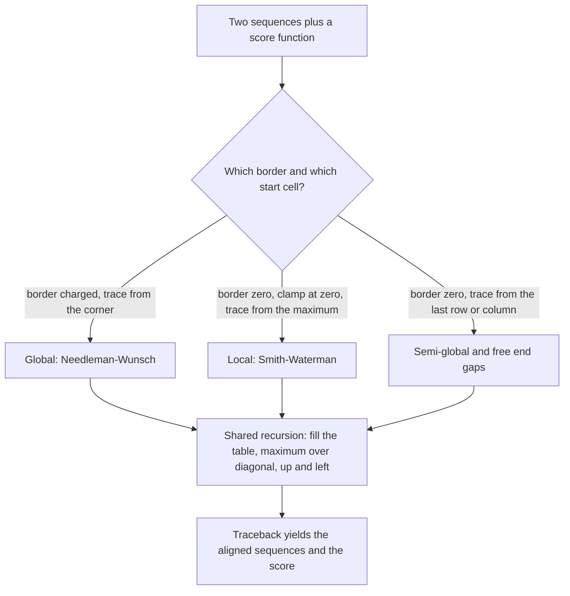

# Sequence Alignment

> Hub page. The two concrete algorithms have their own pages:
> [[needleman-wunsch]] (global) and [[smith-waterman]] (local). The scoring machinery is
> described in [[substitution-matrix]], the evolutionary vocabulary in [[homology]].

## Problem

**Input**: two or more DNA, RNA or protein sequences.
**Output**: an arrangement of them in which corresponding positions are placed in the
same column, with gaps inserted where one sequence has material the other lacks — plus a
score quantifying their similarity.

## Idea

Similar sequences usually share ancestry or function. To measure similarity fairly, the
sequences must first be put in register: matching positions are rewarded, mismatches
penalised, and **gaps** — which model insertions and deletions
([[dna-mutation]]) — are charged a **gap penalty** so that arbitrary stretching is not
free.

**Axes of the problem**

| Axis | Options |
|---|---|
| Number of sequences | **pairwise** (two) vs **multiple** (three or more) |
| Extent | **global** (end to end) vs **local** (best-matching sub-region) |

**Pairwise alignment**, in the definition given in the notes, means lining up two
sequences to achieve maximal identity, in order to assess the degree of similarity and
the possibility of [[homology]]. Formally — **In**: a pair of sequences plus a cost or
score function; **Out**: a correspondence between substrings that maximises the
similarity score.

**Four alignment types**

| Type | Purpose | Algorithm |
|---|---|---|
| **global** | align two complete strings end to end | [[needleman-wunsch]] |
| **local** | find local similarities, e.g. a shared domain | [[smith-waterman]] |
| **semi-global** | approximate pattern matching — one sequence inside the other | NW without border gap costs |
| **free end gaps** | finding overlaps, as needed by assembly | NW with free terminal gaps |

**Where it is used**: finding sequence features such as binding sites; mapping NGS reads
to a reference genome; building the overlap graph for de novo assembly; searching
sequence databases.

**Protein or DNA?** Protein sequences can be more informative, because amino acids share
biophysical properties and because third-codon-position changes are often synonymous
([[central-dogma]]); DNA is more informative for non-coding regions.

The optimal pairwise alignment is computed by **dynamic programming**: break the problem
into smaller subproblems, solve each optimally and combine them — which is only valid
when the overlapping-subproblems property (Bellman's principle) holds. A table is filled
so that each cell reuses already-computed sub-solutions
(see [[algorithmic-complexity]]).

When exact matching is enough — no substitutions, no indels — the far cheaper algorithms
of [[string-matching]] apply instead.

## Pseudocode

All four alignment types share one recursion; only the initialisation of the border, the
clamping at zero and the start cell of the traceback differ:

```text
ALIGN-RECURRENCE(A, B, s, d):
  // s(a,b) = substitution score; d = gap penalty (negative)
  F[i,j] ← max( F[i-1,j-1] + s(A[i], B[j]),   // align A[i] with B[j]
                F[i-1,j]   + d,               // gap in B
                F[i,j-1]   + d )              // gap in A
  // global  : F[i,0] ← i·d, F[0,j] ← j·d, traceback starts at F[n,m]   → NEEDLEMAN-WUNSCH
  // local   : border ← 0, extra option 0, traceback starts at max F[i,j] → SMITH-WATERMAN
  // free end gaps / semi-global: border ← 0, traceback starts in the last row or column
```

The full fill-and-traceback pseudocode, the backpointer matrix and a hand-checkable
worked example live on the algorithm pages: [[needleman-wunsch]] for the global case and
[[smith-waterman]] for the local case. This page deliberately does not repeat them.

## Complexity

- Time `O(n · m)` and space `O(n · m)` for the full table; space can be reduced to
  `O(min(n, m))` if only the score is needed.
- **Multiple** alignment of *k* sequences by the same exact method costs `O(nᵏ)` — which
  is why heuristics are used in practice.
- Searching a whole database exactly is infeasible, which motivates the heuristic
  [[blast]].

## Variants & pitfalls

- **Global vs local** differ only in the initialisation and the traceback start: global
  charges border gaps and traces from the corner; local clamps negative scores to zero
  and traces from the maximum cell.
- Gap penalties are usually **affine** (opening cost plus extension cost) because a
  single long indel is more likely than many short ones; the **constant**, **linear** and
  **affine** schemes are compared in [[substitution-matrix]].
- Alignment is **not** the same as mapping: mapping finds the region, alignment places
  each base within it (see [[next-generation-sequencing]]).
- High similarity does not prove homology; statistical significance must be assessed —
  that is the job of the [[blast]] E-value.

## Diagram


All four alignment types run the same recursion and differ only in the border, the clamping and where the traceback starts.

## Relations

- [[needleman-wunsch]] — the global dynamic-programming algorithm, with full pseudocode.
- [[smith-waterman]] — the local dynamic-programming algorithm.
- [[substitution-matrix]] — the score function and gap-penalty schemes.
- [[homology]] — what an alignment score is evidence for.
- [[string-matching]] — the exact-matching alternative when no mismatches are allowed.
- [[blast]] — the heuristic local-alignment database search built on this.
- [[dna-mutation]] — the biological events that alignment gaps and mismatches represent.
- [[next-generation-sequencing]] — mapping and alignment of reads.
- [[algorithmic-complexity]] — the dynamic-programming cost argument.
- [[hidden-markov-model]] — profile HMMs are built from a multiple alignment and are the
  probabilistic way to align a sequence to a family; MSA is listed in the notes as one of
  the problems HMMs solve well.
- [[dynamic-programming]] — the design pattern behind the shared recursion; this hub is
  its standard example in the course.
- [[genetic-code]] — its redundancy is why protein sequences can be more informative to
  align than DNA.
- [[splicing]] — spliced read mapping is built on this gapped alignment machinery.
- [[knuth-morris-pratt]] — the linear-time exact matcher used when no mismatches or
  indels are allowed.
- [[hamiltonian-and-eulerian-paths]] — the overlap edges of the Hamiltonian assembly
  formulation are free-end-gap alignments.
- Appears in [[L01-bioinformatics-and-the-cell]],
  [[L03-sequencing-and-genomics]], [[L05-sequence-comparison-and-networks]],
  [[L07-algorithms-and-complexity]], [[L08-exact-string-matching]],
  [[L09-sequence-alignment-and-homology]] and
  [[L17-markov-chains-and-hidden-markov-models]].

- [[planted-motif-problem]] — motif discovery is the ungapped, multi-sequence, short-pattern cousin of alignment.
- [[molecular-evolution]], [[evolutionary-distance]] — an alignment of homologous sequences is the required input to every distance estimate in [[M2L08-molecular-evolution-and-phylogeny]].
- [[maximum-parsimony]] — works on the alignment columns directly, with no distance summary.
- [[phylogenetic-tree-reconstruction]] — alignment is the bridge from data selection to modelling.
- [[network-alignment]] — the generalisation from strings to graphs, with the same local/global split.
- [[graph-edit-distance]] — counts edge indels the way edit distance counts character indels.

- Covered further in [[M2L10-network-alignment]], which lifts alignment from strings to graphs.

## Sources

- `raw/module1/gsb_part1.pdf`, pp. 8, 14, 27.
- `raw/module1/gsb_part2.pdf`, pp. 11–16.
- `raw/module1/gsb_part4.pdf`, pp. 15, 18 — profile HMMs over alignment columns, and
  MSA as an HMM application.

- `raw/module2/csb_4.pdf`, pp. 11–15 — local versus global network alignment and graph edit distance.
