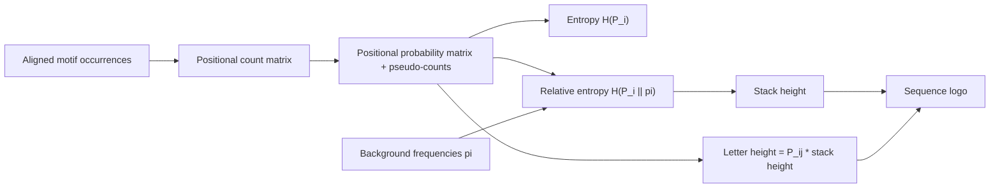

# Sequence logo

## Problem

**Input**: an alignment of equal-length sequences — the occurrences of a
[[sequence-motif]], or the columns of a profile `P_ij` — plus background frequencies
`π_j`.
**Output**: a picture in which each position of the motif is a stack of letters, whose
*total height* says how conserved the position is and whose *individual letter heights*
say which residues do the conserving.

## Idea

A [[position-weight-matrix]] is a table of numbers; nobody reads tables. A sequence logo
renders the same information so that the eye finds the conserved positions immediately:
it **shows which positions are more important than others**. Any sequence of DNA, RNA or
protein can be represented as a sequence logo.

The construction rests entirely on [[information-content]]:

- **Stack height** at position `i` is proportional to the **relative entropy**
  `H(P_i ‖ π)` — how far the column departs from the background.
- **Letter height** within the stack is proportional to that residue's **contribution**,
  `P_ij · H(P_i ‖ π)` — so within a stack letters are ordered by frequency.
- **Colours** highlight different properties (chemical class for amino acids, or simply
  the four bases).

## Pseudocode

```text
SEQUENCE-LOGO(S, pi, beta):
  // S    = aligned occurrences of the motif, each of length L
  // pi   = background frequencies over the alphabet A
  // beta = total pseudo-count mass
  L ← length of the alignment
  for i ← 1 to L:

    // 1. positional count matrix
    for each residue j in A:
      c[i,j] ← number of sequences in S with residue j at position i

    // 2. positional probability matrix, with pseudo-counts so no entry is 0
    for each residue j in A:
      P[i,j] ← (c[i,j] + beta · pi[j]) / (|S| + beta)

    // 3. entropy and relative entropy of the column
    H[i]  ← - Σ_{j ∈ A} P[i,j] · log2 P[i,j]
    I[i]  ← log2 |A| - H[i]                        // information content, in bits
    D[i]  ← Σ_{j ∈ A} P[i,j] · log2 (P[i,j] / pi[j])   // relative entropy

    // 4. draw
    stack_height[i] ← D[i]                          // or I[i] for a uniform background
    for each residue j in A:
      letter_height[i,j] ← P[i,j] · stack_height[i]
    draw the letters of position i stacked, largest at the top

  return the logo
```

With a **uniform** background (`π_j = 1/|A|`), `D[i] = I[i]`, so the classical
"bits" logo is the special case of the relative-entropy logo in which nothing is known
about the background.

## Worked example

Four aligned 4-mers over the DNA alphabet (`|A| = 4`, `log₂ 4 = 2` bits), ignoring
pseudo-counts for legibility:

| | pos 1 | pos 2 | pos 3 | pos 4 |
|---|---|---|---|---|
| seq 1 | A | G | A | T |
| seq 2 | A | G | A | T |
| seq 3 | A | G | A | C |
| seq 4 | A | G | A | C |

- Positions 1–3: one residue with `P = 1`, so `H = 0` and `I = 2 − 0 = 2 bits` — full
  height stacks showing `A`, `G`, `A`.
- Position 4: `P(T) = P(C) = 0.5`, so `H = −(0.5·log₂0.5 + 0.5·log₂0.5) = 1 bit` and
  `I = 2 − 1 = 1 bit` — a half-height stack split evenly between `T` and `C`.

This reproduces exactly the `A G A T/C` logo drawn in the notes: three tall letters and
one short, split stack.

## Complexity

`O(|S| · L)` to count and `O(L · |A|)` to convert and draw — trivial. The expensive part
is obtaining the alignment of motif occurrences in the first place, which is
[[em-motif-discovery]].

## Variants & pitfalls

- **Zero counts.** A residue absent from the alignment gets `P = 0`, and `log₂ 0` is
  undefined; pseudo-counts are mandatory, exactly as in
  [[position-weight-matrix]]. The notes give the pseudo-count form
  `f = (c_j + β·π_j) / (Σc + β)`.
- **Small samples inflate conservation.** With four sequences, a column that happens to
  be constant looks fully conserved. Information content is biased upward by
  approximately `(|A| − 1)/(2 ln 2 · |S|)` bits; corrections exist.
- **Background choice changes the picture.** Counting residue frequencies across *all*
  known proteins gives a different logo from counting them only within the
  **superfamily under consideration**.
- **A logo is not a model.** It shows per-position frequencies and nothing about
  dependencies between positions — the same independence assumption that limits a PWM.
- **The sign of the relative entropy.** The notes write
  `H(P_i‖π) = −Σ_j P_ij log₂(P_ij/π_j)`, the negative of the standard
  Kullback–Leibler divergence, which would give a conserved column a *negative* stack
  height. The standard positive form is used above; the discrepancy is recorded in
  [[open-questions]].

### What a logo shows, per the notes

- the general consensus of the sequences;
- letters representing nucleotides or amino acids;
- letters stacked on top of each other;
- the order of predominance of the residues at every position;
- the relative frequencies of every residue at every position;
- the amount of information present at every position, measured in **bits**;
- the initiation point, cut point or other significant location.

## Diagram


From counts to a logo: the probability matrix feeds both the stack height and the letter heights.

## Relations

- [[information-content]] — supplies entropy, information content and relative entropy.
- [[position-weight-matrix]] — the numeric twin of the logo; same `P_ij`, same `π_j`,
  different arithmetic (log-odds instead of entropy).
- [[sequence-motif]] — what is being drawn.
- [[em-motif-discovery]] — produces the alignment the logo summarises.
- [[transcription-factor-binding-site]] — the usual subject of a DNA logo.
- [[substitution-matrix]] — another log-based score referenced to a background.
- [[E09-binding-sites-pwm-and-pca]] — the module-1 exercise that asked for a logo
  without the course having defined one; this page supplies the definition.
- [[gibbs-sampling]] — one of the discovery methods whose learned profile is displayed
  as a logo.
- [[t-sne]] — letter heights and the t-SNE objective both come from the Kullback–Leibler divergence.

## Appears in

- [[M2L02-sequence-motifs-and-motif-discovery]]
- [[M2E02-motif-discovery-and-expectation-maximization]]
- [[E09-binding-sites-pwm-and-pca]]
- [[L12-binding-sites-and-position-weight-matrices]] — the module-1 lecture that builds
  the matrix this logo draws.

## Sources

- `raw/module2/csb_1.pdf`, p. 15 — sequence logos as a motif representation, the
  `A G A T/C` example and the seven-point list of what a logo shows.
- `raw/module2/csb_1.pdf`, p. 16 — profiles, entropy, information content, relative
  entropy, residue contributions, stack height and colouring.
- `raw/module2/csb_1.pdf`, p. 24 — exercise definition.
- `raw/module1/gsb_3.pdf`, p. 11 — the module-1 exercise in which a sequence logo was
  requested from a count matrix.
