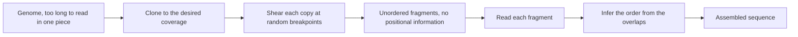

# Shotgun Sequencing

## Problem

**Input**: a genome far longer than any sequencing chemistry can read in one piece.
**Output**: the full sequence of that genome.

Sequencing machines read only short stretches, so the genome must be broken up, read in
pieces, and put back together.

## Idea

Clone the genome, shear the copies into random fragments, sequence the fragments, and
reconstruct the original order from the **overlaps** between fragments. Because the
breakpoints are random and the genome is present in many copies, every position is
covered by several fragments whose overlaps pin down the ordering.

## Pseudocode

```text
SHOTGUN-SEQUENCING(G, k, c):
  // G = genome to sequence, k = target fragment length, c = desired coverage
  C ← CLONE(G, c)                          // many copies of the genome
  F ← ∅
  for each copy in C:
    F ← F ∪ SHEAR(copy, k)                 // random breakpoints, unordered segments
  R ← ∅
  for i ← 1 to |F|:
    R[i] ← READ-SEQUENCE(F[i])             // chemistry reads each fragment
  // the fragments carry no positional information, so order must be inferred
  S ← ASSEMBLE(R)                          // see GREEDY-ASSEMBLY or DE-BRUIJN-ASSEMBLY
  return S
```

## Worked example

Suppose a 20 bp "genome" is sheared into the fragments
`ATTTGC`, `TTGCGC`, `GCAGAG`, `AGAGAC`, `GACCTA`, `CCTAAG`.
No fragment knows its position. Chaining them by overlap yields
`ATTTGCGCAGAGACCTAAG` — the full reconstruction is carried out step by step in
[[E02-greedy-assembly]].

## Complexity

- Wet-lab effort scales with coverage `c`: the number of reads is roughly
  `c · |G| / k`.
- The computational cost is dominated by the assembly step: naive all-against-all overlap
  computation is `O(n²)` in the number of reads (see [[greedy-assembly]] and
  [[algorithmic-complexity]]).

## Variants & pitfalls

- **Repeat regions** are the classical failure mode: fragments from different copies of a
  repeat look identical and are merged incorrectly.
- Coverage must be high enough that overlaps exist everywhere; gaps in coverage split the
  result into separate contigs.
- Shotgun sequencing is the conceptual ancestor of [[next-generation-sequencing]], which
  industrialises the same shear-read-assemble logic.
- Scale from the notes: human ≈ 3 Gbp / 46 chromosomes / ≈ 25 000 genes;
  *E. coli* ≈ 4.6 Mbp / 1 chromosome / ≈ 3200 genes
  (see [[genome-organization]]).

## Diagram


Shear, read, and reconstruct: the overlaps between randomly placed fragments are the only positional information available.

## Relations

- [[next-generation-sequencing]] — the modern high-throughput successor.
- [[greedy-assembly]] and [[de-bruijn-assembly]] — the two reconstruction strategies.
- [[genome-organization]] — determines how hard the reconstruction is.
- [[hamiltonian-and-eulerian-paths]] — the unordered fragments are what become the nodes
  or the *k*-mer edges of the two assembly graph formulations.
- Appears in [[L03-sequencing-and-genomics]] and [[E02-greedy-assembly]].

## Sources

- `raw/module1/gsb_part1.pdf`, p. 7.
