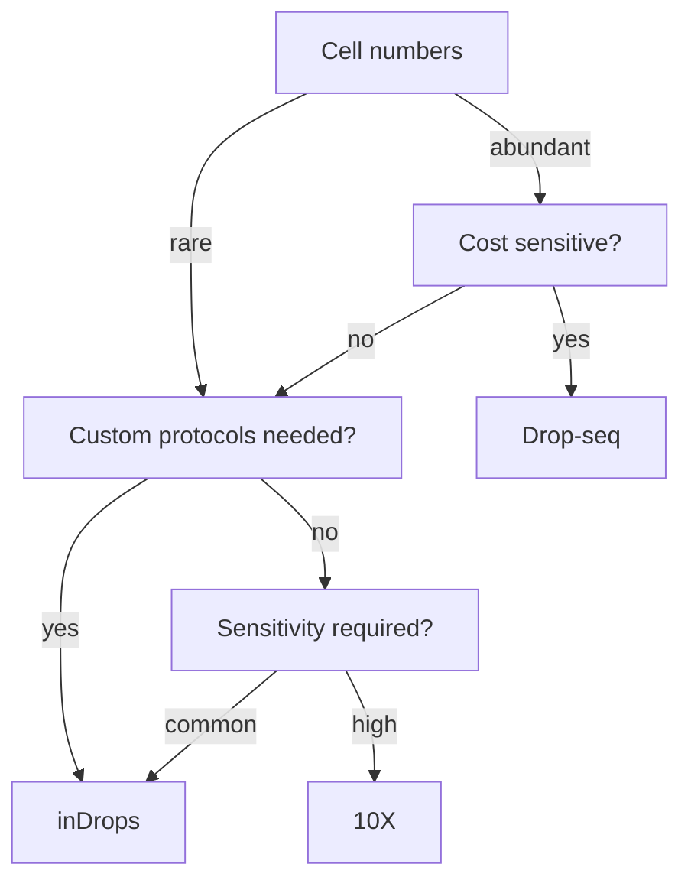

# Single-Cell RNA-Seq

## Problem

**Input**: a tissue sample.
**Output**: a **cell × gene** count matrix — one expression profile **per cell** instead
of one per sample.

This is the direct successor of bulk [[rna-seq]], whose output is one averaged profile
for the whole tissue.

## Idea

The notes draw the contrast as a pipeline:

```text
tissue  →  dissociate into single cells  →  profile each cell separately
        →  each cell type has a distinct expression profile
        →  reveals population variability over thousands of cells
```

against

```text
tissue  →  bulk  →  average gene expression over all cells
        →  cellular heterogeneity is MASKED
```

Bulk RNA-Seq reports the mean of a mixture. If a tumour contains a rare resistant
subclone, or if two cell types move in opposite directions, the mean says nothing. The
promised payoff in the notes is blunt: **cell-specific drugs**.

**What we want from a single-cell method** — the wish list, none of which any protocol
satisfies completely:

- **universal** (e.g. independent of cell size)
- **in situ measurements**
- **no minimum input number of cells**
- **every cell is assayed**
- **every transcript in every cell is detected**
- **transcripts identified by full-length sequence**
- **no [[doublet|doublets]]**
- **multimodal**
- **cost effective**
- **easy to use**
- **open source**

> ⇒ there are **many** single-cell RNA-seq protocols — precisely because every one of
> them trades some of these against the others.

## Pseudocode

The experiment and the analysis, end to end:

```text
SINGLE-CELL-RNA-SEQ(tissue):
  // ---- wet lab ----
  cells ← DISSOCIATE(tissue)                    // tissue → suspension of single cells
  drops ← ENCAPSULATE(cells, beads)             // droplet-based capture, Poisson loading
  for each drop d:
    if d contains ≥ 1 cell and ≥ 1 bead:
      lyse the cell; release the barcoded primers from the bead
      tag every mRNA of d with  (cell barcode of the bead , a random UMI)
  library ← REVERSE-TRANSCRIBE-AND-POOL(drops)
  reads ← SEQUENCE(library)                     // next-generation sequencing

  // ---- counting ----
  for each read r:
    (barcode, umi, location) ← PARSE-AND-ALIGN(r)
  M ← UMI-COLLAPSE(reads)                       // one count per distinct
                                                // (barcode, umi, location) triple
  return M                                      // the cell × gene count matrix
```

```text
ANALYSE(M):
  M ← PREPROCESS(M)                   // 1. data preprocessing
  M ← QUALITY-CONTROL(M)              // 2. remove dying cells and doublets
  M ← NORMALIZE(M)                    // 3. make cells comparable
  M ← SELECT-HIGHLY-VARIABLE-GENES(M) // feature selection
  M ← CORRECT-BATCH-EFFECTS(M)        //    e.g. ComBat
  Y ← REDUCE-DIMENSIONS(M)            // 4. PCA, then t-SNE or UMAP
  L ← CLUSTER(Y)                      // 5. clustering → candidate cell types
  D ← DIFFERENTIAL-EXPRESSION(M, L)   // 6. what distinguishes each cluster
  VISUALISE-AND-INTERPRET(Y, L, D)    // 7.
  return L, D
```

The analysis half is developed in [[single-cell-analysis-workflow]].

## Worked example

**Choosing a system** — the decision tree of the notes, driven by how many cells there
are and what the budget is:


The notes' decision tree for picking a droplet platform; the exact placement of the "common" branch is uncertain, see open questions.

**Why droplet methods are 3'-biased.** Droplet protocols *are a 3' technology*: the
barcoded primer anchors at the poly-A tail, so coverage is high near the 3' end and
decays with distance from it. **More information is therefore available there** — which
is why they fail the "transcript is identified by full-length sequence" wish and cannot
resolve [[splicing|splice isoforms]].

## Complexity

The matrix is **cells × genes**, so where bulk RNA-Seq produced tens of columns, this
produces `10³–10⁶`. It is also **extremely sparse**: most entries are zero, partly
because the gene is off and partly because the transcript was simply not captured
(*dropout*, not to be confused with the regularization [[dropout]]). Every downstream
step — [[data-normalization]], [[principal-component-analysis]], [[t-sne]], [[umap]],
[[cluster-analysis]] — is chosen with that sparsity and that size in mind.

## Variants & pitfalls

- **[[droplet-based-single-cell-methods]]** — the Poisson loading theory, the cell
  capture rate and the cell duplication rate, and the trade-off between them.
- **[[barcode-collision]]** — two cells receiving the same barcode, producing *synthetic*
  doublets.
- **[[doublet|Doublets]]** — technical, synthetic and biological; detected (or not) by a
  barnyard plot.
- **[[unique-molecular-identifier|UMIs]]** — the only defence against counting one
  molecule many times after PCR.
- **Quality control** — dying cells leak cytoplasmic mRNA and appear as barcodes with
  low count depth, few genes and a high mitochondrial fraction; see
  [[single-cell-analysis-workflow]].
- **[[batch-effect|Batch effects]]** are severe, because each run is a separate
  encapsulation; the notes name **ComBat** as the correction.

## Relations

- [[rna-seq]] — the bulk predecessor; single-cell replaces its averaged profile.
- [[next-generation-sequencing]] — the sequencing step is unchanged; only the library
  preparation differs.
- [[droplet-based-single-cell-methods]], [[barcode-collision]], [[doublet]],
  [[unique-molecular-identifier]] — the four chemistry concepts the lecture builds on.
- [[single-cell-analysis-workflow]], [[highly-variable-genes]] — the computational half.
- [[t-sne]], [[umap]], [[principal-component-analysis]] — how the resulting matrix is
  looked at.
- [[cluster-analysis]], [[k-means]] — how cell types are called from it.
- [[batch-effect]], [[data-normalization]] — the module-1 corrections, applied per cell.
- [[enrichment-analysis]], [[gene-set]] — the gene-level downstream analysis.
- [[endophenotype]] — clustering patients by module genes and clustering cells by
  expression are the same move at two different scales.
- [[probability-distribution]] — droplet loading is Poisson, which is where the capture
  and duplication formulas come from.
- [[deep-learning]] — autoencoders and GANs are applied to single-cell count matrices.
- [[generative-adversarial-network]] — GANs are used to simulate or impute single-cell expression data.

## Appears in

- [[M2L07-single-cell-rna-seq]]
- [[M2E07-single-cell-rna-seq-and-dimensionality-reduction]]
- [[L06-expression-profiling]] — the module-1 bulk expression pipeline this assay
  refines to single-cell resolution.

## Sources

- `raw/module2/csb_3.pdf`, p. 12 — tissue to single cells, bulk versus single cell,
  masked cellular heterogeneity, cell-specific drugs, the eleven-point wish list.
- `raw/module2/csb_3.pdf`, p. 13 — droplet methods as a 3' technology.
- `raw/module2/csb_3.pdf`, p. 15 — the platform decision tree (inDrops, 10X, Drop-seq)
  and the preprocessing layers.
- `raw/module2/csb_3.pdf`, p. 17 — batch-effect correction with ComBat.
- `raw/module2/csb_3.pdf`, p. 22 — the seven analysis steps and what they are used for.
