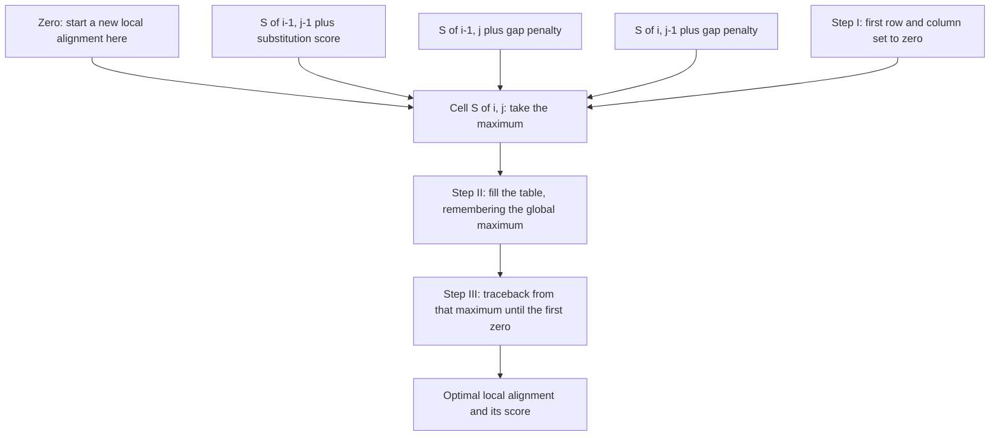

# Smith–Waterman

## Problem

**Input**: two sequences `X = x₁…x_m` and `Y = y₁…y_n`, a substitution matrix and a gap
scheme.
**Output**: the **optimal local alignment** — the pair of substrings, of any length and
starting and ending anywhere in the two sequences, whose alignment score is maximal.

## Idea

Two sequences often share a common **motif or domain** while differing everywhere else;
a global alignment ([[needleman-wunsch]]) would force the unrelated flanks into register
and bury the signal. Local alignment is therefore more **sensitive for highly diverged
sequences**.

Smith–Waterman is the Needleman–Wunsch recursion with two modifications:

1. the first row and first column are set to **zero** — an alignment may start anywhere
   without paying for the skipped prefix;
2. **negative scores are clamped to zero** — a local alignment is abandoned rather than
   continued at a loss.

```text
S(i, j) = max { 0
                S(i-1, j-1) + r(x_i, y_j)
                S(i-1, j)   + g
                S(i,   j-1) + g }
```

The traceback starts at the **maximum entry of the whole matrix** and stops at the first
zero. The algorithm is **guaranteed** to find the optimal local alignment.

## Pseudocode

```text
SMITH-WATERMAN(X, Y, r, g):
  m ← LENGTH(X); n ← LENGTH(Y)

  // Step I: initialization — first row and column are zero
  for i ← 0 to m: S[i,0] ← 0
  for j ← 0 to n: S[0,j] ← 0

  best ← 0; best_i ← 0; best_j ← 0

  // Step II: score calculation, negative scores clamped to zero
  for i ← 1 to m:
    for j ← 1 to n:
      diag ← S[i-1, j-1] + r(X[i], Y[j])
      up   ← S[i-1, j]   + g
      left ← S[i,   j-1] + g
      S[i,j] ← MAX(0, diag, up, left)
      B[i,j] ← ARGMAX(0, diag, up, left)      // "stop", "diag", "up" or "left"
      if S[i,j] > best:
        best ← S[i,j]; best_i ← i; best_j ← j  // remember the global maximum

  // Step III: traceback from the maximum until the first zero
  i ← best_i; j ← best_j
  alnX ← ""; alnY ← ""
  while S[i,j] > 0:
    if B[i,j] = "diag":
      alnX ← X[i] + alnX; alnY ← Y[j] + alnY; i ← i - 1; j ← j - 1
    else if B[i,j] = "up":
      alnX ← X[i] + alnX; alnY ← "-"  + alnY; i ← i - 1
    else:
      alnX ← "-"  + alnX; alnY ← Y[j] + alnY; j ← j - 1

  return (best, alnX, alnY)
```

## Worked example

`X = ACGT`, `Y = TACGA`, match `+1`, mismatch `−1`, `g = −2`.

| | – | T | A | C | G | A |
|---|---|---|---|---|---|---|
| **–** | 0 | 0 | 0 | 0 | 0 | 0 |
| **A** | 0 | 0 | 1 | 0 | 0 | 1 |
| **C** | 0 | 0 | 0 | 2 | 0 | 0 |
| **G** | 0 | 0 | 0 | 0 | **3** | 1 |
| **T** | 0 | 1 | 0 | 0 | 1 | 2 |

The maximum is `3` at `S[3,4]`. Tracing back diagonally until the first zero gives

```text
A C G
A C G
```

score 3 — the shared core, with the unmatched `T` and the flanking `T`/`A` simply left
out of the alignment.

## Complexity

- Time `O(m · n)`, space `O(m · n)` — identical to [[needleman-wunsch]]; the clamping
  costs nothing.
- This is exactly why exhaustive local alignment against a whole database is infeasible
  and why the heuristic [[blast]] exists (see [[algorithmic-complexity]]).

## Variants & pitfalls

- The **alignment score** is the sum of substitution scores and gap penalties and
  reflects the quality of the alignment; comparing scores across different
  [[substitution-matrix|matrices]] or gap schemes is meaningless.
- A positive local score is easy to obtain by chance between any two sequences — the
  score must be assessed statistically, which is the role of the E-value.
- Only the single best local alignment is returned; secondary local alignments require
  repeated runs with the found alignment masked out.
- With all-positive substitution scores the clamping never triggers and the result
  degenerates towards a global alignment; the matrix must contain negative entries.

## Diagram


Four incoming options instead of three: the extra zero is what lets a local alignment start anywhere and be abandoned rather than continued at a loss.

## Relations

- [[needleman-wunsch]] — the global counterpart; same recursion, different boundary and
  traceback.
- [[dynamic-programming]] — the design pattern; this is its clamped, local instance.
- [[sequence-alignment]] — the general framework.
- [[substitution-matrix]] — supplies the scores and gap penalties.
- [[homology]] — local similarity in a shared domain is strong homology evidence.
- [[blast]] — the fast heuristic approximation of this algorithm.
- [[network-alignment]] — local network alignment is its graph analogue: many-to-many mappings of small, well-matching regions.

## Appears in

- [[L05-sequence-comparison-and-networks]]
- [[L07-algorithms-and-complexity]]
- [[L09-sequence-alignment-and-homology]]
- [[E07-alignment-and-homology]]
- [[M2L10-network-alignment]] — module 2 generalises local alignment from sequences to graphs.

## Sources

- `raw/module1/gsb_part2.pdf`, pp. 15–16, 18.
- `raw/module2/csb_4.pdf`, p. 11 — local network alignment defined as many-to-many mapping of subnetworks.
