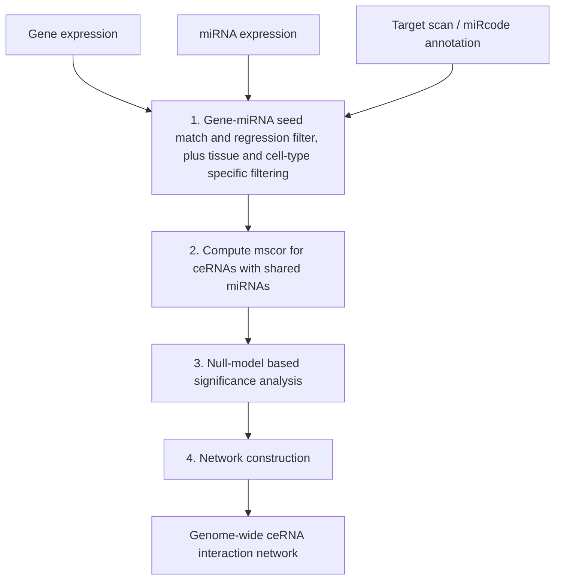

# SPONGE

## Problem

**Input**: a **gene expression** matrix, a **miRNA expression** matrix, and a **miRNA
target annotation** (the notes name **TargetScan** and **miRcode**).
**Output**: a **genome-wide [[competing-endogenous-rna|ceRNA]] interaction network**,
with a p-value on every edge.

**SPONGE** = **S**parse **P**artial correlation **ON** **G**ene **E**xpression.

## Idea

Two genes competing for the same [[microrna]] should lose part of their correlation once
that miRNA is conditioned on. [[sensitivity-correlation]] measures exactly that drop, and
its multiple-miRNA generalisation `mscor` measures it for a whole set of miRNAs at once.
SPONGE is that statistic, plus the two things needed to make it usable at genome scale:

- a **filtering step** that keeps only plausible gene–miRNA pairs, so the number of
  candidate triplets stays finite;
- a **simulated null model** that gives a p-value without permuting real expression
  vectors one triplet at a time — the cost that made the
  [[mutual-information|CMI]] route impossible.

### How SPONGE identifies gene–miRNA interactions

Two ways, used together:

1. **By using user-provided miRNA target annotation**, e.g. **TargetScan** (see
   [[mirna-target-prediction]]).
2. **By computing an elastic net regression model** with **the gene as response variable
   and the miRNA expression as explanatory variables**. The sparsity of the elastic net is
   what the "Sparse" in the name refers to: most miRNAs get coefficient zero, and only
   the surviving ones are treated as regulators of that gene.

### How SPONGE assigns p-values

It **uses a null model in which `mscor` values are simulated under the null hypothesis
that the partial correlation equals the correlation of the genes** — i.e. that the miRNAs
have no influence, so `mscor = 0`. See [[sensitivity-correlation]] for the sampling
scheme. Because `mscor` under the null depends only on the **gene–gene correlation**, the
**number of miRNAs** and the **number of samples**, the null distribution can be
precomputed on a grid of those three values and reused for every gene pair.

## Pseudocode

```text
SPONGE(gene_expr, mirna_expr, target_annotation, θ, α):
  // ---- 1. Gene-miRNA seed match and regression filter -------------------
  I ← ∅                                             // candidate gene-miRNA interactions
  for each gene g:
    S ← { m : SEED-MATCH(m, g) in target_annotation }
    β ← ELASTIC-NET(response ← gene_expr[g], predictors ← mirna_expr[S])
    for each miRNA m in S:
      if |β[m]| > θ:                                // regression filter
        if CO-EXPRESSED(m, g, tissue, cell_type):   // specificity-based filtering
          I ← I ∪ { (g, m) }                        // reduces false positives

  // ---- 2. Compute mscor for ceRNAs with shared miRNAs -------------------
  C ← ∅
  for each gene pair (g1, g2) with M ← miRNAs(g1) ∩ miRNAs(g2), M ≠ ∅:
    r    ← COR(gene_expr[g1], gene_expr[g2])
    p    ← PCOR(gene_expr[g1], gene_expr[g2] | mirna_expr[M])
    C[g1,g2] ← r − p                                // mscor(g1, g2, M)

  // ---- 3. Null-model based significance analysis ------------------------
  for each (g1, g2) in C:
    m     ← |miRNAs(g1) ∩ miRNAs(g2)|
    null  ← SIMULATE-NULL(cor ← COR(g1,g2), m, #samples)   // mscor = 0 holds
    pval[g1,g2] ← ( #{ x ∈ null : x ≥ C[g1,g2] } + 1 ) / ( |null| + 1 )
  q ← BENJAMINI-HOCHBERG(pval)                      // many pairs, so correct

  // ---- 4. Network construction ------------------------------------------
  E ← { (g1, g2) : q[g1,g2] ≤ α }
  return GRAPH(nodes ← genes, edges ← E)

SIMULATE-NULL(cor, m, n_samples):
  N ← ∅
  repeat B times:
    R ← SAMPLE-CORRELATION-MATRIX(cor, m)   // valid R with mscor = 0 by construction
    D ← SAMPLE-DATA(R, n_samples)
    N ← N ∪ { MSCOR(D) }
  return N
```

Steps 1–4 are the four numbered workflow steps of p. 9.

## Worked example

Genes `g₁` and `g₂` correlate at `r = 0.62`. They share `m = 3` miRNAs; conditioning on
all three gives `pcor = 0.21`, so

```text
mscor(g1, g2, M) = 0.62 − 0.21 = 0.41
```

The precomputed null for `(cor ≈ 0.62, m = 3, n = 200)` places only 3 of 10 000 simulated
values at or above `0.41`, so `p ≈ 3·10⁻⁴`. After [[multiple-testing-correction]] over
all gene pairs the edge survives, and `g₁ — g₂` is drawn in the ceRNA network: most of
their co-expression is explained by competition for those three miRNAs.

Had `pcor` come out at `0.60` instead, `mscor ≈ 0.02` — the "no effect" bar pair of
[[sensitivity-correlation]] — and no edge would be drawn.

## Complexity

- Step 1 is one elastic net per gene: `O(#genes · #miRNAs · #samples)` per coordinate
  pass, and it is what makes the rest tractable by shrinking the candidate set.
- Step 2 touches only gene pairs **with shared miRNAs**, far fewer than the
  `O(#genes²)` of a full correlation matrix.
- Step 3 would be the bottleneck if run per pair; precomputing `SIMULATE-NULL` on a grid
  of `(cor, m, #samples)` turns it into a table lookup. This is the single design decision
  that buys genome-wide scale.

## Variants & pitfalls

- **Garbage in, garbage out**: the target annotation is itself a prediction, with the
  false-positive rate described in [[mirna-target-prediction]].
- **Correlation is not competition.** `mscor` is a linear statistic; a shared upstream
  regulator can produce the same signature as competition for a miRNA.
- The notes flag **significance of sensitivity correlations as an open challenge**; the
  simulated null is SPONGE's answer, not a universally accepted one.
- Tissue- and cell-type-specific filtering is essential, not optional — without it, step 1
  admits pairs that never co-occur.

## Diagram


The four-step SPONGE workflow of p. 9, from three input matrices to a network.

## Relations

- [[sensitivity-correlation]] — the statistic SPONGE computes and its null model.
- [[competing-endogenous-rna]] — the network it infers.
- [[microrna]] — the regulator conditioned on.
- [[mirna-target-prediction]] — supplies the annotation consumed in step 1.
- [[mutual-information]] — the alternative it was designed to replace.
- [[interaction-network]] — the output is one, inferred rather than measured.
- [[multiple-testing-correction]] — needed because every gene pair is a test.
- [[statistical-testing]] — empirical p-values from a simulated null.
- [[keypathwayminer]] — the other module-2 method that turns expression data into network
  structure, from the opposite direction.

## Appears in

- [[M2L09-non-coding-rnas]]
- [[M2E09-non-coding-rnas-and-sponge]]

## Sources

- `raw/module2/csb_4.pdf`, p. 5 — SPONGE named as the multiple-sensitivity-correlation
  tool: genome-wide analysis, reduced runtime, multiple miRNAs.
- `raw/module2/csb_4.pdf`, p. 9 — the name expansion and the four workflow steps.
- `raw/module2/csb_4.pdf`, p. 10 — TargetScan annotation, the elastic net regression
  model, and the null-model p-value assignment (exercise).
