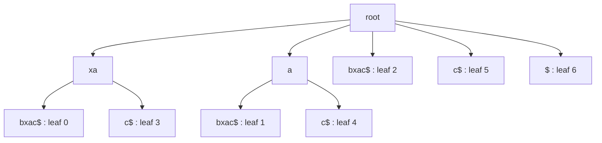

# Suffix Tree

## Problem

**Input:** a string `w[0..m−1]`, terminated with a unique sentinel `$`.
**Output:** a tree representing **all suffixes** of `w`, such that string operations —
"is `P` a substring of `w`?", "where does `P` occur?", "what is the longest repeat?" —
become efficient.

The defining properties from the notes:

1. A data structure representing all suffixes of a string.
2. Every suffix is **exactly one path** from the root to a leaf.
3. It makes string operations efficient — e.g. checking whether a pattern of length `m`
   is a substring costs `O(m)`, independently of the length of `w`.

## Idea

Instead of rescanning the text for every query, build the index once: the text is
preprocessed so that every substring of `w` is the prefix of some suffix, hence a path
starting at the root. This is the **factor-search** paradigm of [[string-matching]],
the one left open by [[knuth-morris-pratt]] and [[boyer-moore-string-search]].

**Features for `w[0..m−1]`**

- `m` leaves, numbered `0 … m−1`; leaf `i` is the suffix starting at position `i`.
- Every internal node has **at least two** children.
- Each edge label is a **substring** of `w`.
- **No two edges** leaving the same node start with the same character — this makes the
  path for any pattern unique.

## Pseudocode

The construction given in the notes is the straightforward incremental one, inserting one
suffix after another (indices 0-based, as in the lecture):

```text
BUILD-SUFFIX-TREE(w):
  w ← w · "$"                              // unique sentinel, forces every suffix to end in a leaf
  root ← new node
  ADD-EDGE(root, w[0..n-1], leaf 0)        // (I) start with the whole string as one root-to-leaf edge
  for i ← 1 to n-1:                        // (II) push suffixes w[1..n-1], w[2..n-1], …
    INSERT(root, w[i..n-1], i)
  return root

INSERT(root, s, leafNumber):
  (u, e, k) ← MATCH(root, s)               // deepest node u, edge e, k characters matched along e
  if k = 0:                                // (a) matching cannot continue from node u
    ADD-EDGE(u, remaining suffix of s, leaf leafNumber)
  else:                                    // (b) mismatch in the middle of edge e = (u, v)
    v ← head(e)
    x ← new internal node                  // split the edge
    label(u, x) ← first k characters of label(e)
    label(x, v) ← rest of label(e)
    ADD-EDGE(x, remaining suffix of s, leaf leafNumber)

CONTAINS(root, P):
  follow the unique path spelling P from the root     // edges are chosen by first character
  return true if all of P is consumed, else false     // O(|P|)
```

## Worked example

`w = xabxac$`. The suffixes pushed in order are
`xabxac$`, `abxac$`, `bxac$`, `xac$`, `ac$`, `c$`, `$`.

- Start: one edge `xabxac$` to leaf 0.
- `abxac$` shares nothing with `x…`, so a new edge from the root → leaf 1.
- `bxac$` → new edge from the root → leaf 2.
- `xac$` shares the prefix `xa` with leaf 0's edge → **split** that edge after `xa`,
  creating an internal node with children `bxac$` (leaf 0) and `c$` (leaf 3).
- `ac$` shares `a` with leaf 1's edge → split after `a`.
- `c$`, `$` → new root edges.


The suffix tree of `xabxac$`; each internal node marks a substring that occurs more than once.

Every internal node corresponds to a **repeated substring** — the basis of the repeat
detection done in [[E10-suffix-trees-and-arrays]].

## Complexity

- **Construction** as given above: **`O(n²)`** — each of the `n` suffixes is matched
  character by character down the tree. (Linear-time constructions exist — Ukkonen's
  algorithm — but are not covered by the notes.)
- **Space**: `O(n)` nodes, with edge labels stored as index pairs into `w`.
- **Query**: `O(|P|)` to decide whether `P` is a substring, plus `O(occ)` to list the
  `occ` occurrences by collecting the leaves of the subtree.

See [[algorithmic-complexity]] for the notation.

## Variants & pitfalls

- **Scoring a PWM on a suffix tree.** Because every shared prefix is stored once, a
  [[position-weight-matrix]] scan evaluates it once: depth-first search accumulating the
  prefix score `p(x ≤ d)` along the edge labels, then
  (a) if a node's score already reaches the threshold `th`, every substring in that
  subtree reaches it, and (b) if the score falls below the intermediate threshold `th_d`,
  the whole branch is pruned.
- **Memory** is the practical pitfall: a suffix tree over a human chromosome needs tens
  of bytes per base, which is why the flattened [[suffix-array]] is usually preferred.
- The **sentinel `$`** is not optional: without it a suffix that is a prefix of another
  suffix would end in the middle of an edge instead of a leaf.

## Relations

- [[suffix-array]] — the flat, memory-efficient representation derived from the same
  ordering of suffixes.
- [[string-matching]] — supplies the factor-search paradigm this structure implements.
- [[position-weight-matrix]] — the motif scan accelerated by the tree.
- [[knuth-morris-pratt]], [[boyer-moore-string-search]] — online alternatives that
  preprocess the *pattern* instead of the *text*.
- [[algorithmic-complexity]] — the `O(n²)` construction versus `O(|P|)` query trade-off.
- [[transcription-factor-binding-site]] — the sites a PWM scan over this index is
  searching for.

## Appears in

- [[L08-exact-string-matching]]
- [[L12-binding-sites-and-position-weight-matrices]]
- [[L13-suffix-trees-and-arrays]]

## Sources

- `raw/module1/gsb_3.pdf`, pp. 13–14, 16–18.
