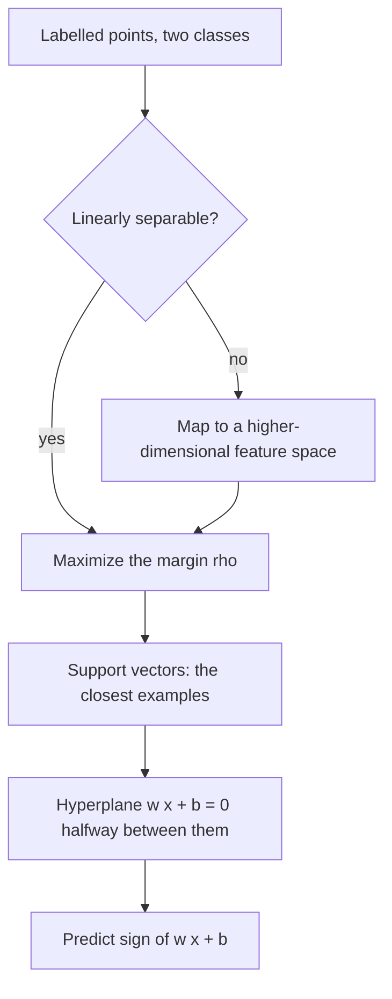

# Support Vector Machine

## Problem

**Input**: labelled points `x_i` in a feature space, two classes.
**Output**: a **linear separator** — a hyperplane `wᵀx + b = 0` — with the **largest
possible margin**, and the decision function

```text
f(x) = sign( wᵀx + b )

wᵀx + b > 0  →  one class
wᵀx + b < 0  →  the other class
```

## Idea

Many hyperplanes separate a linearly separable training set. **Which separator is
optimal?** The one furthest from the data. Formally:

- the **distance from an example `x_i` to the separator** is

  ```text
  r = ( wᵀx_i + b ) / ‖w‖
  ```

- the examples **closest to the hyperplane** are the **support vectors**;
- the **margin `ρ`** of the separator is the **distance between the support vectors**.

**Maximum-margin classification** chooses `w, b` maximising `ρ`. It gives good accuracy
for **PAC** (*probably approximately correct*) learning, and — the decisive practical
point — **only the support vectors matter; all other training examples are ignorable.**

**Non-linear SVM: feature space.** If the data is **not separable**, the original feature
space **can be mapped to some higher-dimensional feature space where the training set is
separable**. An SVM can therefore be **both a linear and a non-linear model**.

## Pseudocode

```text
SVM-TRAIN(X, y, φ):
  // φ is the feature map; φ(x) = x gives the linear SVM
  // maximize the margin ρ = 2/‖w‖  ⇔  minimize ½‖w‖²
  solve:
      minimize    ½ · ‖w‖²
      subject to  y_i · ( wᵀ φ(x_i) + b ) ≥ 1   for all i
  SV ← { x_i : y_i · ( wᵀ φ(x_i) + b ) = 1 }    // the support vectors, constraint tight
  return w, b, SV

SVM-PREDICT(w, b, φ, x):
  return sign( wᵀ φ(x) + b )

MARGIN(w, b, X):
  r ← min_i | wᵀ x_i + b | / ‖w‖                // distance to the nearest example
  return 2 · r                                  // distance between the support vectors
```

## Worked example

The exercise data:

```text
Class 1:  (1,9)   (5,5)   (1,2)
Class 2:  (9,5)   (13,1)  (13,9)
```

Plotted in the `x₁ / x₂` plane, class 1 lies on the left and class 2 on the right, so a
**vertical** separator suffices — only `x₁` matters.

- The class-1 point closest to class 2 is `(5,5)`; the class-2 point closest to class 1
  is `(9,5)`. These are the **support vectors**.
- The **decision boundary** is the vertical line halfway between them:

  ```text
  x₁ = (5 + 9) / 2 = 7        →  w = (1, 0)ᵀ,  b = −7,  f(x) = sign(x₁ − 7)
  ```

- The **margin** is the distance between the support vectors:

  ```text
  ρ = 9 − 5 = 4
  ```

Check the remaining points: `(1,9)` and `(1,2)` give `sign(1−7) = −1` (class 1);
`(13,1)` and `(13,9)` give `sign(13−7) = +1` (class 2). All six points are classified
correctly, and moving `(1,9)` anywhere to the left of `x₁ = 5` would change nothing —
only the support vectors matter.

## Diagram


If the data is not separable it is first mapped to a feature space where it is, and in either case only the support vectors fix the maximum-margin hyperplane.

## Complexity

The training problem is a convex quadratic program in `n` variables; standard solvers are
between `O(n²)` and `O(n³)` in the number of training samples, which is why SVMs are
comfortable with many features but awkward with very many samples. Prediction costs
`O(|SV|)` — only the support vectors are needed.

## Variants & pitfalls

- **Linear versus non-linear**: the notes list the SVM under **linear problems**
  alongside linear regression, and then immediately show that a feature-space mapping
  makes it non-linear. The exercise states the point directly: *an SVM can be both a
  linear and a non-linear model.*
- Mapping to a higher-dimensional space raises the risk of [[overfitting]]; the margin is
  the regularizer that keeps it in check.
- The formulation above assumes the data **is** separable in `φ`-space; overlapping
  classes need slack variables, which the notes do not cover.
- The distance formula `r = (wᵀx_i + b)/‖w‖` is **signed**; the margin uses its absolute
  value.

## Relations

- [[machine-learning]] — "learning = changing the coordinates of a hyperplane" is the
  SVM picture, stated on the first page of the lecture.
- [[decision-tree]], [[random-forest]] — the non-linear alternatives taught in the same
  lecture.
- [[overfitting]] — maximum-margin classification is the SVM's answer to it.
- [[roc-curve]] — how the trained classifier is scored.
- [[principal-component-analysis]] — also a projection onto a direction in feature space,
  but chosen by variance rather than by class separation.
- [[algorithmic-complexity]] — the quadratic-program cost above.
- [[deep-learning]], [[neural-network]] — the contrasting approach: a kernel chosen by hand versus features learned from data.

## Appears in

- [[M2L03-machine-learning-and-classification]]
- [[M2E03-machine-learning-and-classification]]

## Sources

- `raw/module2/csb_part2.pdf`, p. 1 — SVM named as a linear method; learning as moving a
  hyperplane.
- `raw/module2/csb_part2.pdf`, p. 8 — linear separators, `f(x) = sign(wᵀx + b)`, the
  distance `r`, support vectors, margin `ρ`, maximum-margin classification and PAC, and
  the non-linear feature-space mapping.
- `raw/module2/csb_part2.pdf`, p. 11 — the six-point exercise with support vectors,
  decision boundary and margin.
