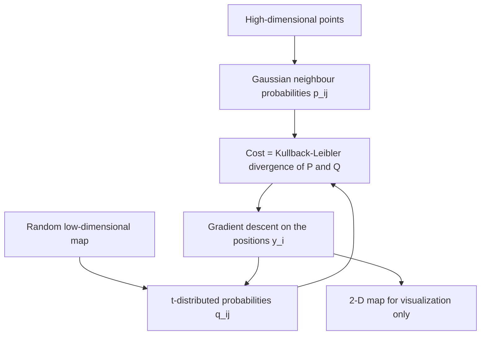

# t-SNE

## Problem

**t-Distributed Stochastic Neighbor Embedding**.

**Input**: points in a high-dimensional space — in this course, cells described by
thousands of genes.
**Output**: a 2-D or 3-D **map** in which points that were neighbours stay neighbours.

The four properties the notes list:

- a technique for **dimensionality reduction**
- **unsupervised** and **non-linear**
- **preserving local similarities (small distances)**
- **only visualization, no clustering!**

## Idea

Distance in a high-dimensional space is not worth preserving exactly — most pairs are
far apart and almost equally far. t-SNE therefore converts distances into
**probabilities of being each other's neighbour**, and asks the low-dimensional map to
reproduce those probabilities rather than the distances themselves.

The three steps, as the notes number them:

1. **Select neighbours with respect to a Gaussian distribution** over points in the
   **high-dimensional** space → `p_ij`, the probability to choose `x_i` as a neighbour
   of `x_j`.
2. **Select neighbours with respect to a t-distribution** over points in the
   **low-dimensional** space → `q_ij`, the probability to choose `y_i` as a neighbour of
   `y_j`. The t-distribution's **heavier tails allow better modelling of longer
   distances** — without it, points that are moderately far apart in high dimensions
   would be crushed together in the map.
3. **Minimize the Kullback–Leibler divergence between both distributions**, by
   [[gradient-descent]] on the positions `y_i`:

```text
C = KL(P ‖ Q) = Σ_i Σ_j  p_ij · log ( p_ij / q_ij )
```

The asymmetry of `KL(P‖Q)` is what makes the result *local*: a large `p_ij` paired with a
small `q_ij` is punished heavily, so **near pairs must stay near**; the reverse costs
almost nothing, so **far pairs may end up anywhere**.

## Pseudocode

```text
T-SNE(X, d_out, perplexity, η, iterations):
  n ← |X|

  // ---- step 1: Gaussian neighbour probabilities in high dimensions ----
  for i ← 1 to n:
    choose σ_i so that the perplexity of p_·|i equals the target
    for j ≠ i:
      p_{j|i} ← exp( −‖x_i − x_j‖² / (2σ_i²) ) / Σ_{k≠i} exp( −‖x_i − x_k‖² / (2σ_i²) )
  for all i, j:
    p_ij ← ( p_{j|i} + p_{i|j} ) / (2n)              // symmetrise

  // ---- initialise the map ----
  Y ← n random points in ℝ^(d_out)

  // ---- steps 2 and 3: t-distributed q, minimise KL by gradient descent ----
  for t ← 1 to iterations:
    for all i, j:
      q_ij ← (1 + ‖y_i − y_j‖²)^(−1) / Σ_{k≠l} (1 + ‖y_k − y_l‖²)^(−1)   // Student t
    for i ← 1 to n:
      ∂C/∂y_i ← 4 · Σ_j (p_ij − q_ij) · (y_i − y_j) · (1 + ‖y_i − y_j‖²)^(−1)
      y_i ← y_i − η · ∂C/∂y_i
  return Y
```

## Worked example

The notes give no numeric trace; the picture they draw is the comparison that motivates
the method. Three groups of symbols (`x`, `o`, `△`) sit in a high-dimensional scatter.
A **linear** projection such as [[principal-component-analysis]] flattens them onto one
axis and can leave the groups interleaved — `x o x o x △ o △` — because it only preserves
directions of greatest variance. t-SNE instead produces three separated runs,
`xxxx oooo △△△△`, because what it optimises is exactly *who is next to whom*.

Caption the notes attach to the idea: **similar objects near each other.**

## Diagram


Both spaces are turned into neighbour probabilities, and the map is moved by gradient descent until the two distributions agree.

## Complexity

```text
time  O(n²) per iteration   — every pair contributes to p_ij and q_ij
space O(n²)                 — the full pairwise probability matrices
```

This is the practical reason the notes say that **[[umap]] scales better than t-SNE
computationally**, and the reason that in [[single-cell-analysis-workflow]] t-SNE is run
on the first few principal components rather than on all genes.

## Variants & pitfalls

- **It is not a clustering.** The notes repeat it twice: *only visualization, no
  clustering*. Groups in a t-SNE plot are a hypothesis; the clusters themselves come from
  [[cluster-analysis]] run on the data, not on the map.
- **Global distances are meaningless.** Only local similarities are preserved, so the
  distance *between* two visible blobs, and their relative sizes, carry no information.
  [[umap]] claims to preserve global dissimilarities too.
- **The perplexity matters**: it sets how many neighbours each `σ_i` covers, and
  different values give visibly different maps of the same data.
- **It is stochastic**: different random initialisations give different maps.

## Relations

- [[umap]] — the successor taught alongside it: also non-linear and visualization-only,
  but preserving global dissimilarities as well and scaling better.
- [[principal-component-analysis]] — the linear alternative; in practice PCA is run
  first and t-SNE on its output.
- [[gradient-descent]] — step 3 is a gradient descent on the embedding coordinates.
- [[cost-function]] — the KL divergence is the cost here.
- [[information-content]] — relative entropy, i.e. the Kullback–Leibler divergence, is
  the same quantity that sets the letter heights in a [[sequence-logo]].
- [[single-cell-analysis-workflow]], [[single-cell-rna-seq]] — the context in which the
  lecture introduces it.
- [[cluster-analysis]], [[k-means]] — what must be done *separately* to obtain groups.
- [[autoencoder]] — the deep-learning route to the same non-linear embedding, which does
  yield a reusable encoder.
- [[rna-interference]] — visual analytics of high-dimensional screening data is a listed RNAi task.
- [[highly-variable-genes]] — HVG selection is the filter applied before the embedding.

## Appears in

- [[M2L07-single-cell-rna-seq]]
- [[M2E07-single-cell-rna-seq-and-dimensionality-reduction]]
- [[L11-normalization-pca-and-batch-effects]] — the module-1 lecture introducing PCA,
  the linear projection this method succeeds.

## Sources

- `raw/module2/csb_3.pdf`, p. 17 — visualization methods and the "similar objects near
  each other" idea, with the linear-versus-non-linear picture.
- `raw/module2/csb_3.pdf`, p. 18 — the four properties, the three steps, `p_ij`, the
  heavier tails of the t-distribution, `q_ij`, and gradient descent on
  `C = KL(P‖Q) = ΣΣ p_ij log(p_ij/q_ij)`.
- `raw/module2/csb_3.pdf`, p. 21 — the exercise: the first step of t-SNE, t-SNE and UMAP
  as visualization and as non-linear methods.
- `raw/module2/csb_4.pdf`, p. 3 — visual analytics in the RNAi screening analysis stack.
