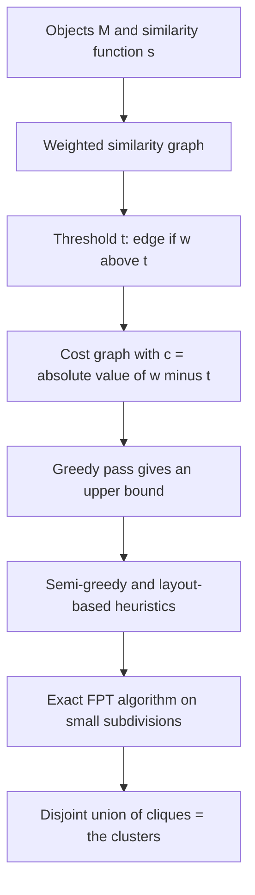

# TransClust

## Problem

**Input**: a set of objects `M` and a **similarity function**

```text
s : (M choose 2) → ℝ
```

**Output**: subsets (**clusters**) which are **highly related according to the
similarity** — e.g. a cluster of homogeneous points.

TransClust is **a clustering tool for biomedical datasets**, based on **Weighted
Transitive Graph Projection**: it **transforms a given graph into a disjoint union of
cliques by using a minimum number of edge modifications**.

## Idea

A perfect clustering is a graph in which "similar to" is **transitive**: if `a~b` and
`b~c` then `a~c`. Such a graph is a disjoint union of **cliques**. A real similarity
graph is not transitive, so ask: *what is the cheapest set of edge insertions and
deletions that makes it so?*

1. Build the **similarity graph** `G`: **nodes = points**, **edges = similarities with
   weights**.
2. Apply an **edge-weight threshold `t`** to construct the unweighted graph `G'`:

   ```text
   existing edge:      w > t
   no edge:            w < t
   ```

3. The **cost function for modifying an edge** is

   ```text
   c = | w − t |
   ```

   Equivalently, shift the weights: the modified similarity graph has `w' = w − t`, and
   the **cost graph** has `w'' = |w'|`. Deleting an existing edge or inserting a missing
   one costs exactly how far its weight sits from the threshold.

4. Project `G'` onto a **transitive graph `G*` with minimal costs** `c`.

## Pseudocode

```text
TRANSCLUST(M, s, t):
  // 1. similarity graph
  G ← graph with V = M, and edge {u,v} of weight s(u,v)

  // 2. thresholding and cost graph
  for each pair {u,v}:
    w'  ← s(u,v) − t                       // modified similarity graph
    E'  ← E' ∪ {u,v}  if w' > 0            // existing edge  : w > t
                                           // non-edge       : w < t
    c[u,v] ← | w' |                        // cost of flipping this pair

  // 3. transitive graph projection: NP-hard
  //    find the cheapest set of edge modifications making G' transitive
  best ← GREEDY(G', c)                     // fast, no quality guarantee → upper bound
  best ← SEMI-GREEDY(G', c, best)          // randomized restarts under the upper bound
  best ← LAYOUT-BASED(G', c, best)         // good heuristic in polynomial time
  for each subdivision D of best that is small enough:
    D* ← EXACT-FPT(D, c)                   // exact, but exponential; re-cluster D
    best ← best with D replaced by D*
  return the connected components (cliques) of best       // the clusters
```

**Missing values**: set the missing similarity values to the **threshold** `t` — then
`c = |w − t| = 0` and the pair costs nothing either way. This also speeds up the
pre-computations.

## Worked example

From the exercise, a weighted similarity graph on nodes `0…10` with edges such as
`0–1 = 5`, `1–2 = 3`, `1–5 = 4`, `5–3 = 9`, `5–6 = 3`, `3–4 = 4`, `4–7 = 8`,
`7–8 = 2`, `7–9 = 3`, `4–10 = 10`, `6–3 = 8`.

**Thresholding at `t = 2`** (a non-edge counts as weight `0`): every weight becomes
`w' = w − t`, so `0–1` becomes `3`, `1–2` becomes `1`, `7–8` becomes `0`, and every
absent pair becomes `−2`, i.e. an absent edge that costs `2` to insert.

**Clustering and its cost.** The resulting clique partition drawn in the notes gives

```text
cost = (2 + 1) + 0 + 3 + (3 + 2) = 11
```

— three deletions and two insertions, each priced at `|w − t|`.

**Evaluation against the gold standard** `C1 = {1,3,6,8,0}`, `C2 = {2,9,10}`,
`C3 = {4,5,7}`: every unordered pair of the 11 objects is labelled TP/FP/FN/TN by the
pair rule of [[f-measure]], giving `F ≈ 0.61` — *low*, i.e. the threshold `t = 2` does
not reproduce the gold standard well. Worked through in
[[M2E04-k-means-and-transclust]].

## Diagram


Thresholding turns similarities into edge-modification costs, and a chain of heuristics with an exact fallback finds the cheapest transitive projection.

## Complexity

**NP-hard.** Weighted transitive graph projection has no known polynomial exact
algorithm, so TransClust combines three strategies:

| Algorithm | Property |
|---|---|
| **Greedy algorithm** | fast, but **no quality guarantee** |
| **Exact fixed-parameter algorithm** | **guarantees the exact solution**, but **exponential** |
| **Graph-layout-based algorithm** | a **good heuristic in polynomial time** |

The pipeline chains them:

```text
Input → similarity network → cost graph → greedy algorithm → upper bound
      → semi-greedy → layout-based algorithm → exact FPT algorithm
      → re-cluster subdivisions → output
```

The greedy pass supplies an **upper bound** that prunes the exact search, and the exact
algorithm is only ever run on **subdivisions** small enough to afford it.

## Variants & pitfalls

- The result depends entirely on the **threshold `t`**: it is the density parameter
  discussed in [[f-measure]], chosen with a gold standard by maximising `F`, and without
  one by maximising `Q(t)`.
- Unlike [[k-means]], TransClust needs **no feature vectors** and **no `k`** — only
  pairwise similarities. That is exactly the k-means weakness *"problematic if objects
  are not described by feature vectors"*.
- The clusters are **cliques**: every pair inside a cluster is asserted to be similar,
  which is a strong model.
- The NP-hardness is real; the output of the heuristic chain is a good solution, not a
  provably optimal one — the same situation as [[ant-colony-optimization]] in
  [[keypathwayminer]].

## Relations

- [[cluster-analysis]] — TransClust is its graph-based representative.
- [[k-means]] — the prototype-based alternative, compared throughout.
- [[f-measure]] — scores the result and picks the threshold `t`.
- [[interaction-network]] — the same object, a weighted graph over biological entities;
  here the weights are similarities rather than interactions.
- [[keypathwayminer]] — the other NP-hard graph extraction problem of module 2, attacked
  by a metaheuristic rather than by an FPT/heuristic chain.
- [[algorithmic-complexity]] — the polynomial/exponential divide that forces the hybrid
  pipeline.
- [[hamiltonian-and-eulerian-paths]] — the module-1 instance of the same lesson: the
  representation decides tractability.
- [[machine-learning]] — unsupervised learning on a graph.
- [[upgma]] — hierarchical clustering reused phylogenetically; both turn a distance matrix into structure without a preset `k`.
- [[network-alignment]] — another graph problem solved by heuristic search over an NP-hard objective.
- [[cytomcs]] — like TransClust, a Cytoscape-family tool operating on network topology.

## Appears in

- [[M2L04-clustering]]
- [[M2E04-k-means-and-transclust]]

## Sources

- `raw/module2/csb_part2.pdf`, p. 15 — definition, weighted transitive graph projection,
  input and goal, thresholding and the cost function, NP-hardness, the three algorithms
  and the pipeline.
- `raw/module2/csb_part2.pdf`, p. 16 — the threshold as density parameter and the
  missing-value trick.
- `raw/module2/csb_part2.pdf`, pp. 19–20 — the worked similarity graph, the
  `t = 2` thresholding, the cost of 11 and the F-measure evaluation.

- `raw/module2/csb_4.pdf`, pp. 11–14 — heuristic optimisation over network structure.
