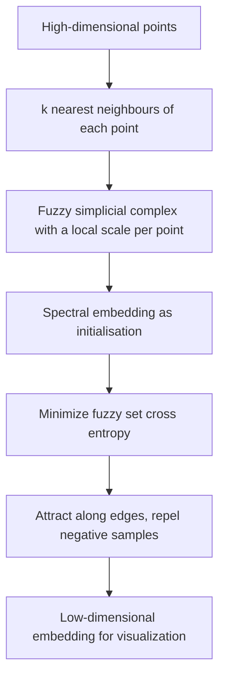

# UMAP

## Problem

**Uniform Manifold Approximation and Projection**.

**Input**: points in a high-dimensional space.
**Output**: a low-dimensional embedding for visualization.

The six properties the notes list:

- a technique for **dimensional reduction**
- **unsupervised** and **non-linear**
- **preserving local similarities (small distances)**
- **preserving global dissimilarities (large distances)** ← the difference from [[t-sne]]
- **scales better than t-SNE computationally**
- **only visualization, no clustering!**

## Idea

UMAP assumes the data lies on a **manifold** — a curved surface of much lower dimension
than the space it is drawn in — and tries to rebuild that manifold's *topology* in two
dimensions.

The three steps, as the notes number them:

1. **Approximate the manifold** for data in the high-dimensional space, using
   **simplicial complexes as neighbourhood graphs**.
2. **Approximate distances** for data in the low-dimensional space using **fuzzy
   spectral embedding**.
3. **Optimize the low-dimensional fuzzy topology to be similar to the high-dimensional
   fuzzy topology**, via **fuzzy set cross entropy**.

**Simplices.** A **`k`-simplex is the convex hull of `k+1` points**; these *can be used
as building blocks for topological spaces and covers*:

| `k` | Simplex |
|---|---|
| 0 | a point |
| 1 | a line |
| 2 | a triangle |
| 3 | a tetrahedron |

**Constructing an open cover as a simplicial complex**: put a ball of some radius around
each point, **determine the overlaps**, and **represent each overlap by a simplex**. The
result is the neighbourhood graph.

**The problem, and the trick that fixes it.** A fixed radius leaves the complex
**disconnected, since the data are not uniformly distributed** — dense regions fuse,
sparse regions fall apart. UMAP's answer is to **assume the data *is* uniformly
distributed on the manifold, and instead change the distances along the manifold**, i.e.
give every point its own local scale. That is a **Riemannian metric**: distance is
measured locally, differently at each point.

**Fuzzy topology and the curse of dimensionality.** The radius is **extended to the
`k`-nearest neighbours**, with `k` as the one meaningful knob:

- **small `k` focuses on local topology**
- **greater `k` focuses on global topology**

Fuzzy topology *allows local distance measures, but may still suffer from isolated
points in high dimensions*, because

> in high dimensions the distance to the first neighbour is large, but similar to the
> distance to all the others.

So UMAP **focuses on the differences in distances among nearest neighbours rather than
the absolute distance**, and **enforces local connectivity by setting membership fuzzy
only after the first neighbour** — i.e. the nearest neighbour always gets membership 1,
which guarantees no point is left isolated.

## Pseudocode

```text
UMAP(X, k, d_out, η, epochs):
  n ← |X|

  // ---- step 1: fuzzy simplicial complex in high dimensions ----
  for i ← 1 to n:
    N_i ← the k nearest neighbours of x_i
    ρ_i ← min_{j ∈ N_i} d(x_i, x_j)        // distance to the FIRST neighbour
    choose σ_i so that Σ_{j ∈ N_i} exp( −(d(x_i,x_j) − ρ_i) / σ_i ) = log₂ k
    for j ∈ N_i:
      w_{i→j} ← exp( −( d(x_i, x_j) − ρ_i ) / σ_i )   // local connectivity:
                                                      // nearest neighbour gets w = 1
  for all i, j:
    w_ij ← w_{i→j} + w_{j→i} − w_{i→j}·w_{j→i}        // fuzzy set union

  // ---- step 2: initialise with a spectral embedding ----
  Y ← SPECTRAL-EMBEDDING(w, d_out)          // eigenvectors of the graph Laplacian

  // ---- step 3: minimise fuzzy set cross entropy ----
  for e ← 1 to epochs:
    for each edge (i, j) with weight w_ij:
      ATTRACT y_i towards y_j, with force ∝ w_ij          // positive term
      for a few randomly sampled c:
        REPEL y_i from y_c, with force ∝ (1 − w_ic)       // negative sampling
    η ← η · (1 − e/epochs)                                // decay the step size
  return Y
```

Step 3 is again a [[gradient-descent]], but on **negative samples** rather than all
pairs — which is exactly where the better scaling comes from.

## Worked example

The notes give no numeric trace; the geometric example is the cover construction. Take a
handful of points on a curved line drawn in the plane. Draw a disc around each. Where
two discs overlap, record a 1-simplex (an edge); where three overlap, a 2-simplex (a
triangle). The union of those simplices is a combinatorial stand-in for the curve. Vary
the radius per point — small where the points are dense, large where they are sparse —
and the complex becomes connected everywhere, which is the "uniform on the manifold"
assumption in action.

The diagram in the notes shows two charts `U_α` and `U_β` on the manifold with transition
maps between them and projections into `ℝ^n`, the standard picture of a manifold covered
by local coordinate patches.

## Diagram


The manifold is approximated by a fuzzy neighbourhood graph, spectrally embedded, then refined until the low-dimensional topology matches the high-dimensional one.

## Complexity

Nearest-neighbour search plus an edge-wise optimisation with negative sampling:

```text
time  ≈ O(n^1.14 · k)   in practice, versus O(n²) per iteration for t-SNE
space O(n · k)          only the k-NN graph, not the full pairwise matrix
```

— which is what the notes mean by *scales better than t-SNE computationally*.

## Variants & pitfalls

- **Still not a clustering.** *Only visualization, no clustering!* — the same warning as
  for [[t-sne]].
- **`k` changes the answer**: small `k` gives many small local structures, large `k` a
  smoother global picture. There is no value that is right for all questions.
- **Global distances are *more* meaningful than in t-SNE, not fully meaningful.** The
  exercise's summary is that UMAP is the method capturing **both local and global
  dissimilarities**.
- **Stochastic**, like t-SNE: a different seed gives a different picture.

## Relations

- [[t-sne]] — the method it is taught against: same purpose, same two warnings, but
  global structure and better scaling.
- [[principal-component-analysis]] — the linear reduction run first in practice.
- [[gradient-descent]] — step 3's optimiser.
- [[graph-neural-network]] — the spectral embedding of step 2 uses the graph Laplacian
  `L = D − A`, the same object a spectral GNN is built on.
- [[cluster-analysis]], [[k-means]] — the separate step that actually produces groups.
- [[interaction-network]], [[de-bruijn-graph]] — further instances of the module's
  recurring move of turning data into a graph before doing anything else.
- [[single-cell-analysis-workflow]], [[single-cell-rna-seq]] — the application.
- [[information-content]] — cross entropy here, relative entropy in the motif lecture:
  the same information-theoretic family of objectives.
- [[rna-interference]] — visual analytics of high-dimensional screening data is a listed RNAi task.
- [[autoencoder]] — both produce low-dimensional embeddings; UMAP is geometric, the autoencoder is learned.
- [[highly-variable-genes]] — HVG selection is the filter applied before the embedding.

## Appears in

- [[M2L07-single-cell-rna-seq]]
- [[M2E07-single-cell-rna-seq-and-dimensionality-reduction]]
- [[L11-normalization-pca-and-batch-effects]] — the module-1 lecture introducing PCA,
  whose leading components are the usual input to this embedding.

## Sources

- `raw/module2/csb_3.pdf`, p. 19 — the six properties, the three steps, `k`-simplices as
  building blocks, open covers from overlapping balls, non-uniform data and the
  Riemannian-metric trick, the manifold chart diagram.
- `raw/module2/csb_3.pdf`, p. 20 — extending the radius to `k` nearest neighbours, small
  versus greater `k`, fuzzy topology and isolated points, focusing on differences in
  neighbour distances, enforcing local connectivity after the first neighbour.
- `raw/module2/csb_3.pdf`, p. 21 — the exercise: the first step of UMAP, UMAP for
  visualization, UMAP as the method capturing both local and global dissimilarities.
- `raw/module2/csb_4.pdf`, p. 3 — visual analytics in the RNAi screening analysis stack.
