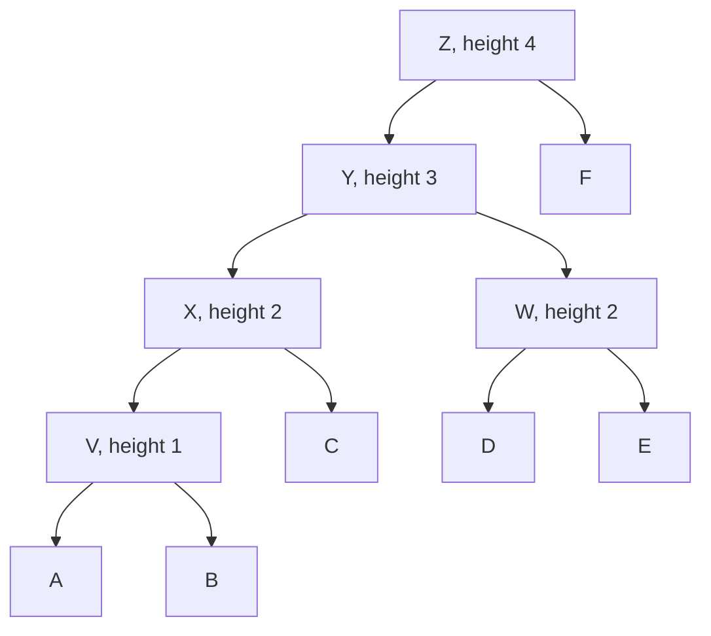

# UPGMA

## Problem

**Unweighted Pair Group Method with Arithmetic mean.**

**Input**: a matrix `D` of pairwise [[evolutionary-distance|evolutionary distances]] over
`n` taxa.
**Output**: a **rooted ultrametric** [[phylogenetic-tree]] with branch lengths.

The notes' characterisation: *distance-based*, *sequential clustering algorithm*,
*assumes a [[molecular-clock]]*, *results in a rooted ultrametric tree*.

## Idea

Agglomerative hierarchical clustering, exactly as in [[cluster-analysis]], with one
phylogenetic twist: because a clock is assumed, the **height** at which two clusters are
joined is **half** their distance — half the divergence went down each lineage.

```text
1. find the pair (i, j) with the minimal distance d_ij
2. merge them into a new node X at height d_ij / 2
3. recompute the distance from X to every remaining cluster
4. repeat until one cluster is left — that is the root
```

The update is the **unweighted arithmetic mean** over all original taxon pairs across the
two clusters:

```text
d_XY  =  (1 / (N_X · N_Y)) ·  Σ_{i ∈ X}  Σ_{j ∈ Y}  d_ij
```

"Unweighted" refers to the *taxon pairs* each counting once — which means a large cluster
automatically carries more weight than a small one.

### The equivalence the notes record

```text
molecular clock property (MCP)  ⟺  ultrametric tree
                                ⟺  three-point condition:
                                    d_ij ≤ d_ik = d_kj   for all i, j, k
```

If the input matrix satisfies the three-point condition, UPGMA reconstructs the true
tree exactly. If it does not, UPGMA still returns *a* tree — a wrong one.

## Pseudocode

```text
UPGMA(D, taxa):
  C ← { {t} : t ∈ taxa }                  // one singleton cluster per taxon
  for each cluster c ∈ C:  height[c] ← 0
  while |C| > 1:
    (X, Y) ← argmin_{X ≠ Y ∈ C}  d(X, Y)  // closest pair

    Z ← X ∪ Y
    height[Z] ← d(X, Y) / 2               // molecular clock: split the distance
    branch(X → Z) ← height[Z] − height[X]
    branch(Y → Z) ← height[Z] − height[Y]

    for each W ∈ C \ {X, Y}:              // arithmetic-mean update
      d(Z, W) ← ( |X| · d(X, W) + |Y| · d(Y, W) ) / ( |X| + |Y| )

    C ← ( C \ {X, Y} ) ∪ {Z}
  return the single remaining cluster as a rooted tree          // its node is the root
```

The weighted form `(|X|·d(X,W) + |Y|·d(Y,W)) / (|X|+|Y|)` is algebraically identical to
the double sum above, and is what one actually computes.

## Worked example

The six taxa **A–F** from the exercise. Initial lower-triangular matrix:

| | A | B | C | D | E |
|---|---|---|---|---|---|
| **B** | 2 | | | | |
| **C** | 4 | 4 | | | |
| **D** | 6 | 6 | 6 | | |
| **E** | 6 | 6 | 6 | 4 | |
| **F** | 8 | 8 | 8 | 8 | 8 |

**Step 1** — minimum is `d(A,B) = 2` → merge into **V** at height `2/2 = 1`.

```text
d(C,V) = ½(4 + 4) = 4      d(D,V) = 6     d(E,V) = 6     d(F,V) = 8
```

| | V | C | D | E |
|---|---|---|---|---|
| **C** | 4 | | | |
| **D** | 6 | 6 | | |
| **E** | 6 | 6 | 4 | |
| **F** | 8 | 8 | 8 | 8 |

**Step 2** — minimum is 4, taken at `(D,E)` → merge into **W** at height `4/2 = 2`.

```text
d(W,C) = ½(6 + 6) = 6      d(W,V) = ¼(6+6+6+6) = 6     d(F,W) = 8
```

**Step 3** — minimum is `d(V,C) = 4` → merge into **X** at height `4/2 = 2`.

```text
d(X,W) = (1/6)(6+6+6+6+6+6) = 6        d(F,X) = ⅓(8+8+8) = 8
```

**Step 4** — minimum is `d(X,W) = 6` → merge into **Y** at height `6/2 = 3`.

```text
d(F,Y) = 8
```

**Step 5** — merge `Y` and `F` into the root **Z** at height `8/2 = 4`.

**Resulting branch lengths** (height of parent minus height of child):

```text
A → V = 1        B → V = 1        V → X = 2 − 1 = 1
C → X = 2        X → Y = 3 − 2 = 1
D → W = 2        E → W = 2        W → Y = 3 − 2 = 1
Y → Z = 4 − 3 = 1                 F → Z = 4
```

Check the ultrametric property: every leaf is at height 0 and the root at height 4, so
root-to-leaf sums all equal 4 — e.g. `A: 1+1+1+1 = 4`, `C: 2+1+1 = 4`, `D: 2+1+1 = 4`,
`F: 4`. ✓


The UPGMA tree for taxa A–F; every leaf lies at height 0 beneath a root at height 4, as an ultrametric tree requires.

## Complexity

```text
iterations:          n − 1
cost per iteration:  O(n²) to find the minimum  +  O(n) to update
total:               O(n³) time,  O(n²) space       — naive implementation
with a heap:         O(n² log n)
```

Compare the `(2n−5)! / (2^(n−3)(n−3)!)` possible topologies that
[[maximum-parsimony]] would have to search: UPGMA is polynomial precisely because it
commits greedily and never reconsiders.

## Variants & pitfalls

- **The clock assumption is the whole risk.** If lineages evolve at different rates, the
  three-point condition fails and UPGMA mis-groups taxa — typically pulling two
  fast-evolving lineages together. Use [[neighbor-joining]] when a clock cannot be
  assumed.
- **Greedy and irrevocable**: an early wrong merge is never undone.
- **The root is an artefact of the method**, not an inference from an outgroup. UPGMA
  always produces a root; [[neighbor-joining]] and [[maximum-parsimony]] require an
  [[bootstrap-tree-assessment|outgroup]] to place one.
- **Ties** (such as the 4s in step 2 of the example) can be broken either way and give
  different trees; the notes' solution circles `(D,E)` first.
- It is the same algorithm as **average-linkage hierarchical clustering** from
  [[cluster-analysis]] — only the interpretation of the merge height is phylogenetic.

## Relations

- [[neighbor-joining]] — the clock-free alternative, producing an unrooted additive tree.
- [[maximum-parsimony]] — the alignment-based alternative that needs no distances.
- [[molecular-clock]] — the assumption; the three-point condition is its algebraic form.
- [[phylogenetic-tree]] — rooted ultrametric trees.
- [[evolutionary-distance]], [[jukes-cantor-model]], [[kimura-two-parameter-model]] —
  where the input matrix `D` comes from.
- [[cluster-analysis]] — UPGMA *is* hierarchical average-linkage clustering.
- [[k-means]], [[transclust]] — the other clustering methods of module 2; unlike these,
  UPGMA keeps the whole merge hierarchy rather than a flat partition.
- [[phylogenetic-tree-reconstruction]] — step 3, "method".
- [[bootstrap-tree-assessment]] — step 4, how much of this tree to believe.
- [[dynamic-programming]] — the contrasting algorithmic strategy from module 1: UPGMA is
  greedy, and greediness is exactly what costs it correctness off-clock.
- [[algorithmic-complexity]] — its O(n³) clustering loop is analysed with the same complexity vocabulary.
- [[molecular-evolution]] — turns evolutionary distances into a clock-assuming tree.

## Appears in

- [[M2L08-molecular-evolution-and-phylogeny]]
- [[M2E08-phylogenetics]]

## Sources

- `raw/module2/csb_3.pdf`, p. 31 — UPGMA as a distance-based sequential clustering
  algorithm, the molecular-clock assumption, the rooted ultrametric result, the merge at
  height `d_ij/2`, the update formula `d_XY = (1/(N_X N_Y)) Σ d_ij`, and the
  MCP ⟺ ultrametric ⟺ three-point-condition equivalence.
- `raw/module2/csb_3.pdf`, p. 30 — distance-based methods in the comparison table.
- `raw/module2/csb_3.pdf`, p. 39 — the full worked example on taxa A–F.
