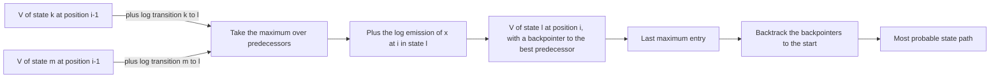

# Viterbi algorithm

## Problem

The **decoding problem** of a [[hidden-markov-model]]:

> Given a model and an output sequence, what is the most likely state sequence through
> the model that generated the output?

**Input**: an HMM with transitions `T(r | q)` and emissions `P(x | q)`, and an observed
sequence `x₁ … x_L`.
**Output**: the single **most probable state path**, which gives a way to match up an
observed sequence with the states in the model.

The biological payoff named in the notes: with states for **intergenic**, **start/stop**
and **coding**, the model **predicts the region of coding DNA from a given sequence**.

## Idea

A **dynamic programming algorithm that allows us to compute the most probable path.**
Define

```
P_ℓ(i, x) = probability of the most probable path that ends in state ℓ having emitted the first i observations
```

The recursion given in the notes is

```
P_ℓ(i, x) = e_ℓ(i) · max_k ( P_k(i−1, x) · P_kℓ )
             ↑                ↑                ↑
   P of observing i      recursion over    P of transition
   in state ℓ            predecessors k    from k to ℓ
```

Only the **best** predecessor survives at each cell — that is the single difference from
the [[forward-algorithm]], which sums instead. Two practical points from the notes:

- **use log** to turn products into sums;
- **backtrack the path from the last maximum entry to the start**.

## Pseudocode

```text
VITERBI(x, Q, T, P, π):
  // x ← observed sequence x[1..L]; Q ← states; π(q) ← initial probability
  // all quantities in log space: log P is used so products become sums

  L ← |x|
  for each q in Q:
    V[q, 1] ← log π(q) + log P(x[1] | q)
    BP[q, 1] ← nil                                 // backpointer

  for i ← 2 to L:
    for each ℓ in Q:
      best ← −∞; arg ← nil
      for each k in Q:
        v ← V[k, i-1] + log T(ℓ | k)               // previous · transition, in log space
        if v > best:
          best ← v; arg ← k                        // keep only the maximum
      V[ℓ, i]  ← log P(x[i] | ℓ) + best            // · emission
      BP[ℓ, i] ← arg

  // termination: the last maximum entry
  q* ← argmax_{q in Q} V[q, L]
  path[L] ← q*

  // backtrack from the last max entry to the start
  for i ← L down to 2:
    path[i-1] ← BP[path[i], i]

  return path, V[q*, L]                            // most probable path and its log probability
```

## Worked example

The exercise model (p. 20): two states with `P(S₁) = 0` and `P(S₂) = 1` at the start. In
this model the **emissions are attached to the transitions**, not to the states — the
other of the two conventions described in
[[hidden-markov-model]] § *Two emission conventions*. The pseudocode above is written in
the standard **state-emission** form, so when following the trellis below, read the
emission factor as belonging to the arrow `k → ℓ` rather than to `ℓ`:

| Transition | probability | emits `A` | emits `C` |
|---|---|---|---|
| `S₁ → S₁` | 0.6 | 0.8 | 0.2 |
| `S₁ → S₂` | 0.4 | 0.5 | 0.5 |
| `S₂ → S₁` | 0.1 | 0.1 | 0.9 |
| `S₂ → S₂` | 0.9 | 0.3 | 0.7 |

Observation sequence `C A A`. Initialise `V[S₁,0] = 0`, `V[S₂,0] = 1` (probabilities, not
logs, for readability). The first observation `C` gives the two candidate products
written on the sheet:

```
into S₁:  max( 0 · 0.6 · 0.2 ,  1 · 0.1 · 0.9 )
          = max( 0 , 0.09 )  = 0.09            // best predecessor: S₂
into S₂:  max( 0 · 0.4 · 0.5 ,  1 · 0.9 · 0.7 )
          = max( 0 , 0.63 )  = 0.63            // best predecessor: S₂
```

Each step keeps the larger of the two incoming products and remembers which predecessor
produced it; after the third column the larger final entry is selected and the
backpointers are followed back to the start to read off the state path. The full working
is in [[E13-markov-chains-and-viterbi]].

The gene-finding sketch of p. 17 uses the same recursion with two states `H` and `L` in
log space, e.g. `P_H(G, 1) = −1 − 1.7` and

```
P_H(G, 2) = −1.7 + max( P_H(G,1) + P_HH , P_L(G,1) + P_LH )
```

where the additions are the log-space form of the products above.

## Complexity

- **Time**: `O(L · |Q|²)` — one column per observation, each of the `|Q|` cells maximising
  over `|Q|` predecessors.
- **Space**: `O(L · |Q|)`, dominated by the backpointer matrix, which must be kept for the
  traceback.
- Naive enumeration of all paths would be `O(|Q|^L)`; see [[algorithmic-complexity]].

## Variants & pitfalls

- **Numerical underflow**: with raw probabilities the products vanish after a few hundred
  steps — hence *use log to use sums, not products*. In log space the `max` is unchanged
  because `log` is monotonic.
- **Viterbi path ≠ most likely state at each position**. The single best path can assign
  a state that the posterior ([[forward-algorithm]] plus backward) considers unlikely;
  posterior decoding and Viterbi decoding can disagree.
- **Ties** must be broken by a fixed rule, otherwise the traceback is ambiguous.
- Viterbi is the same DP skeleton as [[needleman-wunsch]]: a matrix, a max-recursion over
  predecessors, and a traceback through backpointers.
- The tool that implements this family of algorithms for profile HMMs is **HMMER**.

## Diagram


The Viterbi trellis keeps only the best predecessor per cell, which is the single difference from the summing forward recursion.

## Relations

- [[hidden-markov-model]] — the model whose decoding problem this solves.
- [[forward-algorithm]] — the same recursion with a sum instead of a max.
- [[baum-welch-algorithm]] — trains the parameters that Viterbi then decodes with.
- [[markov-chain]] — the hidden state process being recovered.
- [[needleman-wunsch]] — the other classical fill-and-traceback dynamic program in this
  module.
- [[algorithmic-complexity]] — dynamic programming replacing exponential enumeration.
- [[dynamic-programming]] — the design pattern; the trellis is its table and Viterbi its
  maximising instance.
- [[backpropagation]] — both exploit a layered structure to avoid recomputing shared subresults.
- [[maximum-likelihood]] — the related objective over the *data* rather than over a single path; both use the log transform to turn products into sums.

## Appears in

- [[L17-markov-chains-and-hidden-markov-models]]

## Sources

- `raw/module1/gsb_part4.pdf`, p. 17 (decoding problem, recursion, log space, backtrack,
  gene-finding example, HMMER), p. 18 (summary), p. 20 (worked exercise model and
  trellis).
