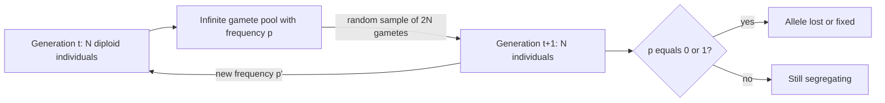

# Wright–Fisher Model

## Problem

**Input:** a population of `N` diploid individuals, a locus with two alleles `A` and `a`,
and the current allele counts `n_A`, `n_a`.
**Output:** the probability distribution of the allele counts in the next generation —
i.e. a model of how allele frequencies move when **nothing but chance** acts on them.

## Idea

Each generation is produced in three steps:

1. The `N` individuals of generation `t` release an **infinite number of gametes**
   carrying alleles in proportion to the current frequencies.
2. A **random sample of `2N` gametes** is drawn from that pool (each individual is
   diploid, so `2N` alleles are needed).
3. These form the `N` individuals of generation `t+1`.

With `p = n_A / 2N` and `q = n_a / 2N = 1 − p`, the count of `A` in the next generation is
binomially distributed:

```text
P{ n_A' = k } = B_{2N,p}(k) = C(2N, k) · p^k · (1 - p)^(2N - k)
```

The change of allele frequency between generations in a finite population due to random
sampling alone is **[[genetic-drift]]**.

**Assumptions**

- Constant population size `N < ∞`.
- Random mating.
- Non-overlapping generations.
- No migration, no mutation, no selection.

These are the [[hardy-weinberg-equilibrium]] assumptions minus the infinite population —
and that single relaxation is what produces drift.


One Wright–Fisher generation: an infinite gamete pool resampled down to 2N alleles.

## Pseudocode

```text
WRIGHT-FISHER(N, p0, T):
  // N individuals, initial allele frequency p0, T generations
  p ← p0
  for t ← 1 to T:
    k ← SAMPLE-BINOMIAL(2N, p)       // draw 2N gametes from an infinite pool
    p ← k / (2N)                     // new allele frequency
    if p = 0: return "allele A lost"        // absorbing state
    if p = 1: return "allele A fixed"       // absorbing state
  return p                           // 0 < p < 1: locus still segregating

TRANSITION-PROBABILITY(N, i, j):
  // probability of going from i copies of A to j copies in one generation
  p ← i / (2N)
  return C(2N, j) · p^j · (1 - p)^(2N - j)
```

## Worked example

A population of `N = 5` diploid individuals, so `2N = 10` alleles. Generation 5 carries
`#A₁ = 8` and `#A₂ = 2`; generation 6 again carries `#A₁ = 8`, `#A₂ = 2`.

Probability of staying at 8 copies:

```text
p = 8/10 = 0.8
P(8 → 8) = C(10, 8) · (8/10)^8 · (1 - 8/10)^(10-8)
         = 45 · 0.8^8 · 0.2^2 ≈ 45 · 0.16777 · 0.04 ≈ 0.302
```

Probability of going from 7 copies to 7 copies:

```text
p = 7/10 = 0.7
P(7 → 7) = C(10, 7) · (7/10)^7 · (1 - 7/10)^(10-7)
         = 120 · 0.7^7 · 0.3^3 ≈ 120 · 0.08235 · 0.027 ≈ 0.267
```

Even "nothing changed" has a probability of only about 30 %: in a population this small,
the frequency almost always moves.

## Complexity

Simulating `T` generations costs `O(T)` binomial draws. The exact transition matrix over
all states has `(2N+1)²` entries, so computing the distribution after `T` generations
exactly costs `O(T · N²)` — one reason simulation is preferred for realistic `N`
([[algorithmic-complexity]]).

## Variants & pitfalls

- **Speed of drift.** Using mean `np` and standard deviation `√(np(1−p))` of the
  binomial with `n = 2N`:

  ```text
  p' = ( 2Np ± √( 2N·p·(1-p) ) ) / 2N = p ± √( p·(1-p) ) / √(2N)
  ```

  The step size shrinks as `1/√(2N)`: for `N → ∞` the effect vanishes and the
  Hardy–Weinberg picture is recovered.
- The model has **two absorbing states**, fixation (`p = 1`) and loss (`p = 0`); without
  mutation it always ends in one of them.
- Real populations violate every assumption — overlapping generations, non-random mating,
  migration — so `N` is replaced by an *effective* population size in practice. The notes
  do not develop this.

## Relations

- [[genetic-drift]] — the phenomenon this model defines.
- [[hardy-weinberg-equilibrium]] — the infinite-population limit of the same setup.
- [[population-genetics]] — the wider framework.
- [[probability-distribution]] — the binomial distribution, with its mean and variance.
- [[genome-wide-association-study]] — drift between subpopulations is what creates the
  population structure that a GWAS has to correct for.

## Appears in

- [[L14-population-genetics]]
- [[E11-population-genetics-and-multiple-testing]]

## Sources

- `raw/module1/gsb_3.pdf`, pp. 21–22, 32.
