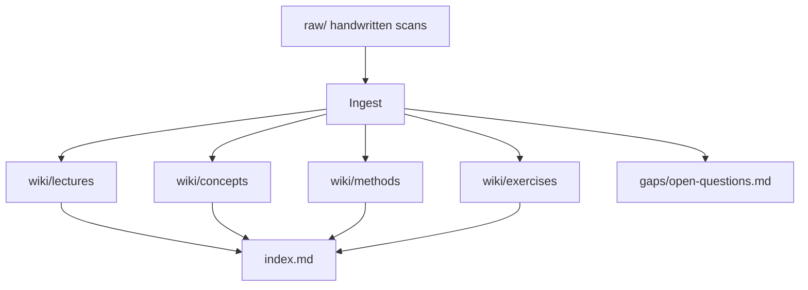
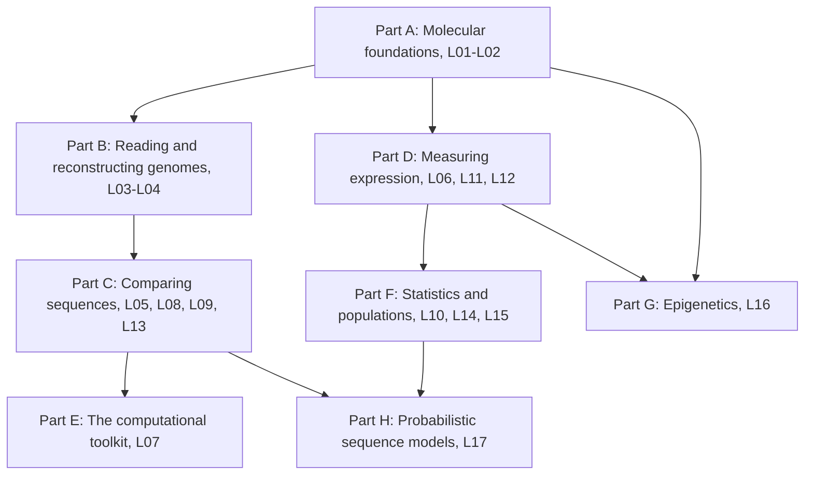
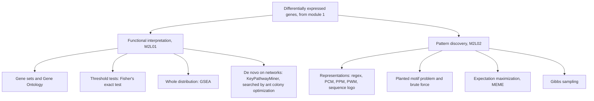
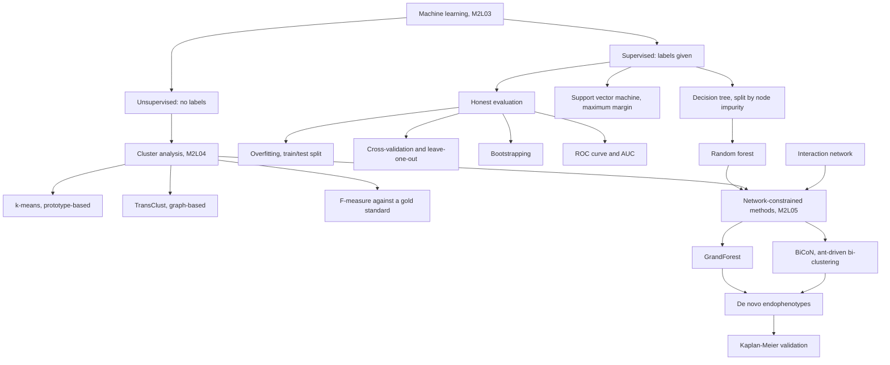
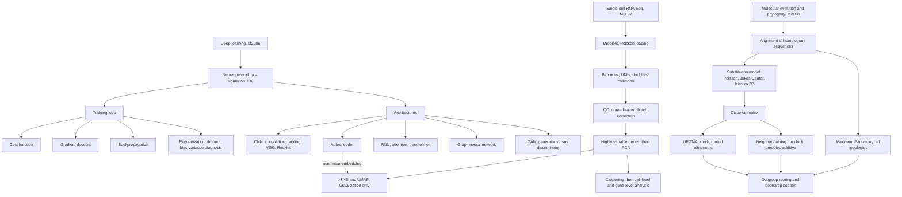
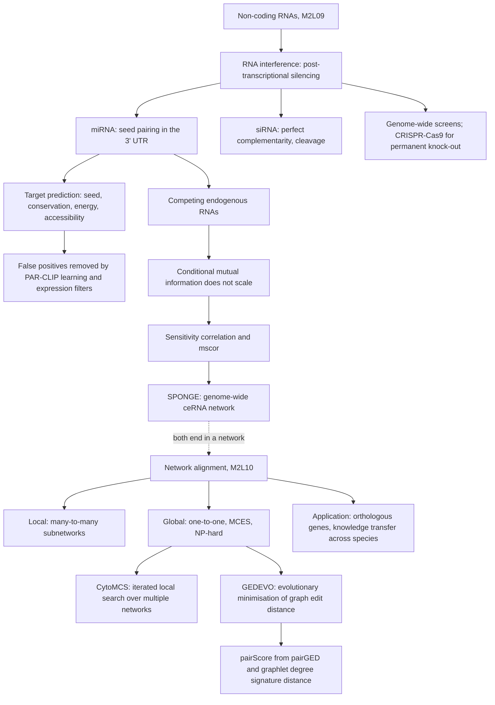
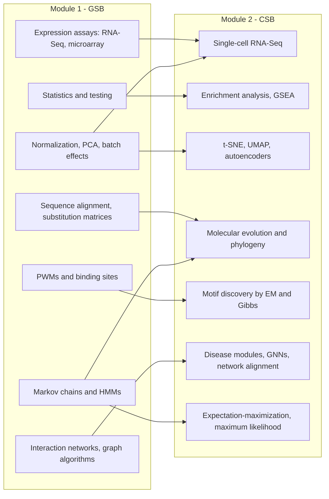

# Overview

Top-level map of the two Computational & Systems Biology modules at UHH, reconstructed
from handwritten lecture and exercise notes. Both modules are now fully ingested:
module 1 as **L01–L17** with **E01–E13**, module 2 as **M2L01–M2L10** with
**M2E01–M2E10**.

Flow of a source through the wiki.

## Module 1

Module 1 (*Grundlagen der System-Biologie*, GSB) runs from molecular-biology foundations
to the algorithms that make genome-scale data tractable. It is now **completely
reconstructed** from all four parts of the handwritten notes —
`raw/module1/gsb_part1.pdf`, `raw/module1/gsb_part2.pdf`, `raw/module1/gsb_3.pdf` and
`raw/module1/gsb_part4.pdf` — as **17 lectures (L01–L17)** and **13 exercise sheets
(E01–E13)**.

### Structure of the module

The eight strands of module 1 and how they build on one another.

**1. Foundations** — [[L01-bioinformatics-and-the-cell]]
The three levels of biological information (sequence/structure, expression/mutation,
networks), the prokaryote–eukaryote contrast, and the scale problem of
[[genome-organization]]. Core concept: the [[central-dogma]], with the
[[genetic-code]] that reads mRNA in triplets and the [[splicing]] step that produces the
mature transcript in the first place.

**2. Expression and its control** — [[L02-gene-expression-and-regulation]]
What a gene is, what expression means, and how it is controlled: the prokaryotic operon
and eukaryotic enhancers in [[gene-regulation]], acting on the [[promoter]], measured by
[[microarray-expression-analysis]]. Exercise:
[[E01-cell-biology-and-gene-expression]].

**3. Reading the genome** — [[L03-sequencing-and-genomics]]
From [[shotgun-sequencing]] through Sanger to [[next-generation-sequencing]], with its
bias profile and the mapping/alignment/assembly vocabulary.

**4. Reconstructing the genome** — [[L04-genome-assembly]]
Assembly as a graph problem: [[greedy-assembly]] on overlap graphs (Hamiltonian,
NP-hard) versus [[de-bruijn-assembly]] on a [[de-bruijn-graph]] (Eulerian, polynomial) —
the divide itself is set out in [[hamiltonian-and-eulerian-paths]].
Exercises: [[E02-greedy-assembly]], [[E03-de-bruijn-assembly]].

**5. Comparing sequences, finding regulators** —
[[L05-sequence-comparison-and-networks]]
[[sequence-alignment]] and [[blast]], the structural classes of [[dna-mutation]],
[[chip-seq]] as the experimental handle on [[epigenetics]], and
[[interaction-network|interaction networks]].

**6. Profiling the transcriptome** — [[L06-expression-profiling]]
Why array intensities must be normalised before comparison, and how [[rna-seq]] replaces
them with a count matrix.

**7. The computational toolkit** — [[L07-algorithms-and-complexity]]
[[algorithmic-complexity]]: O/Ω/Θ, the growth hierarchy, [[dynamic-programming]] and
divide and conquer, applied in [[boyer-moore-majority-vote]] and
[[E04-complexity-and-majority-element]].

**8. Searching strings exactly** — [[L08-exact-string-matching]]
[[string-matching]] as the formal problem behind motif and binding-site search, its
prefix/suffix/factor paradigms, and the two classical algorithms
[[knuth-morris-pratt]] and [[boyer-moore-string-search]]. Exercises:
[[E05-kmp-string-matching]], [[E06-boyer-moore-string-search]].

**9. Comparing sequences approximately** —
[[L09-sequence-alignment-and-homology]]
Because sequences mutate, exact search gives way to [[sequence-alignment]]:
[[needleman-wunsch]] for global and [[smith-waterman]] for local alignment, scored by a
[[substitution-matrix]], interpreted through [[homology]] and scaled up by [[blast]].
Exercise: [[E07-alignment-and-homology]].

**10. Making sense of the numbers** —
[[L10-biostatistics-and-statistical-testing]]
[[descriptive-statistics]] summarise a sample, [[probability-distribution|distributions]]
model it, [[qq-plot|QQ-plots]] check the model, and [[statistical-testing]] turns a
difference into a decision with its p-value and its two error types. Exercise:
[[E08-test-errors-and-z-score]].

**11. Preparing the data** — [[L11-normalization-pca-and-batch-effects]]
Before any test: [[data-normalization]] by log transform and [[z-score]],
[[principal-component-analysis]] for visualisation, quality control and outlier
detection, and the [[batch-effect]] that no amount of rescaling removes.

**12. Finding the regulators in the sequence** —
[[L12-binding-sites-and-position-weight-matrices]]
The [[transcription-factor-binding-site]] is short and degenerate, so exact search gives
way to the [[position-weight-matrix]]: pseudo-counts, log-odds scoring, a threshold taken
from the background score distribution, and lookahead scanning. Exercise:
[[E09-binding-sites-pwm-and-pca]].

**13. Indexing the text** — [[L13-suffix-trees-and-arrays]]
The missing factor-search paradigm of [[string-matching]]: the [[suffix-tree]] and its
flattened form the [[suffix-array]], which turn a genome-wide motif scan into a pruned
depth-first search. Exercise: [[E10-suffix-trees-and-arrays]].

**14. Genomes in populations** — [[L14-population-genetics]]
[[population-genetics]] vocabulary built on the [[snp]] as the unit of variation, the
[[wright-fisher-model]] and the
[[genetic-drift]] it produces, [[hardy-weinberg-equilibrium]] as the null model,
population structure as the confounder, and [[haplotype-phasing]].

**15. From variants to phenotypes** — [[L15-gwas-eqtl-and-multiple-testing]]
The [[genome-wide-association-study]] and its [[expression-qtl|eQTL]] variant, and the
[[multiple-testing-correction]] — Bonferroni for the FWER, Benjamini–Hochberg for the
FDR — without which a million simultaneous tests mean nothing. Exercise:
[[E11-population-genetics-and-multiple-testing]].

**16. The layer above the sequence** — [[L16-epigenetics]]
Every cell has the same DNA sequence, so tissue-specific expression must be stored
elsewhere: in [[chromatin]] and its two mark types, [[histone-modification]] and
[[dna-methylation]] in its [[cpg-island]] context ([[epigenetics]]). Measured by
[[chip-seq]] plus [[peak-calling]] with MACS2, and by [[bisulfite-sequencing]] plus DMR
detection; accessibility itself is read out by [[atac-seq]], which the notes name but do
not describe. Scaled to cohorts by the [[epigenome-wide-association-study]]. Exercise:
[[E12-epigenetics-and-peak-calling]].

**17. Sequence models with memory** —
[[L17-markov-chains-and-hidden-markov-models]]
The probabilistic close of the module: the [[markov-chain]] as a model of state changes
with a limited history, and the [[hidden-markov-model]] in which the states are no longer
observed. Its three problems and their algorithms — [[forward-algorithm]] for evaluation,
[[baum-welch-algorithm]] for learning, [[viterbi-algorithm]] for decoding — give gene
prediction, profile HMMs and HMMER. Exercise: [[E13-markov-chains-and-viterbi]].

## Module 2

Module 2 (*Computational & Systems Biology*, CSB) starts where module 1's measurement
pipelines stop: given a list of differentially expressed genes, how do you extract
**biological meaning** from it? Its first part is **functional interpretation** — relate
expression to groups of genes, to networks, to pathways — and its second is **pattern
discovery** — find the short regulatory sequences that explain why those genes move
together. Its third part turns from genes to **patients**: learn a classifier, learn it
honestly, and when the labels themselves are suspect, discover new ones from the data
under the constraint of an [[interaction-network]]. Its fourth part leaves genes behind
altogether: first **deep learning**, where the model's features are learned rather than
designed; then **single-cell RNA-Seq**, where the unit of measurement drops from a tissue
to one cell; and finally **molecular evolution and phylogeny**, which reads the same
sequences as a record of history. Its closing part returns to regulation and to networks:
**non-coding RNAs**, a control layer written in RNA rather than in protein, and **network
alignment**, which lifts the comparison of sequences up to the comparison of whole
interactomes. The module is fully ingested:
`raw/module2/csb_1.pdf` (part 1 of 4) supplies **M2L01–M2L02** and **M2E01–M2E02**;
`raw/module2/csb_part2.pdf` (part 2 of 4) supplies **M2L03–M2L05** and **M2E03–M2E05**;
`raw/module2/csb_3.pdf` (part 3 of 4) supplies **M2L06–M2L08** and **M2E06–M2E08**;
`raw/module2/csb_4.pdf` (part 4 of 4) supplies **M2L09–M2L10** and **M2E09–M2E10**.

### Structure of the module

The two strands covered by part 1 of the module-2 notes.

The three strands covered by part 2: supervised classification, unsupervised clustering, and the network-constrained combination of the two.

The three strands covered by part 3: learned representations, single-cell resolution, and sequences read as evolutionary history.

The two strands covered by part 4: regulation carried by RNA, and the comparison of whole networks.

1. **Enrichment analysis** — [[M2L01-enrichment-analysis]]. The workflow from
   experimental design to functional groups; the three ways of defining a group
   ([[gene-set]], [[interaction-network]], pathway); [[gene-ontology]] as the controlled
   vocabulary, a DAG with `is a` and `part of` relations over cellular component,
   molecular function and biological process; the two-class, time-course and
   linear-model designs; [[fishers-exact-test]] as the threshold-dependent test and
   [[gene-set-enrichment-analysis]] as the whole-distribution alternative, with its ES
   score, permutation null, empirical p-value and FDR.
   Exercise: [[M2E01-enrichment-analysis-and-keypathwayminer]].

2. **De novo network enrichment** — still [[M2L01-enrichment-analysis]].
   [[keypathwayminer]] drops the a priori gene set and searches the
   [[interaction-network]] itself for maximal connected subnetworks that tolerate `K`
   gene exceptions and `L` case exceptions, under the per-node **INEs** model or the
   global **GLONE** model. The search is NP-hard and is run with
   [[ant-colony-optimization]], the metaheuristic whose standard example is the
   [[travelling-salesman-problem]].

3. **Sequence motifs and their representations** —
   [[M2L02-sequence-motifs-and-motif-discovery]]. A [[sequence-motif]] is a short
   conserved pattern with a biological function; the canonical case is a
   [[transcription-factor-binding-site]], and candidate sequences come from a
   [[gene-knockout]]. Representations run from regular expressions through count and
   probability matrices to the [[position-weight-matrix]], and are visualised as a
   [[sequence-logo]] whose geometry comes from [[information-content]].

4. **Motif discovery** — still [[M2L02-sequence-motifs-and-motif-discovery]]. The
   [[planted-motif-problem]] formalises the task; brute force costs
   `O(4^l · m · n · d)`. The probabilistic route is
   [[expectation-maximization]] — explained on a coin-flip example and applied in
   [[em-motif-discovery]], extended by MEME with pseudo-counts and a one-step start
   search — and its stochastic analogue [[gibbs-sampling]].
   Exercise: [[M2E02-motif-discovery-and-expectation-maximization]].

5. **Machine learning and classification** —
   [[M2L03-machine-learning-and-classification]]. [[machine-learning]] inverts normal
   programming: data and answers go in, the rules come out. Learning a binary classifier
   means moving a hyperplane; problems are linear (linear regression,
   [[support-vector-machine]]) or non-linear ([[random-forest]], neural networks). The
   central danger is [[overfitting]], and the defences are how the data is spent:
   train/test split, [[cross-validation]] and leave-one-out, [[bootstrapping]]. Results
   are scored by the confusion matrix of [[statistical-testing]] and, across all cutoffs,
   by the [[roc-curve]] and its AUC. The models themselves are the [[decision-tree]],
   grown top-down by maximising the drop in [[node-impurity]] (resubstitution error, Gini
   or entropy), its ensemble the [[random-forest]] with its out-of-bag error and two-stage
   feature selection, and the maximum-margin [[support-vector-machine]].
   Exercise: [[M2E03-machine-learning-and-classification]].

6. **Clustering** — [[M2L04-clustering]]. [[cluster-analysis]] is the unsupervised
   counterpart: no labels, so the goal is to minimise intra-cluster and maximise
   inter-cluster distance. Five families — density-, graph-, hierarchical-, model- and
   prototype-based — of which two are developed: [[k-means]], whose assignment/centroid
   loop is the hard-assignment cousin of [[expectation-maximization]] and whose `k` is
   chosen by the elbow method; and [[transclust]], a weighted transitive graph projection
   that needs only a similarity function and a threshold, is NP-hard, and is solved by a
   cascade of greedy, semi-greedy, layout-based and exact fixed-parameter steps. Both are
   evaluated by the pairwise [[f-measure]] against a gold standard.
   Exercise: [[M2E04-k-means-and-transclust]].

7. **Network-based disease modules** — [[M2L05-network-based-disease-modules]]. Random
   forest plus [[interaction-network]] gives [[grandforest]], which grows its trees along
   network edges and returns a connected disease-gene module — supervised from labels, or
   unsupervised by generating a background and then clustering patients on the module
   genes into de novo [[endophenotype|endophenotypes]]. [[bicon]] attacks the same problem
   as a network-constrained bi-clustering driven by [[ant-colony-optimization]], splitting
   patients and genes at once. Both are validated by [[kaplan-meier-plot|Kaplan–Meier
   plots]] and p-values.
   Exercise: [[M2E05-grandforest-and-bicon]].

8. **Deep learning** — [[M2L06-deep-learning]]. [[deep-learning]] recasts machine
   learning as curve fitting and then learns the curve's features instead of designing
   them. A [[neural-network]] computes `a¹ = σ(W a⁰ + b)` layer by layer; an
   [[activation-function]] keeps the composition non-linear; a [[cost-function]] scores
   the result; [[gradient-descent]] reduces it; and [[backpropagation]] supplies the
   gradient. [[overfitting]] is controlled by [[dropout]] and diagnosed by the
   [[bias-variance-tradeoff]]. On top sit the architectures: the
   [[convolutional-neural-network]] with its [[pooling-layer]] for translationally
   equivariant data, the [[autoencoder]] for unsupervised compression, the
   [[recurrent-neural-network]] family for sequences, the [[graph-neural-network]] for
   networks, and the [[generative-adversarial-network]] with its three characteristic
   failure modes.
   Exercise: [[M2E06-deep-learning]].

9. **Single-cell RNA-Seq** — [[M2L07-single-cell-rna-seq]]. Bulk [[rna-seq]] measures an
   average over cells and therefore cannot see heterogeneity.
   [[single-cell-rna-seq]] fixes that, at the cost of a new class of artefacts:
   [[droplet-based-single-cell-methods]] load cells by a Poisson process, so capture and
   duplication rates trade off against each other, producing
   [[doublet|doublets]] and [[barcode-collision|barcode collisions]], while
   [[unique-molecular-identifier|UMIs]] undo amplification bias. The computational side
   is the seven-step [[single-cell-analysis-workflow]]: quality control, normalization,
   [[batch-effect]] correction, [[highly-variable-genes]] selection,
   [[principal-component-analysis]], visualization by [[t-sne]] or [[umap]], and
   downstream analysis split into cell-level and gene-level questions.
   Exercise: [[M2E07-single-cell-rna-seq-and-dimensionality-reduction]].

10. **Molecular evolution and phylogeny** —
    [[M2L08-molecular-evolution-and-phylogeny]]. [[molecular-evolution]] is mutation
    filtered by selection, mostly neutral, and therefore roughly clock-like
    ([[molecular-clock]]). The vocabulary of a [[phylogenetic-tree]] — OTUs and HTUs,
    rooted and unrooted, cladograms, additive and ultrametric trees — comes with a
    counting formula whose factorial growth dictates every algorithm that follows.
    Because `p = D/L` underestimates the true substitution count, an
    [[evolutionary-distance]] must be estimated by a model: Poisson,
    [[jukes-cantor-model]] or [[kimura-two-parameter-model]], the latter separating
    [[transition-and-transversion|transitions from transversions]].
    [[phylogenetic-tree-reconstruction]] then sets out four steps and three methods —
    [[upgma]] with a clock, [[neighbor-joining]] without one, and the alignment-based
    [[maximum-parsimony]] — closing with outgroup rooting and
    [[bootstrap-tree-assessment]]. [[gene-tree-and-species-tree]] and [[homology]] decide
    which sequences may be compared in the first place.
    Exercise: [[M2E08-phylogenetics]].

11. **Non-coding RNAs** — [[M2L09-non-coding-rnas]]. Identical DNA, different cell types:
    besides [[epigenetics]], the answer is [[non-coding-rna]].
    [[rna-interference]] is sequence-specific post-transcriptional gene silencing with
    two effectors — the endogenous [[microrna]], 19–22 nt, processed by Drosha,
    Exportin 5 and Dicer and acting through miRISC by seed pairing in the 3′ UTR, and the
    [[small-interfering-rna]], perfectly complementary and cleaving. Scaled up by
    robotics, RNAi becomes a genome-wide screening platform; as a therapy it has been
    overtaken by [[crispr-cas9]], which trades reversible knockdown for permanent
    [[gene-knockout]]. Because the seed is short, [[mirna-target-prediction]] is
    dominated by false positives, so the fixes are orthogonal evidence: learning from
    PAR-CLIP data with [[machine-learning]], and filtering by tissue-specific expression.
    Shared binding sites make genes compete — the [[competing-endogenous-rna]]
    hypothesis — which [[mutual-information]] expresses but cannot scale to, so
    [[sensitivity-correlation]] and its multiple form `mscor` take over, and [[sponge]]
    builds the genome-wide network.
    Exercise: [[M2E09-non-coding-rnas-and-sponge]].

12. **Network alignment** — [[M2L10-network-alignment]]. [[network-alignment]] is
    [[sequence-alignment]] one level up: the best mapping between the nodes of two or
    more [[interaction-network|networks]], local (many-to-many on subnetworks) or global
    (one-to-one on entire networks), used to find orthologous genes across species and
    transfer annotation ([[homology]]). The global case is the MCES problem, which
    generalises subgraph isomorphism and is therefore NP-hard
    ([[algorithmic-complexity]]). Two heuristics answer it from opposite directions:
    [[cytomcs]], an iterated local search for **multiple** alignment that maximises
    squared per-edge conservation, and [[gedevo]], which minimises the
    [[graph-edit-distance]] with an [[evolutionary-algorithm]] guided by a `pairScore`
    built from local edit cost and the [[graphlet-degree-signature-distance]], and kept
    diverse by health values.
    Exercise: [[M2E10-network-alignment]].

## How the two modules relate

Module 2 is not a second, separate subject: almost every one of its lectures picks up a
module-1 page and pushes it further. Module 1 supplies the **data, the vocabulary and the
algorithmic toolbox**; module 2 supplies the **models that are fitted to that data**.
Fifty-two concept and method pages are cited by lectures of *both* modules — those pages
are the seam, and each one carries links in both directions.

The seven main dependencies of module 2 on module 1; each arrow is realised as a pair of
reciprocal wikilinks between the pages concerned.

The recurring pattern is that a module-1 descriptive device becomes a module-2
**inference problem**: a [[position-weight-matrix]] built by counting known sites becomes
[[em-motif-discovery|a matrix estimated from unlabelled sequences]]; a
[[substitution-matrix]] read off a table becomes an explicit
[[jukes-cantor-model|rate model]] fitted by [[maximum-likelihood]]; a
[[principal-component-analysis|linear projection]] becomes a
[[t-sne|neighbourhood-preserving]] or [[autoencoder|learned]] one; an
[[interaction-network]] drawn as a picture becomes the constraint inside
[[bicon|a search]] or the structure inside [[graph-neural-network|a model]];
[[statistical-testing]] of one hypothesis becomes
[[enrichment-analysis]] over thousands with
[[multiple-testing-correction]]; and [[baum-welch-algorithm|Baum–Welch]] is revealed in
module 2 as one instance of [[expectation-maximization]].

## Themes

Twenty-three threads run through the completed material:

- **Information flow** — [[central-dogma]], [[genetic-code]], [[splicing]],
  [[genome-organization]], [[gene-regulation]], [[promoter]] and [[dna-mutation]]: what
  the genome encodes, how it is controlled, and what happens when it changes.
- **Measurement technology** — [[shotgun-sequencing]],
  [[next-generation-sequencing]], [[chip-seq]], [[microarray-expression-analysis]] and
  [[rna-seq]]: every dataset carries the bias of the instrument that produced it.
- **Sequences as strings** — [[string-matching]] with [[knuth-morris-pratt]] and
  [[boyer-moore-string-search]] for exact search, [[suffix-tree]] and [[suffix-array]]
  for indexed factor search, then [[sequence-alignment]] with
  [[needleman-wunsch]], [[smith-waterman]] and [[blast]] for approximate search, plus
  [[greedy-assembly]] and [[de-bruijn-assembly]]: biology reduced to string comparison
  and graph traversal.
- **Evolutionary inference** — [[homology]] and [[substitution-matrix]]: similarity is
  only evidence, and the scoring scheme decides what counts as evidence.
- **Tractability** — [[algorithmic-complexity]], [[dynamic-programming]],
  [[hamiltonian-and-eulerian-paths]] and the [[de-bruijn-graph]]: at
  genome scale, the choice of representation decides whether a problem is solvable at
  all.
- **Quantifying uncertainty** — [[descriptive-statistics]],
  [[probability-distribution]], [[qq-plot]], [[statistical-testing]] and
  [[multiple-testing-correction]]: every omics measurement is a sample, every conclusion
  drawn from it is a test decision with two error types, and running a million such
  decisions at once changes what counts as significant.
- **Data quality and bias** — [[data-normalization]], [[z-score]], [[batch-effect]] and
  [[principal-component-analysis]]: the shape of the data and the circumstances of its
  measurement decide the result before any model is fitted.
- **Motif models** — [[transcription-factor-binding-site]],
  [[position-weight-matrix]], [[sequence-motif]], [[sequence-logo]] and
  [[information-content]]: biological signals are degenerate, so recognition is
  probabilistic log-odds scoring rather than exact matching, and conservation is
  measured in bits.
- **Populations and association** — [[population-genetics]], [[snp]],
  [[wright-fisher-model]],
  [[genetic-drift]], [[hardy-weinberg-equilibrium]], [[haplotype-phasing]],
  [[genome-wide-association-study]] and [[expression-qtl]]: variation between
  individuals is the signal, and population structure is the confounder.
- **Epigenetics** — [[epigenetics]], [[chromatin]], [[histone-modification]],
  [[dna-methylation]], [[cpg-island]], read out by [[chip-seq]] with [[peak-calling]],
  by [[atac-seq]] for accessibility and
  by [[bisulfite-sequencing]], and taken to cohort scale by the
  [[epigenome-wide-association-study]]: the same sequence can carry different states, so
  regulation is not fully written in the letters.
- **Probabilistic sequence models** — [[markov-chain]] and [[hidden-markov-model]] with
  [[forward-algorithm]], [[baum-welch-algorithm]] and [[viterbi-algorithm]]: when the
  biological label of a position is hidden, the answer is a trellis, a maximum and a
  traceback — the probabilistic twin of [[needleman-wunsch]].
- **Functional interpretation** — [[gene-set]], [[gene-ontology]],
  [[enrichment-analysis]], [[fishers-exact-test]], [[gene-set-enrichment-analysis]] and
  [[keypathwayminer]]: a gene list is not a result; meaning comes from relating it to
  groups, and the groups are either given a priori or discovered in a network.
- **Latent variables and iterative estimation** — [[expectation-maximization]],
  [[em-motif-discovery]], [[gibbs-sampling]], [[maximum-likelihood]] and
  [[baum-welch-algorithm]]: when the
  decisive variable is unobserved, guess the parameters, weight every possibility by its
  likelihood, re-estimate, repeat — and worry about local maxima.
- **Metaheuristics for intractable search** — [[travelling-salesman-problem]],
  [[ant-colony-optimization]] and [[keypathwayminer]]: when a problem is NP-hard,
  the practical answer is a randomised, polynomial-per-run search that gives a good
  answer rather than a provable one. [[transclust]] and [[bicon]] extend the thread.
- **Supervised learning and honest evaluation** — [[machine-learning]],
  [[decision-tree]], [[node-impurity]], [[random-forest]],
  [[support-vector-machine]], and against them [[overfitting]],
  [[cross-validation]], [[bootstrapping]] and the [[roc-curve]]: a model that fits its
  training data perfectly has told you nothing, so the interesting number is always the
  one measured on data the model has not seen.
- **Unsupervised structure discovery** — [[cluster-analysis]], [[k-means]],
  [[transclust]], [[f-measure]] and, from module 1,
  [[principal-component-analysis]]: when there are no labels, structure has to be argued
  for rather than verified, which is why every clustering comes with a quality criterion
  attached.
- **Network-constrained patient stratification** — [[grandforest]], [[bicon]],
  [[endophenotype]], [[kaplan-meier-plot]] and [[keypathwayminer]] over the
  [[interaction-network]]: restricting the search to connected subnetworks turns an
  underdetermined, noisy search into a tractable one, and turns a cluster of patients
  into a candidate disease subtype with a survival curve behind it.
- **Learned representations** — [[deep-learning]], [[neural-network]],
  [[backpropagation]], [[gradient-descent]], [[convolutional-neural-network]],
  [[autoencoder]], [[graph-neural-network]] and
  [[generative-adversarial-network]]: when the features are not known in advance, learn
  them — which buys accuracy and costs interpretability, and makes
  [[bias-variance-tradeoff|bias and variance]] something to diagnose rather than assume.
- **Resolution of measurement** — [[single-cell-rna-seq]],
  [[droplet-based-single-cell-methods]], [[unique-molecular-identifier]], [[doublet]],
  [[barcode-collision]] and the [[single-cell-analysis-workflow]] against bulk
  [[rna-seq]] and [[microarray-expression-analysis]]: measuring one cell at a time
  dissolves the averaging that hid heterogeneity, and replaces it with a new, Poisson-
  governed set of artefacts that every downstream step has to account for.
- **Dimensionality reduction and visualization** — [[principal-component-analysis]],
  [[t-sne]], [[umap]], [[autoencoder]] and [[highly-variable-genes]]: high-dimensional
  data has to be projected before it can be looked at, and a projection is a claim about
  what is worth preserving — local neighbourhoods, global geometry, or variance.
- **Reconstructing history** — [[molecular-evolution]], [[phylogenetic-tree]],
  [[evolutionary-distance]], [[jukes-cantor-model]], [[kimura-two-parameter-model]],
  [[upgma]], [[neighbor-joining]], [[maximum-parsimony]] and
  [[bootstrap-tree-assessment]]: the observed difference between two sequences is a
  lower bound on what happened, so every tree rests on a model of the unobserved, and
  every branch needs a support value before it is believed.
- **Regulation carried by RNA** — [[non-coding-rna]], [[rna-interference]],
  [[microrna]], [[small-interfering-rna]], [[competing-endogenous-rna]],
  [[mirna-target-prediction]] and [[sponge]], against [[crispr-cas9]] and
  [[gene-knockout]] on the DNA side: a second regulatory layer that is not written in the
  letters of a gene, recognised through a seed so short that every computational question
  about it is a question about false positives.
- **Comparing networks instead of sequences** — [[network-alignment]],
  [[graph-edit-distance]], [[graphlet-degree-signature-distance]], [[cytomcs]],
  [[gedevo]] and [[evolutionary-algorithm]] over the [[interaction-network]]: the same
  local/global split and the same maximise-or-minimise duality as
  [[sequence-alignment]], but without a dynamic-programming shortcut, so every usable
  answer is a metaheuristic one.

## See also
- [[index]] — full page catalog
- [[open-questions]] — known gaps
- [[log]] — chronological record of how the wiki was built

## Sources

- `raw/module1/gsb_part1.pdf` — parts A–E of module 1 (L01–L07, E01–E04).
- `raw/module1/gsb_part2.pdf` — exact string matching, alignment and biostatistics
  (L08–L10, E05–E08).
- `raw/module1/gsb_3.pdf` — normalization/PCA, PWMs, suffix structures, population
  genetics and GWAS (L11–L15, E09–E11).
- `raw/module1/gsb_part4.pdf` — epigenetics and Markov models (L16–L17, E12–E13).
- `raw/module2/csb_1.pdf` — enrichment analysis, KeyPathwayMiner, sequence motifs and
  motif discovery (M2L01–M2L02, M2E01–M2E02); part 1 of 4.
- `raw/module2/csb_part2.pdf` — machine learning and classification, clustering, and
  network-based disease modules (M2L03–M2L05, M2E03–M2E05); part 2 of 4.
- `raw/module2/csb_3.pdf` — deep learning, single-cell RNA-Seq, and molecular evolution
  and phylogeny (M2L06–M2L08, M2E06–M2E08); part 3 of 4.
- `raw/module2/csb_4.pdf` — non-coding RNAs, RNA interference, CRISPR–Cas9, miRNA target
  prediction, ceRNAs and SPONGE, then network alignment with CytoMCS and GEDEVO
  (M2L09–M2L10, M2E09–M2E10); part 4 of 4. The collection is complete.
